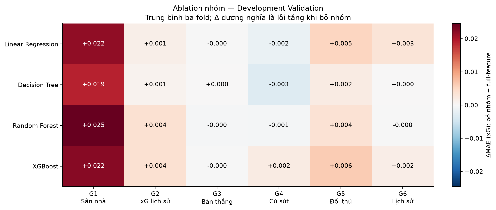
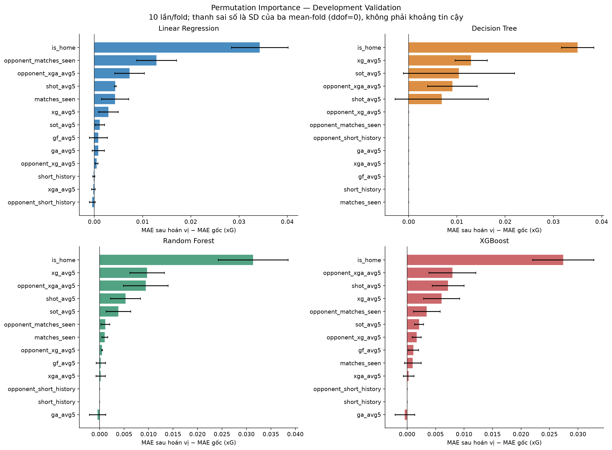
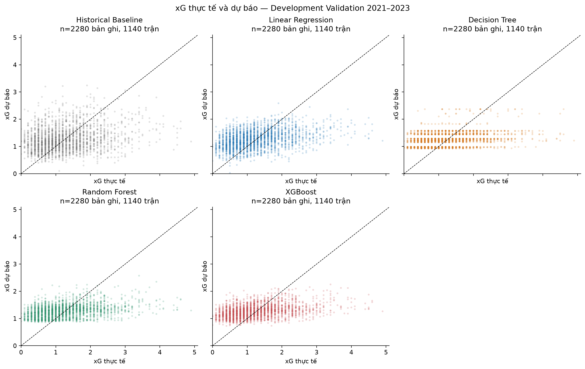
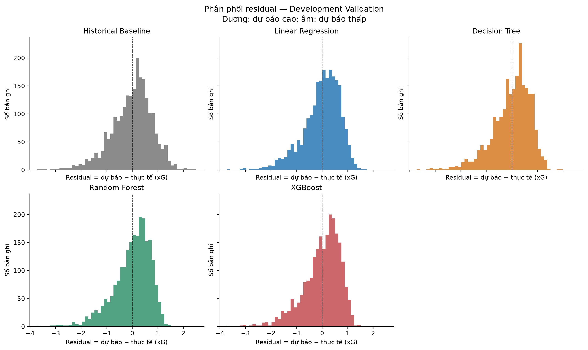
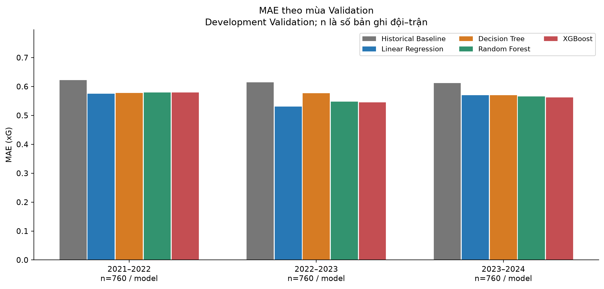
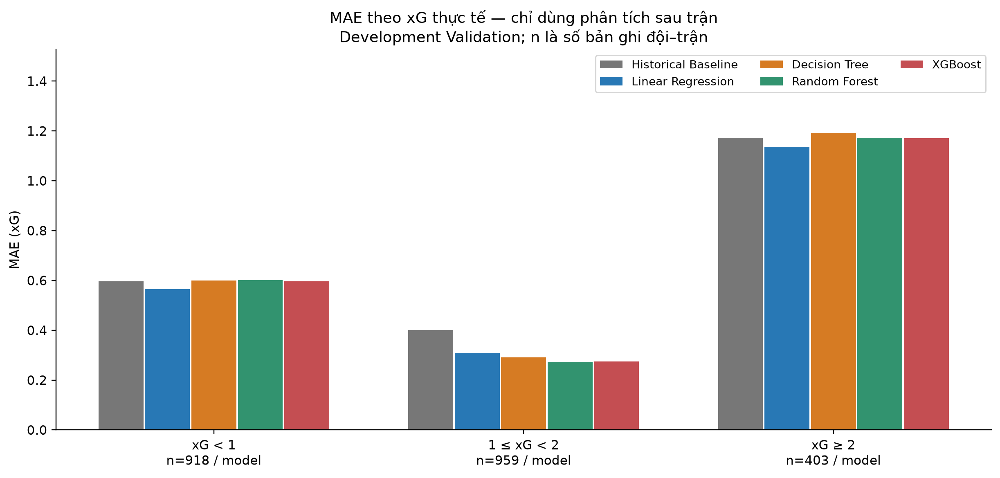
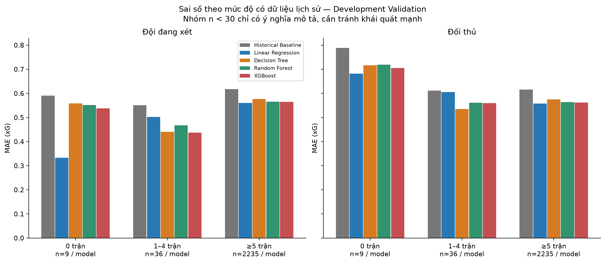

# Phân tích đóng góp features và sai số dự báo xG La Liga

## 1. Bối cảnh và mục tiêu Phase 6

Phân tích bốn Regression models đã tuning ở Phase 5 bằng Group Ablation, Permutation Importance và Error Analysis trên Development Validation. Historical Baseline giữ nguyên làm benchmark. Không tuning lại, không Feature Selection, SHAP, Final Test, tạo Final Model hoặc triển khai website.

## 2. Kiểm tra repository và kết quả Phase 5

Đã đọc preprocessing, schema normalized CSV, scripts chuẩn hóa/chuẩn bị features, cross_validation.py, train_models.py, tune_models.py, requirements, các CSV/JSON Phase 4–5, reports Phase 3–5 và tests hiện có. Tái sử dụng APIs và hàm metric/hash; không cần hoặc tìm Final Features.docx.

| model | mean_validation_mae | mean_validation_rmse | best_params |
|---|---|---|---|
| Decision Tree | 0.574865 | 0.743133 | {"max_depth": 3, "min_samples_leaf": 1, "min_samples_split": 2} |
| Linear Regression | 0.558838 | 0.724288 | {"fit_intercept": true, "positive": false} |
| Random Forest | 0.564262 | 0.726435 | {"max_depth": 4, "max_features": 1.0, "min_samples_leaf": 2, "n_estimators": 100} |
| XGBoost | 0.562303 | 0.724073 | {"colsample_bytree": 0.7, "learning_rate": 0.05, "max_depth": 2, "min_child_weight": 3, "n_estimators": 100, "reg_lambda": 10, "subsample": 0.85} |

Các cấu hình được đọc trực tiếp best_params.json; fixed_parameters được so với model_templates() hiện có trước khi clone/set_params. Kiểm tra SHA-256 nguồn, feature order, clipping và ddof; không hard-code tham số đã chọn. Không chỉnh sửa kết quả hoặc báo cáo Phase 5 để ép khớp.

## 3. Định nghĩa 13 features và Feature Engineering

Nguồn xác minh là data/preprocess_laliga.py, các hằng số của module hiện có và dataset. Rolling theo team/stint sử dụng shift(1), window=5, min_periods=1, loại hiện trận khỏi lịch sử. Stint bắt đầu lại khi gap giữa các mùa quan sát >1, không phải ngưỡng 300 ngày. matches_seen là cumcount và short_history kiểm tra <5.

| Thứ tự | Feature | Ý nghĩa đã đối chiếu |
|---|---|---|
| 1 | `is_home` | 1 = Home, 0 = Away; lấy từ venue. |
| 2 | `matches_seen` | Số trận đã quan sát trước hiện trận, trong stint các mùa La Liga liên tiếp của đội. |
| 3 | `short_history` | 1 khi matches_seen < 5; bao gồm 0–4 trận, không chỉ 0 trận. |
| 4 | `xg_avg5` | Trung bình xg của tối đa 5 trận trước; tấn công theo xG. |
| 5 | `xga_avg5` | Trung bình xga của tối đa 5 trận trước; xG đối thủ tạo ra. |
| 6 | `gf_avg5` | Trung bình bàn ghi được của tối đa 5 trận trước. |
| 7 | `ga_avg5` | Trung bình bàn thua của tối đa 5 trận trước. |
| 8 | `shot_avg5` | Trung bình tổng cú sút sh của tối đa 5 trận trước. |
| 9 | `sot_avg5` | Trung bình cú sút trúng đích sot của tối đa 5 trận trước. |
| 10 | `opponent_xg_avg5` | xg_avg5 của đối thủ, ghép từ phía còn lại cùng match_id. |
| 11 | `opponent_xga_avg5` | xga_avg5 của đối thủ, ghép từ phía còn lại cùng match_id. |
| 12 | `opponent_matches_seen` | Số trận lịch sử trước đó của đối thủ trong stint tương ứng. |
| 13 | `opponent_short_history` | 1 khi opponent_matches_seen < 5. |

**sh là tổng cú sút; sot là cú sút trúng đích.** ROLLING_MAP ánh xạ sh→shot_avg5 và sot→sot_avg5 riêng biệt; đã kiểm tra sh≥sot và số dòng hai giá trị khác nhau trên Development. Kiểm tra số học hỗ trợ tính nhất quán của schema, không tự nó chứng minh ngữ nghĩa ngoài định nghĩa dự án.

## 4. Dữ liệu, target, metadata và Final Test

Dataset nguồn: 4700 dòng × 26 cột, 2350 trận. Development: 3800 bản ghi, season 2019–2023. Validation của ba fold: 2280 bản ghi/model, tương ứng 1140 trận/model.

Target y=xg. season, date, round, match_id, team, opponent, venue chỉ dùng chia tập/audit/phân tích; is_home đồng thời là feature hợp lệ và biến phân nhóm. gf, ga, sh, sot, xga và xg hiện trận không xuất hiện trong X. Không dùng actual_xg groups làm feature hoặc điều chỉnh model.

Season 2024 và 2025 chỉ được đọc khi kiểm tra schema/toàn vẹn nguồn; bị loại trước prepare_features của Development và mọi thí nghiệm, scoring, Ablation, Permutation, Error Analysis. Không fit model toàn bộ Development.

## 5. Cross-Validation và Median Imputation

| fold | train_seasons | validation_season | train_samples | validation_samples | train_end | validation_start | validation_end |
|---|---|---|---|---|---|---|---|
| 1 | 2019;2020 | 2021 | 1520 | 760 | 2021-05-23 | 2021-08-13 | 2022-05-22 |
| 2 | 2019;2020;2021 | 2022 | 2280 | 760 | 2022-05-22 | 2022-08-12 | 2023-06-04 |
| 3 | 2019;2020;2021;2022 | 2023 | 3040 | 760 | 2023-06-04 | 2023-08-11 | 2024-05-26 |

Giữ nguyên Expanding Window Phase 4/5; splitter kiểm tra mùa, ngày, cặp trận và không giao match_id. X/y/metadata giữ đúng thứ tự với indices iloc của Development. prepare_features() khôi phục đúng Fixed Prior về NaN; mỗi full-feature reference có Pipeline/preprocessor/estimator mới, chỉ fit trên Train. Tám median được đối chiếu riêng từ Train, năm features còn lại và mọi ô hợp lệ giữ nguyên. Không có dataset impute toàn cục.

Đánh giá theo dự báo tuần tự trước trận: trận đã kết thúc trước đó trong cùng mùa Validation được phép cung cấp lịch sử có sẵn; không dùng hiện trận hoặc trận tương lai. Không giả định dự báo đồng thời cả mùa. Tác vụ đọc/kiểm chứng logic Feature Engineering chứ không tái tính rolling.

## 6. Tái tạo full-feature trước phân tích

| model | fold | train_samples | validation_samples | mae | rmse | phase5_hash_matches |
|---|---|---|---|---|---|---|
| Linear Regression | 1 | 1520 | 760 | 0.575382 | 0.748049 | True |
| Decision Tree | 1 | 1520 | 760 | 0.577458 | 0.757878 | True |
| Random Forest | 1 | 1520 | 760 | 0.579769 | 0.750968 | True |
| XGBoost | 1 | 1520 | 760 | 0.579321 | 0.750631 | True |
| Historical Baseline | 1 | 1520 | 760 | 0.622037 | 0.807998 | True |
| Linear Regression | 2 | 2280 | 760 | 0.530931 | 0.688029 | True |
| Decision Tree | 2 | 2280 | 760 | 0.576727 | 0.738452 | True |
| Random Forest | 2 | 2280 | 760 | 0.547493 | 0.704312 | True |
| XGBoost | 2 | 2280 | 760 | 0.545561 | 0.700480 | True |
| Historical Baseline | 2 | 2280 | 760 | 0.614235 | 0.796441 | True |
| Linear Regression | 3 | 3040 | 760 | 0.570200 | 0.736786 | True |
| Decision Tree | 3 | 3040 | 760 | 0.570410 | 0.733068 | True |
| Random Forest | 3 | 3040 | 760 | 0.565524 | 0.724026 | True |
| XGBoost | 3 | 3040 | 760 | 0.562027 | 0.721108 | True |
| Historical Baseline | 3 | 3040 | 760 | 0.612246 | 0.785152 | True |

Đối chiếu đủ 15 dòng với overfitting_diagnostics.csv, configuration_stage=after: MAE/RMSE khớp atol=1e-12, rtol=0 và hash dự báo khớp chính xác. Hash là SHA-256 của dự báo sau clipping dưới dạng float64 little-endian. Tất cả reference được tái tạo và đối chiếu trước khi bắt đầu Ablation/Permutation.

12 fitted full-feature estimators được giữ trong bộ nhớ cho Permutation. Baseline lấy xg_avg5 từ cùng preprocessor đã fit Train của một reference trong fold; không fit Regression, không Ablation hoặc Permutation baseline.

## 7. Sáu nhóm và Leave-One-Group-Out Ablation

| Nhóm | Tên | Features bị bỏ |
|---|---|---|
| G1 | Venue | is_home |
| G2 | Historical xG | xg_avg5, xga_avg5 |
| G3 | Historical Goals | gf_avg5, ga_avg5 |
| G4 | Shooting Performance | shot_avg5, sot_avg5 |
| G5 | Opponent Strength | opponent_xg_avg5, opponent_xga_avg5 |
| G6 | History Availability | matches_seen, short_history, opponent_matches_seen, opponent_short_history |

Mỗi lần bỏ đúng một nhóm, clone estimator mới giữ nguyên hyperparameters Phase 5, fit Train và dự báo Validation bằng các cột còn lại đúng thứ tự. Đầu tiên preprocess cả 13 features bằng preprocessor đã fit Train, rồi mới chọn cột cho estimator; không sửa HistoryMedianImputer.

**G6:** matches_seen/opponent_matches_seen vẫn dùng để xác minh và khôi phục prior trước imputation. Bỏ G6 chỉ loại bốn cột khỏi estimator, không loại mọi vai trò gián tiếp của thông tin lịch sử trong preprocessing.

ΔMAE=ablated_mae−full_mae, ΔRMSE tương tự. Δ dương nghĩa là bỏ nhóm làm lỗi tăng; Δ âm nghĩa là giảm lỗi trong thí nghiệm này. Không retune sau bỏ nhóm, không diễn giải Δ là tác động nhân quả hoặc tự động loại feature khi Δ nhỏ/âm.

### Kết quả từng fold — đủ 72 lượt fit

| model | fold | removed_group | n_features | full_mae | ablated_mae | delta_mae | full_rmse | ablated_rmse | delta_rmse |
|---|---|---|---|---|---|---|---|---|---|
| Linear Regression | 1 | G1 | 12 | 0.575382 | 0.593727 | 0.018345 | 0.748049 | 0.767611 | 0.019562 |
| Linear Regression | 1 | G2 | 11 | 0.575382 | 0.577573 | 0.002191 | 0.748049 | 0.749087 | 0.001039 |
| Linear Regression | 1 | G3 | 11 | 0.575382 | 0.572817 | -0.002564 | 0.748049 | 0.748067 | 0.000018 |
| Linear Regression | 1 | G4 | 11 | 0.575382 | 0.573151 | -0.002230 | 0.748049 | 0.753201 | 0.005153 |
| Linear Regression | 1 | G5 | 11 | 0.575382 | 0.580056 | 0.004674 | 0.748049 | 0.756503 | 0.008455 |
| Linear Regression | 1 | G6 | 9 | 0.575382 | 0.574426 | -0.000955 | 0.748049 | 0.742649 | -0.005399 |
| Decision Tree | 1 | G1 | 12 | 0.577458 | 0.612238 | 0.034780 | 0.757878 | 0.789796 | 0.031917 |
| Decision Tree | 1 | G2 | 11 | 0.577458 | 0.578094 | 0.000636 | 0.757878 | 0.759103 | 0.001224 |
| Decision Tree | 1 | G3 | 11 | 0.577458 | 0.577458 | 0.000000 | 0.757878 | 0.757878 | -0.000000 |
| Decision Tree | 1 | G4 | 11 | 0.577458 | 0.586023 | 0.008565 | 0.757878 | 0.765557 | 0.007679 |
| Decision Tree | 1 | G5 | 11 | 0.577458 | 0.581060 | 0.003602 | 0.757878 | 0.762472 | 0.004593 |
| Decision Tree | 1 | G6 | 9 | 0.577458 | 0.577458 | 0.000000 | 0.757878 | 0.757878 | -0.000000 |
| Random Forest | 1 | G1 | 12 | 0.579769 | 0.602611 | 0.022841 | 0.750968 | 0.772795 | 0.021827 |
| Random Forest | 1 | G2 | 11 | 0.579769 | 0.586561 | 0.006791 | 0.750968 | 0.755556 | 0.004588 |
| Random Forest | 1 | G3 | 11 | 0.579769 | 0.577238 | -0.002532 | 0.750968 | 0.747882 | -0.003086 |
| Random Forest | 1 | G4 | 11 | 0.579769 | 0.581079 | 0.001309 | 0.750968 | 0.751377 | 0.000409 |
| Random Forest | 1 | G5 | 11 | 0.579769 | 0.581789 | 0.002019 | 0.750968 | 0.755874 | 0.004905 |
| Random Forest | 1 | G6 | 9 | 0.579769 | 0.577916 | -0.001854 | 0.750968 | 0.749741 | -0.001227 |
| XGBoost | 1 | G1 | 12 | 0.579321 | 0.599283 | 0.019962 | 0.750631 | 0.767708 | 0.017077 |
| XGBoost | 1 | G2 | 11 | 0.579321 | 0.583118 | 0.003797 | 0.750631 | 0.753982 | 0.003351 |
| XGBoost | 1 | G3 | 11 | 0.579321 | 0.576235 | -0.003086 | 0.750631 | 0.746264 | -0.004367 |
| XGBoost | 1 | G4 | 11 | 0.579321 | 0.581618 | 0.002297 | 0.750631 | 0.752192 | 0.001561 |
| XGBoost | 1 | G5 | 11 | 0.579321 | 0.582253 | 0.002932 | 0.750631 | 0.754449 | 0.003818 |
| XGBoost | 1 | G6 | 9 | 0.579321 | 0.582904 | 0.003583 | 0.750631 | 0.752205 | 0.001574 |
| Linear Regression | 2 | G1 | 12 | 0.530931 | 0.558962 | 0.028031 | 0.688029 | 0.718613 | 0.030584 |
| Linear Regression | 2 | G2 | 11 | 0.530931 | 0.531175 | 0.000243 | 0.688029 | 0.688088 | 0.000059 |
| Linear Regression | 2 | G3 | 11 | 0.530931 | 0.532586 | 0.001655 | 0.688029 | 0.690006 | 0.001977 |
| Linear Regression | 2 | G4 | 11 | 0.530931 | 0.529892 | -0.001039 | 0.688029 | 0.692763 | 0.004734 |
| Linear Regression | 2 | G5 | 11 | 0.530931 | 0.537847 | 0.006916 | 0.688029 | 0.700687 | 0.012657 |
| Linear Regression | 2 | G6 | 9 | 0.530931 | 0.545128 | 0.014197 | 0.688029 | 0.699479 | 0.011450 |
| Decision Tree | 2 | G1 | 12 | 0.576727 | 0.587387 | 0.010660 | 0.738452 | 0.746885 | 0.008433 |
| Decision Tree | 2 | G2 | 11 | 0.576727 | 0.571772 | -0.004956 | 0.738452 | 0.737430 | -0.001022 |
| Decision Tree | 2 | G3 | 11 | 0.576727 | 0.576727 | 0.000000 | 0.738452 | 0.738452 | 0.000000 |
| Decision Tree | 2 | G4 | 11 | 0.576727 | 0.562752 | -0.013975 | 0.738452 | 0.722577 | -0.015876 |
| Decision Tree | 2 | G5 | 11 | 0.576727 | 0.575747 | -0.000981 | 0.738452 | 0.739891 | 0.001439 |
| Decision Tree | 2 | G6 | 9 | 0.576727 | 0.576727 | 0.000000 | 0.738452 | 0.738452 | 0.000000 |
| Random Forest | 2 | G1 | 12 | 0.547493 | 0.575890 | 0.028397 | 0.704312 | 0.729262 | 0.024950 |
| Random Forest | 2 | G2 | 11 | 0.547493 | 0.548752 | 0.001259 | 0.704312 | 0.702244 | -0.002069 |
| Random Forest | 2 | G3 | 11 | 0.547493 | 0.548410 | 0.000916 | 0.704312 | 0.704166 | -0.000146 |
| Random Forest | 2 | G4 | 11 | 0.547493 | 0.545881 | -0.001612 | 0.704312 | 0.706814 | 0.002502 |
| Random Forest | 2 | G5 | 11 | 0.547493 | 0.554015 | 0.006522 | 0.704312 | 0.714841 | 0.010528 |
| Random Forest | 2 | G6 | 9 | 0.547493 | 0.548551 | 0.001058 | 0.704312 | 0.705827 | 0.001515 |
| XGBoost | 2 | G1 | 12 | 0.545561 | 0.570255 | 0.024695 | 0.700480 | 0.727989 | 0.027509 |
| XGBoost | 2 | G2 | 11 | 0.545561 | 0.547438 | 0.001878 | 0.700480 | 0.700808 | 0.000328 |
| XGBoost | 2 | G3 | 11 | 0.545561 | 0.547151 | 0.001590 | 0.700480 | 0.701224 | 0.000744 |
| XGBoost | 2 | G4 | 11 | 0.545561 | 0.544574 | -0.000987 | 0.700480 | 0.705820 | 0.005341 |
| XGBoost | 2 | G5 | 11 | 0.545561 | 0.553341 | 0.007780 | 0.700480 | 0.713557 | 0.013077 |
| XGBoost | 2 | G6 | 9 | 0.545561 | 0.546725 | 0.001164 | 0.700480 | 0.702108 | 0.001629 |
| Linear Regression | 3 | G1 | 12 | 0.570200 | 0.589024 | 0.018824 | 0.736786 | 0.762275 | 0.025488 |
| Linear Regression | 3 | G2 | 11 | 0.570200 | 0.572244 | 0.002044 | 0.736786 | 0.739855 | 0.003069 |
| Linear Regression | 3 | G3 | 11 | 0.570200 | 0.570631 | 0.000431 | 0.736786 | 0.737031 | 0.000245 |
| Linear Regression | 3 | G4 | 11 | 0.570200 | 0.568714 | -0.001486 | 0.736786 | 0.733830 | -0.002956 |
| Linear Regression | 3 | G5 | 11 | 0.570200 | 0.574592 | 0.004392 | 0.736786 | 0.744448 | 0.007661 |
| Linear Regression | 3 | G6 | 9 | 0.570200 | 0.566442 | -0.003758 | 0.736786 | 0.727511 | -0.009276 |
| Decision Tree | 3 | G1 | 12 | 0.570410 | 0.581533 | 0.011123 | 0.733068 | 0.749452 | 0.016384 |
| Decision Tree | 3 | G2 | 11 | 0.570410 | 0.577484 | 0.007074 | 0.733068 | 0.738374 | 0.005306 |
| Decision Tree | 3 | G3 | 11 | 0.570410 | 0.570410 | 0.000000 | 0.733068 | 0.733068 | 0.000000 |
| Decision Tree | 3 | G4 | 11 | 0.570410 | 0.566510 | -0.003899 | 0.733068 | 0.729613 | -0.003456 |
| Decision Tree | 3 | G5 | 11 | 0.570410 | 0.573563 | 0.003154 | 0.733068 | 0.737643 | 0.004575 |
| Decision Tree | 3 | G6 | 9 | 0.570410 | 0.570410 | 0.000000 | 0.733068 | 0.733068 | -0.000000 |
| Random Forest | 3 | G1 | 12 | 0.565524 | 0.587871 | 0.022346 | 0.724026 | 0.747286 | 0.023260 |
| Random Forest | 3 | G2 | 11 | 0.565524 | 0.568548 | 0.003024 | 0.724026 | 0.728975 | 0.004949 |
| Random Forest | 3 | G3 | 11 | 0.565524 | 0.566382 | 0.000858 | 0.724026 | 0.724465 | 0.000439 |
| Random Forest | 3 | G4 | 11 | 0.565524 | 0.564203 | -0.001321 | 0.724026 | 0.725604 | 0.001578 |
| Random Forest | 3 | G5 | 11 | 0.565524 | 0.567646 | 0.002122 | 0.724026 | 0.728624 | 0.004598 |
| Random Forest | 3 | G6 | 9 | 0.565524 | 0.565933 | 0.000408 | 0.724026 | 0.726277 | 0.002251 |
| XGBoost | 3 | G1 | 12 | 0.562027 | 0.584251 | 0.022224 | 0.721108 | 0.745741 | 0.024633 |
| XGBoost | 3 | G2 | 11 | 0.562027 | 0.567604 | 0.005577 | 0.721108 | 0.725603 | 0.004495 |
| XGBoost | 3 | G3 | 11 | 0.562027 | 0.563347 | 0.001320 | 0.721108 | 0.722126 | 0.001018 |
| XGBoost | 3 | G4 | 11 | 0.562027 | 0.566728 | 0.004701 | 0.721108 | 0.725981 | 0.004873 |
| XGBoost | 3 | G5 | 11 | 0.562027 | 0.569733 | 0.007706 | 0.721108 | 0.728444 | 0.007336 |
| XGBoost | 3 | G6 | 9 | 0.562027 | 0.562440 | 0.000413 | 0.721108 | 0.721282 | 0.000174 |

### Tổng hợp ba fold (ddof=0)

| model | removed_group | mean_delta_mae | std_delta_mae | mean_delta_rmse | std_delta_rmse | positive_delta_folds |
|---|---|---|---|---|---|---|
| Linear Regression | G1 | 0.021733 | 0.004457 | 0.025211 | 0.004504 | 3 |
| Linear Regression | G2 | 0.001493 | 0.000886 | 0.001389 | 0.001254 | 3 |
| Linear Regression | G3 | -0.000160 | 0.001772 | 0.000747 | 0.000875 | 2 |
| Linear Regression | G4 | -0.001585 | 0.000491 | 0.002310 | 0.003728 | 0 |
| Linear Regression | G5 | 0.005327 | 0.001129 | 0.009591 | 0.002192 | 3 |
| Linear Regression | G6 | 0.003161 | 0.007887 | -0.001075 | 0.008997 | 1 |
| Decision Tree | G1 | 0.018854 | 0.011263 | 0.018911 | 0.009753 | 3 |
| Decision Tree | G2 | 0.000918 | 0.004915 | 0.001836 | 0.002619 | 2 |
| Decision Tree | G3 | 0.000000 | 0.000000 | -0.000000 | 0.000000 | 0 |
| Decision Tree | G4 | -0.003103 | 0.009219 | -0.003884 | 0.009621 | 1 |
| Decision Tree | G5 | 0.001925 | 0.002063 | 0.003536 | 0.001483 | 2 |
| Decision Tree | G6 | 0.000000 | 0.000000 | -0.000000 | 0.000000 | 0 |
| Random Forest | G1 | 0.024528 | 0.002743 | 0.023346 | 0.001277 | 3 |
| Random Forest | G2 | 0.003692 | 0.002307 | 0.002490 | 0.003226 | 3 |
| Random Forest | G3 | -0.000252 | 0.001612 | -0.000931 | 0.001542 | 2 |
| Random Forest | G4 | -0.000541 | 0.001314 | 0.001496 | 0.000856 | 1 |
| Random Forest | G5 | 0.003554 | 0.002099 | 0.006677 | 0.002726 | 3 |
| Random Forest | G6 | -0.000129 | 0.001248 | 0.000847 | 0.001497 | 2 |
| XGBoost | G1 | 0.022294 | 0.001933 | 0.023073 | 0.004399 | 3 |
| XGBoost | G2 | 0.003751 | 0.001510 | 0.002725 | 0.001758 | 3 |
| XGBoost | G3 | -0.000059 | 0.002144 | -0.000868 | 0.002476 | 2 |
| XGBoost | G4 | 0.002004 | 0.002331 | 0.003925 | 0.001682 | 2 |
| XGBoost | G5 | 0.006140 | 0.002268 | 0.008077 | 0.003816 | 3 |
| XGBoost | G6 | 0.001720 | 0.001353 | 0.001125 | 0.000673 | 3 |

## 8. Permutation Importance

Dùng sklearn.inspection.permutation_importance trên X_validation sau preprocessing. Mỗi full estimator giữ nguyên, không fit lại; chỉ một cột hoán vị mỗi lượt, target và ma trận gốc được kiểm tra không đổi. n_repeats=10, random_state=42, n_jobs=1. Dùng scorer âm gọi evaluate_predictions() để clip trước MAE; importance_mae=permuted_mae−original_mae.

Lưu 1.560 repetition riêng. Thư viện còn chấm 12 baseline nguyên bản; kiểm chứng tái lập thực nghiệm chạy lại 130 perturbations và 1 baseline ở reference đầu với cùng seed, không thêm model fit. Seed 42 khởi tạo chuỗi RNG, không hiểu repetition thứ r là seed=42+r.

permutation_fold_summary.csv có mean/SD qua 10 repetition trong mỗi fold. permutation_summary.csv lấy trung bình ba mean-fold và SD giữa ba mean-fold (ddof=0), đồng thời lưu mean SD trong-fold. Thanh sai số trên hình là biến động giữa mùa/fold, không phải khoảng tin cậy.

### Kết quả tổng hợp 13 features cho bốn model

| model | feature | mean_importance_mae | std_between_folds | mean_std_within_fold | positive_importance_folds |
|---|---|---|---|---|---|
| Linear Regression | is_home | 0.034283 | 0.005876 | 0.005286 | 3 |
| Linear Regression | matches_seen | 0.004300 | 0.002834 | 0.003372 | 3 |
| Linear Regression | short_history | -0.000129 | 0.000240 | 0.000333 | 1 |
| Linear Regression | xg_avg5 | 0.002902 | 0.002053 | 0.001234 | 3 |
| Linear Regression | xga_avg5 | -0.000221 | 0.000382 | 0.000168 | 2 |
| Linear Regression | gf_avg5 | 0.000823 | 0.001852 | 0.001387 | 2 |
| Linear Regression | ga_avg5 | 0.000809 | 0.001280 | 0.001484 | 2 |
| Linear Regression | shot_avg5 | 0.004331 | 0.000178 | 0.001211 | 3 |
| Linear Regression | sot_avg5 | 0.001137 | 0.000990 | 0.000980 | 3 |
| Linear Regression | opponent_xg_avg5 | 0.000464 | 0.000296 | 0.000461 | 3 |
| Linear Regression | opponent_xga_avg5 | 0.007289 | 0.003080 | 0.002697 | 3 |
| Linear Regression | opponent_matches_seen | 0.012893 | 0.004133 | 0.005114 | 3 |
| Linear Regression | opponent_short_history | -0.000423 | 0.000609 | 0.000228 | 1 |
| Decision Tree | is_home | 0.035018 | 0.003350 | 0.006907 | 3 |
| Decision Tree | matches_seen | 0.000000 | 0.000000 | 0.000000 | 0 |
| Decision Tree | short_history | 0.000000 | 0.000000 | 0.000000 | 0 |
| Decision Tree | xg_avg5 | 0.012931 | 0.003336 | 0.003369 | 3 |
| Decision Tree | xga_avg5 | 0.000000 | 0.000000 | 0.000000 | 0 |
| Decision Tree | gf_avg5 | 0.000000 | 0.000000 | 0.000000 | 0 |
| Decision Tree | ga_avg5 | 0.000000 | 0.000000 | 0.000000 | 0 |
| Decision Tree | shot_avg5 | 0.006840 | 0.009673 | 0.001543 | 1 |
| Decision Tree | sot_avg5 | 0.010404 | 0.011531 | 0.002008 | 2 |
| Decision Tree | opponent_xg_avg5 | 0.000000 | 0.000000 | 0.000000 | 0 |
| Decision Tree | opponent_xga_avg5 | 0.009050 | 0.005121 | 0.003962 | 3 |
| Decision Tree | opponent_matches_seen | 0.000000 | 0.000000 | 0.000000 | 0 |
| Decision Tree | opponent_short_history | 0.000000 | 0.000000 | 0.000000 | 0 |
| Random Forest | is_home | 0.031368 | 0.007145 | 0.004768 | 3 |
| Random Forest | matches_seen | 0.001024 | 0.000604 | 0.000609 | 3 |
| Random Forest | short_history | 0.000000 | 0.000000 | 0.000000 | 0 |
| Random Forest | xg_avg5 | 0.009675 | 0.003533 | 0.002553 | 3 |
| Random Forest | xga_avg5 | 0.000196 | 0.000971 | 0.000681 | 1 |
| Random Forest | gf_avg5 | 0.000220 | 0.000968 | 0.000890 | 2 |
| Random Forest | ga_avg5 | -0.000445 | 0.001664 | 0.000904 | 2 |
| Random Forest | shot_avg5 | 0.005273 | 0.003058 | 0.001616 | 3 |
| Random Forest | sot_avg5 | 0.003819 | 0.002505 | 0.001578 | 3 |
| Random Forest | opponent_xg_avg5 | 0.000485 | 0.000114 | 0.000489 | 3 |
| Random Forest | opponent_xga_avg5 | 0.009416 | 0.004572 | 0.003166 | 3 |
| Random Forest | opponent_matches_seen | 0.001155 | 0.000895 | 0.000671 | 2 |
| Random Forest | opponent_short_history | 0.000000 | 0.000000 | 0.000000 | 0 |
| XGBoost | is_home | 0.027406 | 0.005362 | 0.004185 | 3 |
| XGBoost | matches_seen | 0.000991 | 0.001457 | 0.001026 | 2 |
| XGBoost | short_history | 0.000000 | 0.000000 | 0.000000 | 0 |
| XGBoost | xg_avg5 | 0.006042 | 0.003168 | 0.001739 | 3 |
| XGBoost | xga_avg5 | 0.000254 | 0.000935 | 0.000744 | 2 |
| XGBoost | gf_avg5 | 0.001105 | 0.000921 | 0.001139 | 2 |
| XGBoost | ga_avg5 | -0.000398 | 0.001724 | 0.001174 | 1 |
| XGBoost | shot_avg5 | 0.007189 | 0.002802 | 0.001912 | 3 |
| XGBoost | sot_avg5 | 0.002102 | 0.000786 | 0.001153 | 3 |
| XGBoost | opponent_xg_avg5 | 0.001682 | 0.000789 | 0.000845 | 3 |
| XGBoost | opponent_xga_avg5 | 0.007947 | 0.004117 | 0.002909 | 3 |
| XGBoost | opponent_matches_seen | 0.003447 | 0.002343 | 0.001552 | 3 |
| XGBoost | opponent_short_history | 0.000000 | 0.000000 | 0.000000 | 0 |

### Mean importance theo từng fold

| model | feature | fold_1 | fold_2 | fold_3 |
|---|---|---|---|---|
| Decision Tree | ga_avg5 | 0.000000 | 0.000000 | 0.000000 |
| Decision Tree | gf_avg5 | 0.000000 | 0.000000 | 0.000000 |
| Decision Tree | is_home | 0.030835 | 0.039035 | 0.035183 |
| Decision Tree | matches_seen | 0.000000 | 0.000000 | 0.000000 |
| Decision Tree | opponent_matches_seen | 0.000000 | 0.000000 | 0.000000 |
| Decision Tree | opponent_short_history | 0.000000 | 0.000000 | 0.000000 |
| Decision Tree | opponent_xg_avg5 | 0.000000 | 0.000000 | 0.000000 |
| Decision Tree | opponent_xga_avg5 | 0.005081 | 0.005788 | 0.016281 |
| Decision Tree | short_history | 0.000000 | 0.000000 | 0.000000 |
| Decision Tree | shot_avg5 | 0.000000 | 0.000000 | 0.020519 |
| Decision Tree | sot_avg5 | 0.026482 | 0.004731 | 0.000000 |
| Decision Tree | xg_avg5 | 0.010859 | 0.010295 | 0.017638 |
| Decision Tree | xga_avg5 | 0.000000 | 0.000000 | 0.000000 |
| Linear Regression | ga_avg5 | -0.000225 | 0.002613 | 0.000040 |
| Linear Regression | gf_avg5 | -0.001719 | 0.001547 | 0.002640 |
| Linear Regression | is_home | 0.028891 | 0.042455 | 0.031504 |
| Linear Regression | matches_seen | 0.002468 | 0.008304 | 0.002129 |
| Linear Regression | opponent_matches_seen | 0.007896 | 0.018018 | 0.012764 |
| Linear Regression | opponent_short_history | -0.001281 | -0.000060 | 0.000070 |
| Linear Regression | opponent_xg_avg5 | 0.000108 | 0.000834 | 0.000450 |
| Linear Regression | opponent_xga_avg5 | 0.006141 | 0.011503 | 0.004225 |
| Linear Regression | short_history | -0.000119 | 0.000160 | -0.000428 |
| Linear Regression | shot_avg5 | 0.004084 | 0.004498 | 0.004412 |
| Linear Regression | sot_avg5 | 0.000390 | 0.002536 | 0.000486 |
| Linear Regression | xg_avg5 | 0.000049 | 0.004793 | 0.003864 |
| Linear Regression | xga_avg5 | -0.000759 | 0.000083 | 0.000014 |
| Random Forest | ga_avg5 | -0.002779 | 0.000983 | 0.000460 |
| Random Forest | gf_avg5 | -0.001138 | 0.000752 | 0.001045 |
| Random Forest | is_home | 0.022034 | 0.039385 | 0.032685 |
| Random Forest | matches_seen | 0.000332 | 0.001804 | 0.000936 |
| Random Forest | opponent_matches_seen | -0.000090 | 0.001978 | 0.001576 |
| Random Forest | opponent_short_history | 0.000000 | 0.000000 | 0.000000 |
| Random Forest | opponent_xg_avg5 | 0.000608 | 0.000513 | 0.000332 |
| Random Forest | opponent_xga_avg5 | 0.003111 | 0.013810 | 0.011328 |
| Random Forest | short_history | 0.000000 | 0.000000 | 0.000000 |
| Random Forest | shot_avg5 | 0.001073 | 0.006478 | 0.008266 |
| Random Forest | sot_avg5 | 0.006611 | 0.004312 | 0.000533 |
| Random Forest | xg_avg5 | 0.004905 | 0.013348 | 0.010771 |
| Random Forest | xga_avg5 | -0.000720 | 0.001540 | -0.000232 |
| XGBoost | ga_avg5 | -0.002608 | 0.001601 | -0.000188 |
| XGBoost | gf_avg5 | -0.000192 | 0.001859 | 0.001649 |
| XGBoost | is_home | 0.021046 | 0.034161 | 0.027012 |
| XGBoost | matches_seen | 0.000657 | 0.002918 | -0.000603 |
| XGBoost | opponent_matches_seen | 0.000477 | 0.003661 | 0.006204 |
| XGBoost | opponent_short_history | 0.000000 | 0.000000 | 0.000000 |
| XGBoost | opponent_xg_avg5 | 0.000566 | 0.002258 | 0.002221 |
| XGBoost | opponent_xga_avg5 | 0.003325 | 0.013325 | 0.007191 |
| XGBoost | short_history | 0.000000 | 0.000000 | 0.000000 |
| XGBoost | shot_avg5 | 0.003398 | 0.010086 | 0.008083 |
| XGBoost | sot_avg5 | 0.002408 | 0.002875 | 0.001023 |
| XGBoost | xg_avg5 | 0.001563 | 0.008266 | 0.008298 |
| XGBoost | xga_avg5 | -0.000814 | 0.001464 | 0.000112 |

## 9. Kết hợp Ablation và Permutation

Ablation bỏ nhóm và huấn luyện lại nên model có thể bù bằng các features còn lại. Permutation giữ nguyên model nhưng gây nhiễu một feature khi đánh giá. Hai đại lượng khác nhau; không cộng importance của các cột để coi như Delta của nhóm.

- **Linear Regression:** nhóm có ΔMAE lớn nhất là G1 (+0.021733; dương ở 3/3 fold). Feature có mean permutation importance lớn nhất là is_home, thuộc G1 (+0.034283; dương ở 3/3 fold).
- **Decision Tree:** nhóm có ΔMAE lớn nhất là G1 (+0.018854; dương ở 3/3 fold). Feature có mean permutation importance lớn nhất là is_home, thuộc G1 (+0.035018; dương ở 3/3 fold).
- **Random Forest:** nhóm có ΔMAE lớn nhất là G1 (+0.024528; dương ở 3/3 fold). Feature có mean permutation importance lớn nhất là is_home, thuộc G1 (+0.031368; dương ở 3/3 fold).
- **XGBoost:** nhóm có ΔMAE lớn nhất là G1 (+0.022294; dương ở 3/3 fold). Feature có mean permutation importance lớn nhất là is_home, thuộc G1 (+0.027406; dương ở 3/3 fold).

### Đối chiếu Linear Regression và XGBoost

| removed_group | Linear Regression | XGBoost |
|---|---|---|
| G1 | 0.021733 | 0.022294 |
| G2 | 0.001493 | 0.003751 |
| G3 | -0.000160 | -0.000059 |
| G4 | -0.001585 | 0.002004 |
| G5 | 0.005327 | 0.006140 |
| G6 | 0.003161 | 0.001720 |

| feature | Linear Regression | XGBoost |
|---|---|---|
| ga_avg5 | 0.000809 | -0.000398 |
| gf_avg5 | 0.000823 | 0.001105 |
| is_home | 0.034283 | 0.027406 |
| matches_seen | 0.004300 | 0.000991 |
| opponent_matches_seen | 0.012893 | 0.003447 |
| opponent_short_history | -0.000423 | 0.000000 |
| opponent_xg_avg5 | 0.000464 | 0.001682 |
| opponent_xga_avg5 | 0.007289 | 0.007947 |
| short_history | -0.000129 | 0.000000 |
| shot_avg5 | 0.004331 | 0.007189 |
| sot_avg5 | 0.001137 | 0.002102 |
| xg_avg5 | 0.002902 | 0.006042 |
| xga_avg5 | -0.000221 | 0.000254 |

Các biến tấn công xg_avg5, gf_avg5, shot_avg5, sot_avg5 có thể chia sẻ thông tin; low importance không chứng minh vô dụng. matches_seen/short_history có quan hệ xác định; hoán vị độc lập có thể tạo tổ hợp không thực tế. Hai bản ghi cùng trận có liên quan, nhưng permutation cột độc lập có thể phá tính nhất quán Home/Away. Kết quả là model reliance dưới perturbation đã chọn, không phải quan hệ nhân quả. Chưa đo hoặc tách hoàn toàn tác động tương quan. Không thực hiện Feature Selection/SHAP.

## 10. Error Analysis — đơn vị, công thức và quy tắc

validation_predictions.csv chỉ chứa Validation 2021–2023, gồm metadata yêu cầu và source_row (index dòng nguồn bắt đầu từ 0; dòng CSV vật lý = source_row+2). residual=predicted−actual; absolute_error=abs(residual); squared_error=residual². Dương là overprediction, âm là underprediction. Mỗi model có 2.280 đội–trận/1.140 trận; 11.400 dòng tổng không có nghĩa 11.400 trận độc lập.

error_analysis.csv luôn là thống kê subgroup gộp các bản ghi Validation, tách dimension/group/scope rõ ràng; season riêng tương ứng đúng một fold. MAE/RMSE tính bằng metric dùng chung. Dispersion gồm residual_std và absolute_error_std, ddof=0; thêm median, p90 và max Absolute Error. RMSE gộp các quan sát không đồng nhất với trung bình RMSE của ba fold; bảng CV dùng mean-fold, bảng subgroup dùng pooled observations.

Quy tắc chẩn đoán cố định trước xem kết quả: sai số lớn ≥1.0 xG; chênh dự báo LR/XGBoost lớn ≥0.5 xG; subgroup n<30 được đánh dấu mẫu nhỏ; chọn 15 lỗi tuyệt đối cao nhất/model cùng cực trị over/under nếu chưa nằm trong top 15. Các ngưỡng này chỉ để mô tả, không dùng chọn hoặc điều chỉnh model.

## 11. Sai số theo mùa

Ba mùa chỉ cho thấy biến động Development Validation; không đủ kết luận xu hướng dài hạn.

| model | group | n_observations | n_matches | mae | rmse | mean_residual | median_absolute_error | residual_std | small_sample |
|---|---|---|---|---|---|---|---|---|---|
| Historical Baseline | 2021 | 760 | 380 | 0.622037 | 0.807998 | -0.011336 | 0.500000 | 0.807918 | False |
| Historical Baseline | 2022 | 760 | 380 | 0.614235 | 0.796441 | -0.016660 | 0.500000 | 0.796267 | False |
| Historical Baseline | 2023 | 760 | 380 | 0.612246 | 0.785152 | -0.005294 | 0.500000 | 0.785134 | False |
| Linear Regression | 2021 | 760 | 380 | 0.575382 | 0.748049 | 0.016357 | 0.470056 | 0.747870 | False |
| Linear Regression | 2022 | 760 | 380 | 0.530931 | 0.688029 | -0.037696 | 0.426917 | 0.686996 | False |
| Linear Regression | 2023 | 760 | 380 | 0.570200 | 0.736786 | -0.030749 | 0.486667 | 0.736145 | False |
| Decision Tree | 2021 | 760 | 380 | 0.577458 | 0.757878 | 0.023268 | 0.482403 | 0.757521 | False |
| Decision Tree | 2022 | 760 | 380 | 0.576727 | 0.738452 | -0.039355 | 0.468248 | 0.737403 | False |
| Decision Tree | 2023 | 760 | 380 | 0.570410 | 0.733068 | -0.019661 | 0.477953 | 0.732805 | False |
| Random Forest | 2021 | 760 | 380 | 0.579769 | 0.750968 | 0.033836 | 0.462430 | 0.750206 | False |
| Random Forest | 2022 | 760 | 380 | 0.547493 | 0.704312 | -0.027526 | 0.443779 | 0.703774 | False |
| Random Forest | 2023 | 760 | 380 | 0.565524 | 0.724026 | -0.011350 | 0.487709 | 0.723937 | False |
| XGBoost | 2021 | 760 | 380 | 0.579321 | 0.750631 | 0.026320 | 0.462943 | 0.750170 | False |
| XGBoost | 2022 | 760 | 380 | 0.545561 | 0.700480 | -0.024550 | 0.459690 | 0.700049 | False |
| XGBoost | 2023 | 760 | 380 | 0.562027 | 0.721108 | -0.015623 | 0.484424 | 0.720939 | False |

## 12. Sai số Home/Away

Khác biệt sai số và residual không chứng minh home advantage có tác động nhân quả.

| model | group | n_observations | n_matches | mae | rmse | mean_residual | median_absolute_error | residual_std | small_sample |
|---|---|---|---|---|---|---|---|---|---|
| Historical Baseline | Away | 1140 | 1140 | 0.588105 | 0.749784 | 0.180778 | 0.500000 | 0.727665 | False |
| Historical Baseline | Home | 1140 | 1140 | 0.644240 | 0.840785 | -0.202971 | 0.500000 | 0.815918 | False |
| Linear Regression | Away | 1140 | 1140 | 0.523244 | 0.682850 | 0.017823 | 0.427486 | 0.682618 | False |
| Linear Regression | Home | 1140 | 1140 | 0.594432 | 0.764368 | -0.052549 | 0.489481 | 0.762560 | False |
| Decision Tree | Away | 1140 | 1140 | 0.533878 | 0.697316 | 0.016700 | 0.455310 | 0.697116 | False |
| Decision Tree | Home | 1140 | 1140 | 0.615852 | 0.786429 | -0.040531 | 0.522047 | 0.785384 | False |
| Random Forest | Away | 1140 | 1140 | 0.530183 | 0.685366 | 0.043545 | 0.439145 | 0.683981 | False |
| Random Forest | Home | 1140 | 1140 | 0.598342 | 0.765782 | -0.046904 | 0.494456 | 0.764344 | False |
| XGBoost | Away | 1140 | 1140 | 0.530227 | 0.682151 | 0.061103 | 0.461701 | 0.679409 | False |
| XGBoost | Home | 1140 | 1140 | 0.594378 | 0.764252 | -0.070339 | 0.478434 | 0.761008 | False |

## 13. Sai số theo xG thực tế

Nhóm cố định: xg_lt_1 (<1), xg_1_to_2 (1≤xG<2), xg_ge_2 (≥2). Chỉ phân tích sau trận; việc nhóm theo target có hiệu ứng điều kiện hóa, không phải features trước trận.

| model | group | n_observations | n_matches | mae | rmse | mean_residual | median_absolute_error | residual_std | small_sample |
|---|---|---|---|---|---|---|---|---|---|
| Historical Baseline | xg_1_to_2 | 959 | 765 | 0.401048 | 0.502581 | -0.101569 | 0.340000 | 0.492210 | False |
| Historical Baseline | xg_ge_2 | 403 | 377 | 1.172337 | 1.337137 | -1.135612 | 1.080000 | 0.705919 | False |
| Historical Baseline | xg_lt_1 | 918 | 765 | 0.596750 | 0.726107 | 0.577077 | 0.500000 | 0.440697 | False |
| Linear Regression | xg_1_to_2 | 959 | 765 | 0.310080 | 0.391442 | -0.091533 | 0.260473 | 0.380590 | False |
| Linear Regression | xg_ge_2 | 403 | 377 | 1.136230 | 1.285733 | -1.134854 | 1.082635 | 0.604332 | False |
| Linear Regression | xg_lt_1 | 918 | 765 | 0.565231 | 0.647159 | 0.550695 | 0.554131 | 0.339925 | False |
| Decision Tree | xg_1_to_2 | 959 | 765 | 0.291744 | 0.368777 | -0.103026 | 0.243523 | 0.354093 | False |
| Decision Tree | xg_ge_2 | 403 | 377 | 1.192359 | 1.335109 | -1.187977 | 1.104062 | 0.609283 | False |
| Decision Tree | xg_lt_1 | 918 | 765 | 0.599552 | 0.668793 | 0.599552 | 0.582403 | 0.296346 | False |
| Random Forest | xg_1_to_2 | 959 | 765 | 0.273626 | 0.341313 | -0.086846 | 0.237813 | 0.330079 | False |
| Random Forest | xg_ge_2 | 403 | 377 | 1.172025 | 1.307869 | -1.172001 | 1.065323 | 0.580462 | False |
| Random Forest | xg_lt_1 | 918 | 765 | 0.601073 | 0.662528 | 0.601059 | 0.597436 | 0.278697 | False |
| XGBoost | xg_1_to_2 | 959 | 765 | 0.274531 | 0.341476 | -0.089183 | 0.240096 | 0.329625 | False |
| XGBoost | xg_ge_2 | 403 | 377 | 1.170440 | 1.306816 | -1.170440 | 1.112670 | 0.581237 | False |
| XGBoost | xg_lt_1 | 918 | 765 | 0.595957 | 0.657016 | 0.595518 | 0.589725 | 0.277539 | False |

- Linear Regression, xg_lt_1: n=918, Mean Residual=+0.550695, MAE=0.565231. Dấu residual mô tả chiều sai lệch trong nhóm đã quan sát, không tự giải thích nguyên nhân.
- Linear Regression, xg_ge_2: n=403, Mean Residual=-1.134854, MAE=1.136230. Dấu residual mô tả chiều sai lệch trong nhóm đã quan sát, không tự giải thích nguyên nhân.
- XGBoost, xg_lt_1: n=918, Mean Residual=+0.595518, MAE=0.595957. Dấu residual mô tả chiều sai lệch trong nhóm đã quan sát, không tự giải thích nguyên nhân.
- XGBoost, xg_ge_2: n=403, Mean Residual=-1.170440, MAE=1.170440. Dấu residual mô tả chiều sai lệch trong nhóm đã quan sát, không tự giải thích nguyên nhân.
## 14. Sai số theo lịch sử đội

zero=0 trận, one_to_four=1–4, five_or_more=≥5. short_history bao gồm cả zero và one_to_four.

| model | group | n_observations | n_matches | mae | rmse | mean_residual | median_absolute_error | residual_std | small_sample |
|---|---|---|---|---|---|---|---|---|---|
| Historical Baseline | five_or_more | 2235 | 1137 | 0.617324 | 0.798636 | -0.009629 | 0.500000 | 0.798578 | False |
| Historical Baseline | one_to_four | 36 | 33 | 0.550926 | 0.694172 | -0.252778 | 0.400000 | 0.646512 | False |
| Historical Baseline | zero | 9 | 9 | 0.591111 | 0.657740 | 0.591111 | 0.680000 | 0.288461 | True |
| Linear Regression | five_or_more | 2235 | 1137 | 0.560660 | 0.726954 | -0.015084 | 0.466266 | 0.726798 | False |
| Linear Regression | one_to_four | 36 | 33 | 0.502240 | 0.650213 | -0.239142 | 0.377512 | 0.604639 | False |
| Linear Regression | zero | 9 | 9 | 0.332607 | 0.377987 | 0.303686 | 0.342281 | 0.225053 | True |
| Decision Tree | five_or_more | 2235 | 1137 | 0.577092 | 0.746369 | -0.016320 | 0.482403 | 0.746190 | False |
| Decision Tree | one_to_four | 36 | 33 | 0.440658 | 0.553830 | 0.118876 | 0.376900 | 0.540921 | False |
| Decision Tree | zero | 9 | 9 | 0.558606 | 0.605213 | 0.558606 | 0.582403 | 0.232899 | True |
| Random Forest | five_or_more | 2235 | 1137 | 0.565872 | 0.729275 | -0.006010 | 0.464613 | 0.729250 | False |
| Random Forest | one_to_four | 36 | 33 | 0.467445 | 0.583798 | 0.128837 | 0.377318 | 0.569404 | False |
| Random Forest | zero | 9 | 9 | 0.551721 | 0.584284 | 0.551721 | 0.603948 | 0.192332 | True |
| XGBoost | five_or_more | 2235 | 1137 | 0.564411 | 0.727104 | -0.007831 | 0.469440 | 0.727062 | False |
| XGBoost | one_to_four | 36 | 33 | 0.437463 | 0.571462 | 0.059187 | 0.342551 | 0.568389 | False |
| XGBoost | zero | 9 | 9 | 0.538168 | 0.574681 | 0.538168 | 0.560893 | 0.201575 | True |


Có 5 subgroup model/nhóm với n<30 trong bảng này. Các nhóm không có hoặc có ít lịch sử cần được xem thận trọng; không dùng sai số nhóm nhỏ làm căn cứ retune.
## 15. Sai số theo lịch sử đối thủ

Áp dụng cùng ranh giới; n nhỏ không hỗ trợ khái quát mạnh.

| model | group | n_observations | n_matches | mae | rmse | mean_residual | median_absolute_error | residual_std | small_sample |
|---|---|---|---|---|---|---|---|---|---|
| Historical Baseline | five_or_more | 2235 | 1137 | 0.615553 | 0.795783 | -0.006213 | 0.500000 | 0.795759 | False |
| Historical Baseline | one_to_four | 36 | 33 | 0.611435 | 0.758747 | -0.235417 | 0.490000 | 0.721301 | False |
| Historical Baseline | zero | 9 | 9 | 0.788889 | 1.089485 | -0.326667 | 0.640000 | 1.039359 | True |
| Linear Regression | five_or_more | 2235 | 1137 | 0.557594 | 0.724403 | -0.020925 | 0.458075 | 0.724101 | False |
| Linear Regression | one_to_four | 36 | 33 | 0.605236 | 0.704243 | 0.207800 | 0.555403 | 0.672887 | False |
| Linear Regression | zero | 9 | 9 | 0.682205 | 0.877370 | -0.033382 | 0.571510 | 0.876735 | True |
| Decision Tree | five_or_more | 2235 | 1137 | 0.574933 | 0.743370 | -0.009072 | 0.482403 | 0.743315 | False |
| Decision Tree | one_to_four | 36 | 33 | 0.535281 | 0.663641 | -0.096402 | 0.424674 | 0.656602 | False |
| Decision Tree | zero | 9 | 9 | 0.716378 | 0.969907 | -0.380062 | 0.597802 | 0.892341 | True |
| Random Forest | five_or_more | 2235 | 1137 | 0.563688 | 0.726606 | 0.000317 | 0.462784 | 0.726606 | False |
| Random Forest | one_to_four | 36 | 33 | 0.561245 | 0.674520 | -0.045793 | 0.507700 | 0.672963 | False |
| Random Forest | zero | 9 | 9 | 0.718900 | 0.921744 | -0.321066 | 0.492362 | 0.864018 | True |
| XGBoost | five_or_more | 2235 | 1137 | 0.561774 | 0.724328 | -0.003387 | 0.467009 | 0.724320 | False |
| XGBoost | one_to_four | 36 | 33 | 0.559397 | 0.663942 | -0.012984 | 0.514696 | 0.663815 | False |
| XGBoost | zero | 9 | 9 | 0.705272 | 0.934740 | -0.276752 | 0.626269 | 0.892831 | True |


Có 5 subgroup model/nhóm với n<30 trong bảng này. Các nhóm không có hoặc có ít lịch sử cần được xem thận trọng; không dùng sai số nhóm nhỏ làm căn cứ retune.

## 16. Sai số theo Matchweek

Round được parse đầy đủ theo mẫu Matchweek N, N∈[1,38]; bảng sắp theo số nguyên, không theo chuỗi. Không đưa round vào X.

| matchweek | n_per_model | Historical Baseline | Linear Regression | Decision Tree | Random Forest | XGBoost |
|---|---|---|---|---|---|---|
| 1 | 60 | 0.609000 | 0.488531 | 0.539803 | 0.528067 | 0.523630 |
| 2 | 60 | 0.568000 | 0.546775 | 0.534129 | 0.521149 | 0.500971 |
| 3 | 60 | 0.625333 | 0.594885 | 0.585543 | 0.584954 | 0.577470 |
| 4 | 60 | 0.675889 | 0.697601 | 0.675776 | 0.706685 | 0.697952 |
| 5 | 60 | 0.506000 | 0.487241 | 0.543631 | 0.519550 | 0.506019 |
| 6 | 60 | 0.610333 | 0.550217 | 0.555317 | 0.538927 | 0.538831 |
| 7 | 60 | 0.571667 | 0.534823 | 0.513854 | 0.519761 | 0.520185 |
| 8 | 60 | 0.587333 | 0.501434 | 0.545569 | 0.513859 | 0.513312 |
| 9 | 60 | 0.590333 | 0.548892 | 0.551268 | 0.556645 | 0.568186 |
| 10 | 60 | 0.506333 | 0.403773 | 0.432506 | 0.403800 | 0.398898 |
| 11 | 60 | 0.661000 | 0.612402 | 0.640192 | 0.621333 | 0.621263 |
| 12 | 60 | 0.574333 | 0.482444 | 0.458590 | 0.475146 | 0.490682 |
| 13 | 60 | 0.696667 | 0.674126 | 0.691677 | 0.694992 | 0.689640 |
| 14 | 60 | 0.573333 | 0.545369 | 0.556722 | 0.528976 | 0.528491 |
| 15 | 60 | 0.661667 | 0.580945 | 0.606581 | 0.578114 | 0.582165 |
| 16 | 60 | 0.581333 | 0.572055 | 0.599112 | 0.564349 | 0.552247 |
| 17 | 60 | 0.598000 | 0.557948 | 0.580213 | 0.587651 | 0.568228 |
| 18 | 60 | 0.599667 | 0.589780 | 0.655679 | 0.617910 | 0.630700 |
| 19 | 60 | 0.669000 | 0.636353 | 0.640264 | 0.619242 | 0.622158 |
| 20 | 60 | 0.675667 | 0.565210 | 0.590833 | 0.565469 | 0.560535 |
| 21 | 60 | 0.578667 | 0.551900 | 0.606076 | 0.579713 | 0.567187 |
| 22 | 60 | 0.581667 | 0.541917 | 0.531901 | 0.547664 | 0.553670 |
| 23 | 60 | 0.519000 | 0.442532 | 0.474354 | 0.454593 | 0.442787 |
| 24 | 60 | 0.544000 | 0.467190 | 0.477209 | 0.482239 | 0.475045 |
| 25 | 60 | 0.747333 | 0.636965 | 0.658472 | 0.648008 | 0.645348 |
| 26 | 60 | 0.663333 | 0.578034 | 0.586094 | 0.592190 | 0.589910 |
| 27 | 60 | 0.660000 | 0.561257 | 0.589530 | 0.581507 | 0.579906 |
| 28 | 60 | 0.575000 | 0.546105 | 0.573573 | 0.551086 | 0.540778 |
| 29 | 60 | 0.566333 | 0.553227 | 0.545597 | 0.539711 | 0.552942 |
| 30 | 60 | 0.610667 | 0.470104 | 0.557921 | 0.522224 | 0.510747 |
| 31 | 60 | 0.615667 | 0.577580 | 0.565783 | 0.546918 | 0.544500 |
| 32 | 60 | 0.614667 | 0.589238 | 0.607075 | 0.595709 | 0.595726 |
| 33 | 60 | 0.765667 | 0.686209 | 0.636359 | 0.664551 | 0.673838 |
| 34 | 60 | 0.669667 | 0.621021 | 0.616172 | 0.614796 | 0.609524 |
| 35 | 60 | 0.521000 | 0.460588 | 0.484946 | 0.466374 | 0.480839 |
| 36 | 60 | 0.661333 | 0.582363 | 0.617392 | 0.580087 | 0.579043 |
| 37 | 60 | 0.730667 | 0.582830 | 0.618113 | 0.615147 | 0.619011 |
| 38 | 60 | 0.649000 | 0.615963 | 0.601044 | 0.612873 | 0.615145 |

## 17. Các trường hợp sai số lớn

Chọn theo quy tắc giống nhau cho mọi model: top 15 Absolute Error, thêm cực trị over/under nếu chưa có. Giữ từng bản ghi duy nhất/model; không chọn ví dụ nhằm ưu ái model. Chỉ mô tả từ metadata/xG/dự báo hiện có, không đoán thẻ đỏ, chiến thuật hoặc diễn biến khi không có bằng chứng.

### Historical Baseline: 15 trường hợp

| fold | date | match_id | team | opponent | is_home | actual_xg | predicted_xg | residual | absolute_error | largest_overprediction | largest_underprediction |
|---|---|---|---|---|---|---|---|---|---|---|---|
| 1 | 2022-02-19 | 1003 | Villarreal | Granada | 0 | 4.900000 | 1.180000 | -3.720000 | 3.720000 | False | True |
| 1 | 2022-04-03 | 1058 | Real Betis | Osasuna | 1 | 4.400000 | 0.880000 | -3.520000 | 3.520000 | False | False |
| 3 | 2024-05-03 | 1851 | Getafe | Athletic Club | 1 | 4.500000 | 1.060000 | -3.440000 | 3.440000 | False | False |
| 2 | 2023-04-02 | 1408 | Real Madrid | Valladolid | 1 | 4.500000 | 1.320000 | -3.180000 | 3.180000 | False | False |
| 3 | 2023-11-11 | 1643 | Girona | Rayo Vallecano | 0 | 4.500000 | 1.500000 | -3.000000 | 3.000000 | False | False |
| 3 | 2023-11-10 | 1640 | Athletic Club | Celta Vigo | 1 | 4.600000 | 1.660000 | -2.940000 | 2.940000 | False | False |
| 1 | 2022-04-20 | 1085 | Real Madrid | Osasuna | 0 | 4.500000 | 1.660000 | -2.840000 | 2.840000 | False | False |
| 1 | 2022-01-08 | 955 | Real Madrid | Valencia | 1 | 3.900000 | 1.160000 | -2.740000 | 2.740000 | False | False |
| 3 | 2024-04-20 | 1833 | Celta Vigo | Las Palmas | 1 | 4.000000 | 1.260000 | -2.740000 | 2.740000 | False | False |
| 3 | 2024-05-24 | 1891 | Girona | Granada | 1 | 4.600000 | 1.920000 | -2.680000 | 2.680000 | False | False |
| 1 | 2021-08-15 | 768 | Sevilla | Rayo Vallecano | 1 | 3.700000 | 1.040000 | -2.660000 | 2.660000 | False | False |
| 1 | 2022-02-27 | 1015 | Villarreal | Espanyol | 1 | 4.400000 | 1.740000 | -2.660000 | 2.660000 | False | False |
| 2 | 2022-10-22 | 1241 | Rayo Vallecano | Cadiz | 1 | 3.700000 | 1.160000 | -2.540000 | 2.540000 | False | False |
| 2 | 2022-09-03 | 1173 | Barcelona | Sevilla | 0 | 4.000000 | 1.480000 | -2.520000 | 2.520000 | False | False |
| 2 | 2022-10-01 | 1203 | Barcelona | Mallorca | 0 | 0.700000 | 3.200000 | 2.500000 | 2.500000 | True | False |

### Linear Regression: 16 trường hợp

| fold | date | match_id | team | opponent | is_home | actual_xg | predicted_xg | residual | absolute_error | largest_overprediction | largest_underprediction |
|---|---|---|---|---|---|---|---|---|---|---|---|
| 1 | 2022-02-19 | 1003 | Villarreal | Granada | 0 | 4.900000 | 1.208874 | -3.691126 | 3.691126 | False | True |
| 3 | 2023-11-11 | 1643 | Girona | Rayo Vallecano | 0 | 4.500000 | 1.287829 | -3.212171 | 3.212171 | False | False |
| 3 | 2024-05-03 | 1851 | Getafe | Athletic Club | 1 | 4.500000 | 1.305779 | -3.194221 | 3.194221 | False | False |
| 1 | 2022-04-20 | 1085 | Real Madrid | Osasuna | 0 | 4.500000 | 1.458388 | -3.041612 | 3.041612 | False | False |
| 3 | 2023-11-10 | 1640 | Athletic Club | Celta Vigo | 1 | 4.600000 | 1.579389 | -3.020611 | 3.020611 | False | False |
| 1 | 2022-04-03 | 1058 | Real Betis | Osasuna | 1 | 4.400000 | 1.382831 | -3.017169 | 3.017169 | False | False |
| 1 | 2022-04-17 | 1077 | Levante | Granada | 0 | 3.900000 | 1.058906 | -2.841094 | 2.841094 | False | False |
| 3 | 2024-05-24 | 1891 | Girona | Granada | 1 | 4.600000 | 1.816803 | -2.783197 | 2.783197 | False | False |
| 2 | 2022-09-03 | 1173 | Barcelona | Sevilla | 0 | 4.000000 | 1.321768 | -2.678232 | 2.678232 | False | False |
| 2 | 2023-02-24 | 1361 | Real Betis | Elche | 0 | 4.100000 | 1.465809 | -2.634191 | 2.634191 | False | False |
| 1 | 2022-02-27 | 1015 | Villarreal | Espanyol | 1 | 4.400000 | 1.818583 | -2.581417 | 2.581417 | False | False |
| 1 | 2022-03-06 | 1026 | Barcelona | Elche | 0 | 4.100000 | 1.550128 | -2.549872 | 2.549872 | False | False |
| 2 | 2023-04-02 | 1408 | Real Madrid | Valladolid | 1 | 4.500000 | 2.051490 | -2.448510 | 2.448510 | False | False |
| 3 | 2024-05-05 | 1858 | Celta Vigo | Villarreal | 1 | 3.900000 | 1.480516 | -2.419484 | 2.419484 | False | False |
| 1 | 2021-11-28 | 902 | Atletico Madrid | Cadiz | 0 | 3.800000 | 1.418820 | -2.381180 | 2.381180 | False | False |
| 1 | 2021-10-16 | 840 | Real Sociedad | Mallorca | 1 | 0.400000 | 2.030925 | 1.630925 | 1.630925 | True | False |

### Decision Tree: 16 trường hợp

| fold | date | match_id | team | opponent | is_home | actual_xg | predicted_xg | residual | absolute_error | largest_overprediction | largest_underprediction |
|---|---|---|---|---|---|---|---|---|---|---|---|
| 1 | 2022-02-19 | 1003 | Villarreal | Granada | 0 | 4.900000 | 1.214480 | -3.685520 | 3.685520 | False | True |
| 1 | 2022-04-20 | 1085 | Real Madrid | Osasuna | 0 | 4.500000 | 1.214480 | -3.285520 | 3.285520 | False | False |
| 3 | 2024-05-24 | 1891 | Girona | Granada | 1 | 4.600000 | 1.445033 | -3.154967 | 3.154967 | False | False |
| 1 | 2022-02-27 | 1015 | Villarreal | Espanyol | 1 | 4.400000 | 1.283788 | -3.116212 | 3.116212 | False | False |
| 1 | 2022-04-03 | 1058 | Real Betis | Osasuna | 1 | 4.400000 | 1.283788 | -3.116212 | 3.116212 | False | False |
| 3 | 2024-05-03 | 1851 | Getafe | Athletic Club | 1 | 4.500000 | 1.445033 | -3.054967 | 3.054967 | False | False |
| 3 | 2023-11-11 | 1643 | Girona | Rayo Vallecano | 0 | 4.500000 | 1.481818 | -3.018182 | 3.018182 | False | False |
| 2 | 2023-02-24 | 1361 | Real Betis | Elche | 0 | 4.100000 | 1.195938 | -2.904062 | 2.904062 | False | False |
| 1 | 2022-03-06 | 1026 | Barcelona | Elche | 0 | 4.100000 | 1.214480 | -2.885520 | 2.885520 | False | False |
| 2 | 2023-02-15 | 1350 | Real Madrid | Elche | 1 | 4.100000 | 1.267241 | -2.832759 | 2.832759 | False | False |
| 1 | 2021-11-28 | 902 | Atletico Madrid | Cadiz | 0 | 3.800000 | 0.982403 | -2.817597 | 2.817597 | False | False |
| 2 | 2022-09-03 | 1173 | Barcelona | Sevilla | 0 | 4.000000 | 1.195938 | -2.804062 | 2.804062 | False | False |
| 1 | 2022-04-17 | 1077 | Levante | Granada | 0 | 3.900000 | 1.214480 | -2.685520 | 2.685520 | False | False |
| 3 | 2024-04-20 | 1833 | Celta Vigo | Las Palmas | 1 | 4.000000 | 1.445033 | -2.554967 | 2.554967 | False | False |
| 1 | 2021-11-21 | 894 | Real Madrid | Granada | 0 | 3.500000 | 0.982403 | -2.517597 | 2.517597 | False | False |
| 1 | 2021-12-05 | 915 | Rayo Vallecano | Espanyol | 1 | 0.400000 | 2.306250 | 1.906250 | 1.906250 | True | False |

### Random Forest: 16 trường hợp

| fold | date | match_id | team | opponent | is_home | actual_xg | predicted_xg | residual | absolute_error | largest_overprediction | largest_underprediction |
|---|---|---|---|---|---|---|---|---|---|---|---|
| 1 | 2022-02-19 | 1003 | Villarreal | Granada | 0 | 4.900000 | 1.293719 | -3.606281 | 3.606281 | False | True |
| 3 | 2023-11-11 | 1643 | Girona | Rayo Vallecano | 0 | 4.500000 | 1.321098 | -3.178902 | 3.178902 | False | False |
| 1 | 2022-04-20 | 1085 | Real Madrid | Osasuna | 0 | 4.500000 | 1.321397 | -3.178603 | 3.178603 | False | False |
| 3 | 2024-05-03 | 1851 | Getafe | Athletic Club | 1 | 4.500000 | 1.402520 | -3.097480 | 3.097480 | False | False |
| 1 | 2022-04-03 | 1058 | Real Betis | Osasuna | 1 | 4.400000 | 1.306175 | -3.093825 | 3.093825 | False | False |
| 1 | 2022-02-27 | 1015 | Villarreal | Espanyol | 1 | 4.400000 | 1.488642 | -2.911358 | 2.911358 | False | False |
| 3 | 2023-11-10 | 1640 | Athletic Club | Celta Vigo | 1 | 4.600000 | 1.692222 | -2.907778 | 2.907778 | False | False |
| 3 | 2024-05-24 | 1891 | Girona | Granada | 1 | 4.600000 | 1.711149 | -2.888851 | 2.888851 | False | False |
| 1 | 2022-03-06 | 1026 | Barcelona | Elche | 0 | 4.100000 | 1.350529 | -2.749471 | 2.749471 | False | False |
| 2 | 2023-04-02 | 1408 | Real Madrid | Valladolid | 1 | 4.500000 | 1.766472 | -2.733528 | 2.733528 | False | False |
| 1 | 2022-04-17 | 1077 | Levante | Granada | 0 | 3.900000 | 1.166959 | -2.733041 | 2.733041 | False | False |
| 2 | 2023-02-24 | 1361 | Real Betis | Elche | 0 | 4.100000 | 1.377139 | -2.722861 | 2.722861 | False | False |
| 2 | 2022-09-03 | 1173 | Barcelona | Sevilla | 0 | 4.000000 | 1.347261 | -2.652739 | 2.652739 | False | False |
| 1 | 2021-11-28 | 902 | Atletico Madrid | Cadiz | 0 | 3.800000 | 1.202494 | -2.597506 | 2.597506 | False | False |
| 3 | 2024-04-20 | 1833 | Celta Vigo | Las Palmas | 1 | 4.000000 | 1.505906 | -2.494094 | 2.494094 | False | False |
| 3 | 2023-10-27 | 1620 | Girona | Celta Vigo | 1 | 0.600000 | 2.079979 | 1.479979 | 1.479979 | True | False |

### XGBoost: 16 trường hợp

| fold | date | match_id | team | opponent | is_home | actual_xg | predicted_xg | residual | absolute_error | largest_overprediction | largest_underprediction |
|---|---|---|---|---|---|---|---|---|---|---|---|
| 1 | 2022-02-19 | 1003 | Villarreal | Granada | 0 | 4.900000 | 1.264474 | -3.635526 | 3.635526 | False | True |
| 1 | 2022-04-20 | 1085 | Real Madrid | Osasuna | 0 | 4.500000 | 1.346516 | -3.153484 | 3.153484 | False | False |
| 3 | 2024-05-03 | 1851 | Getafe | Athletic Club | 1 | 4.500000 | 1.358095 | -3.141905 | 3.141905 | False | False |
| 3 | 2023-11-11 | 1643 | Girona | Rayo Vallecano | 0 | 4.500000 | 1.407805 | -3.092195 | 3.092195 | False | False |
| 1 | 2022-04-03 | 1058 | Real Betis | Osasuna | 1 | 4.400000 | 1.343374 | -3.056626 | 3.056626 | False | False |
| 3 | 2024-05-24 | 1891 | Girona | Granada | 1 | 4.600000 | 1.598412 | -3.001588 | 3.001588 | False | False |
| 3 | 2023-11-10 | 1640 | Athletic Club | Celta Vigo | 1 | 4.600000 | 1.652338 | -2.947662 | 2.947662 | False | False |
| 1 | 2022-02-27 | 1015 | Villarreal | Espanyol | 1 | 4.400000 | 1.554491 | -2.845509 | 2.845509 | False | False |
| 2 | 2023-02-24 | 1361 | Real Betis | Elche | 0 | 4.100000 | 1.342339 | -2.757661 | 2.757661 | False | False |
| 1 | 2022-04-17 | 1077 | Levante | Granada | 0 | 3.900000 | 1.179250 | -2.720750 | 2.720750 | False | False |
| 1 | 2022-03-06 | 1026 | Barcelona | Elche | 0 | 4.100000 | 1.448402 | -2.651598 | 2.651598 | False | False |
| 2 | 2023-04-02 | 1408 | Real Madrid | Valladolid | 1 | 4.500000 | 1.877132 | -2.622868 | 2.622868 | False | False |
| 1 | 2021-11-28 | 902 | Atletico Madrid | Cadiz | 0 | 3.800000 | 1.186671 | -2.613329 | 2.613329 | False | False |
| 2 | 2022-09-03 | 1173 | Barcelona | Sevilla | 0 | 4.000000 | 1.406174 | -2.593826 | 2.593826 | False | False |
| 3 | 2024-05-05 | 1858 | Celta Vigo | Villarreal | 1 | 3.900000 | 1.386627 | -2.513373 | 2.513373 | False | False |
| 1 | 2021-10-16 | 840 | Real Sociedad | Mallorca | 1 | 0.400000 | 1.867885 | 1.467885 | 1.467885 | True | False |

## 18. Hai phía cùng trận và sai số chung nhiều model

| model | matches | both_large |
|---|---|---|
| Decision Tree | 1140 | 21 |
| Historical Baseline | 1140 | 32 |
| Linear Regression | 1140 | 18 |
| Random Forest | 1140 | 17 |
| XGBoost | 1140 | 17 |

Các trận có lỗi cả hai phía lớn nhất theo min(Absolute Error Home, Away), tối đa 3/model:

| model | fold | date | match_id | home_team | away_team | home_actual_xg | away_actual_xg | home_predicted_xg | away_predicted_xg | home_absolute_error | away_absolute_error |
|---|---|---|---|---|---|---|---|---|---|---|---|
| Decision Tree | 2 | 2023-05-13 | 1473 | Villarreal | Athletic Club | 3.200000 | 3.100000 | 1.568116 | 0.931752 | 1.631884 | 2.168248 |
| Decision Tree | 3 | 2023-10-01 | 1596 | Almeria | Granada | 2.900000 | 2.900000 | 1.445033 | 0.967759 | 1.454967 | 1.932241 |
| Decision Tree | 2 | 2023-02-05 | 1336 | Barcelona | Sevilla | 2.700000 | 0.100000 | 1.267241 | 1.502198 | 1.432759 | 1.402198 |
| Historical Baseline | 1 | 2022-04-10 | 1066 | Levante | Barcelona | 3.400000 | 1.200000 | 1.340000 | 3.220000 | 2.060000 | 2.020000 |
| Historical Baseline | 3 | 2024-04-27 | 1842 | Alaves | Celta Vigo | 2.300000 | 0.200000 | 0.580000 | 1.760000 | 1.720000 | 1.560000 |
| Historical Baseline | 1 | 2021-12-12 | 923 | Real Madrid | Atletico Madrid | 0.400000 | 0.700000 | 2.040000 | 2.180000 | 1.640000 | 1.480000 |
| Linear Regression | 3 | 2024-05-19 | 1888 | Valencia | Girona | 3.200000 | 2.600000 | 1.551941 | 0.981589 | 1.648059 | 1.618411 |
| Linear Regression | 3 | 2023-12-10 | 1676 | Barcelona | Girona | 3.700000 | 2.500000 | 1.717529 | 0.948831 | 1.982471 | 1.551169 |
| Linear Regression | 2 | 2023-05-13 | 1473 | Villarreal | Athletic Club | 3.200000 | 3.100000 | 1.680998 | 1.093996 | 1.519002 | 2.006004 |
| Random Forest | 2 | 2023-05-13 | 1473 | Villarreal | Athletic Club | 3.200000 | 3.100000 | 1.761723 | 1.008710 | 1.438277 | 2.091290 |
| Random Forest | 2 | 2023-05-14 | 1477 | Espanyol | Barcelona | 2.700000 | 3.100000 | 1.264317 | 1.517457 | 1.435683 | 1.582543 |
| Random Forest | 3 | 2024-05-19 | 1888 | Valencia | Girona | 3.200000 | 2.600000 | 1.444829 | 1.222882 | 1.755171 | 1.377118 |
| XGBoost | 2 | 2023-05-14 | 1477 | Espanyol | Barcelona | 2.700000 | 3.100000 | 1.198457 | 1.504199 | 1.501543 | 1.595801 |
| XGBoost | 2 | 2023-05-13 | 1473 | Villarreal | Athletic Club | 3.200000 | 3.100000 | 1.720974 | 1.065413 | 1.479026 | 2.034587 |
| XGBoost | 3 | 2024-05-19 | 1888 | Valencia | Girona | 3.200000 | 2.600000 | 1.477485 | 1.175742 | 1.722515 | 1.424258 |

Có 333 đội–trận (313 trận phân biệt) có ít nhất hai trong bốn Regression models sai số ≥1 xG. 217 đội–trận có cả bốn model cùng sai số lớn; 20 trận có cả hai phía đều thuộc nhóm nhiều-model-sai-lớn. Benchmark được hiển thị trong cross_model_errors.csv nhưng không tính vào số bốn regressors.

| fold | date | match_id | team | opponent | actual_xg | regression_models_large | mean_regressor_absolute_error | linear_regression_predicted_xg | xgboost_predicted_xg |
|---|---|---|---|---|---|---|---|---|---|
| 1 | 2022-02-19 | 1003 | Villarreal | Granada | 4.900000 | 4 | 3.654613 | 1.208874 | 1.264474 |
| 1 | 2022-04-20 | 1085 | Real Madrid | Osasuna | 4.500000 | 4 | 3.164805 | 1.458388 | 1.346516 |
| 3 | 2023-11-11 | 1643 | Girona | Rayo Vallecano | 4.500000 | 4 | 3.125362 | 1.287829 | 1.407805 |
| 3 | 2024-05-03 | 1851 | Getafe | Athletic Club | 4.500000 | 4 | 3.122143 | 1.305779 | 1.358095 |
| 1 | 2022-04-03 | 1058 | Real Betis | Osasuna | 4.400000 | 4 | 3.070958 | 1.382831 | 1.343374 |
| 3 | 2024-05-24 | 1891 | Girona | Granada | 4.600000 | 4 | 2.957151 | 1.816803 | 1.598412 |
| 1 | 2022-02-27 | 1015 | Villarreal | Espanyol | 4.400000 | 4 | 2.863624 | 1.818583 | 1.554491 |
| 3 | 2023-11-10 | 1640 | Athletic Club | Celta Vigo | 4.600000 | 4 | 2.776856 | 1.579389 | 1.652338 |
| 2 | 2023-02-24 | 1361 | Real Betis | Elche | 4.100000 | 4 | 2.754694 | 1.465809 | 1.342339 |
| 1 | 2022-04-17 | 1077 | Levante | Granada | 3.900000 | 4 | 2.745102 | 1.058906 | 1.179250 |

## 19. Chênh lệch dự báo Linear Regression và XGBoost

Có 8 đội–trận có |prediction_LR−prediction_XGB|≥0.5 xG. Bảng là 10 chênh lệch lớn nhất theo quy tắc cố định; không dùng để điều chỉnh hoặc chọn model.

| fold | date | match_id | team | opponent | actual_xg | linear_regression_predicted_xg | xgboost_predicted_xg | linear_regression_absolute_error | xgboost_absolute_error | lr_xgb_prediction_difference |
|---|---|---|---|---|---|---|---|---|---|---|
| 1 | 2021-08-22 | 778 | Real Sociedad | Rayo Vallecano | 1.900000 | 2.586441 | 1.760918 | 0.686441 | 0.139082 | 0.825523 |
| 1 | 2021-08-22 | 778 | Rayo Vallecano | Real Sociedad | 0.500000 | 0.028821 | 0.798097 | 0.471179 | 0.298097 | 0.769276 |
| 1 | 2021-08-29 | 790 | Granada | Rayo Vallecano | 0.500000 | 1.716952 | 1.155883 | 1.216952 | 0.655883 | 0.561070 |
| 1 | 2021-09-19 | 804 | Espanyol | Real Betis | 1.100000 | 0.455939 | 1.010018 | 0.644061 | 0.089982 | 0.554079 |
| 1 | 2021-08-29 | 790 | Rayo Vallecano | Granada | 2.200000 | 0.524446 | 1.073162 | 1.675554 | 1.126838 | 0.548716 |
| 2 | 2023-01-22 | 1317 | Girona | Villarreal | 0.600000 | 1.167749 | 1.716125 | 0.567749 | 1.116125 | 0.548376 |
| 1 | 2021-08-21 | 772 | Mallorca | Alaves | 0.700000 | 0.320663 | 0.860384 | 0.379337 | 0.160384 | 0.539721 |
| 1 | 2021-09-12 | 793 | Espanyol | Atletico Madrid | 0.400000 | 0.742122 | 1.255552 | 0.342122 | 0.855552 | 0.513429 |
| 1 | 2021-09-11 | 791 | Mallorca | Athletic Club | 0.200000 | 0.594011 | 1.091549 | 0.394011 | 0.891549 | 0.497538 |
| 1 | 2021-09-12 | 793 | Atletico Madrid | Espanyol | 0.800000 | 1.789540 | 1.310226 | 0.989540 | 0.510226 | 0.479314 |

## 20. Biểu đồ học thuật

### ablation_delta_mae.png



Ô heatmap khớp chính xác mean_delta_mae. PNG 220 dpi; dữ liệu chỉ thuộc Development Validation.

### permutation_importance.png



Chiều rộng cột khớp mean_importance_mae; xerr dùng std_between_folds. PNG 220 dpi; dữ liệu chỉ thuộc Development Validation.

### actual_vs_predicted.png



Mọi tọa độ scatter khớp actual_xg/predicted_xg; không lấy mẫu bớt bản ghi. PNG 220 dpi; dữ liệu chỉ thuộc Development Validation.

### residual_distribution.png



Tần số histogram khớp np.histogram với cùng bin ở mọi model. PNG 220 dpi; dữ liệu chỉ thuộc Development Validation.

### mae_by_season.png



Chiều cao mọi cột khớp MAE và số quan sát của subgroup đã xuất. PNG 220 dpi; dữ liệu chỉ thuộc Development Validation.

### mae_by_actual_xg.png



Chiều cao mọi cột khớp MAE và số quan sát của subgroup đã xuất. PNG 220 dpi; dữ liệu chỉ thuộc Development Validation.

### mae_by_history.png



Cột MAE và nhãn n của hai nhóm lịch sử khớp bảng error_analysis. PNG 220 dpi; dữ liệu chỉ thuộc Development Validation.

Hình Ablation so sánh delta với mốc 0; Permutation hiển thị cả importance âm và SD giữa fold. Scatter dùng toàn bộ quan sát/model và đường y=x; histogram dùng cùng bins và dấu residual rõ ràng. Các hình MAE theo mùa, actual xG và lịch sử ghi số quan sát; nhóm actual xG chỉ là hậu kiểm. Không dùng các hình làm lý do tự đổi pipeline 13 features.

### Các điểm quan sát từ bảng và biểu đồ

- Linear Regression: ba features có mean Permutation Importance lớn nhất là is_home (+0.034283); opponent_matches_seen (+0.012893); opponent_xga_avg5 (+0.007289).
- XGBoost: ba features có mean Permutation Importance lớn nhất là is_home (+0.027406); opponent_xga_avg5 (+0.007947); shot_avg5 (+0.007189).

Trong các kết quả này, có thể so sánh trực tiếp mức reliance của LR vào số trận lịch sử đối thủ với reliance của XGBoost vào thông tin xGA đối thủ và cú sút. Đây là mô tả perturbation từng cột; không đồng nhất với tổng đóng góp của một nhóm, vì Ablation cho phép model học bù từ những cột giữ lại.

- Linear Regression: MAE mùa thấp nhất ở season=2022 (0.530931), cao nhất ở season=2021 (0.575382). Home MAE=0.594432, Mean Residual=-0.052549; Away MAE=0.523244, Mean Residual=+0.017823 (mỗi phía n=1140). Residual gộp=-0.017363 có thể che các chiều sai lệch khác nhau khi điều kiện hóa theo xG thực tế.
- Linear Regression: nhóm đội có 0 trận lịch sử có n=9, MAE=0.332607; nhóm ≥5 trận có n=2235, MAE=0.560660. Không mặc định rằng nhóm ít lịch sử luôn có sai số cao hơn, cũng không suy ra ưu thế từ nhóm n rất nhỏ.
- XGBoost: MAE mùa thấp nhất ở season=2022 (0.545561), cao nhất ở season=2021 (0.579321). Home MAE=0.594378, Mean Residual=-0.070339; Away MAE=0.530227, Mean Residual=+0.061103 (mỗi phía n=1140). Residual gộp=-0.004618 có thể che các chiều sai lệch khác nhau khi điều kiện hóa theo xG thực tế.
- XGBoost: nhóm đội có 0 trận lịch sử có n=9, MAE=0.538168; nhóm ≥5 trận có n=2235, MAE=0.564411. Không mặc định rằng nhóm ít lịch sử luôn có sai số cao hơn, cũng không suy ra ưu thế từ nhóm n rất nhỏ.

Các kết quả này không đủ giải thích nhân quả cho khác biệt Home/Away hoặc giữa mùa. Scatter và bảng actual_xg cho thấy cần phân biệt sai lệch tổng thể với sai lệch có điều kiện; không dùng các nhóm hậu kiểm để thay model hoặc tạo feature mới.

## 21. Giới hạn diễn giải và model-selection bias

Cấu hình Phase 5 được chọn bằng chính ba mùa Validation này; Phase 6 tiếp tục phân tích chúng nên đây là development-stage diagnostics, không phải đánh giá độc lập sau chọn hay Final Test. Sai số thấp hơn khi bỏ một nhóm chỉ là giả thuyết cho nghiên cứu sau, không tự tạo feature set mới. Ba mùa không đủ suy ra xu hướng dài hạn hoặc ý nghĩa thống kê.

Ablation và Permutation không đo cùng đại lượng và không phải tác động nhân quả. Tương quan features, mối liên hệ xác định của counters/flags, hai phía cùng trận và kích thước subgroup nhỏ giới hạn cách hiểu. Không có dữ liệu sự kiện/chiến thuật để giải thích nhân quả các ca lớn. Phân nhóm theo target là mô tả hậu nghiệm và có hiệu ứng điều kiện hóa; không được chuyển thành feature trước trận.

## 22. Kiểm thử, kiểm chứng và tái lập

| Kiểm chứng | Kết quả | Bằng chứng |
|---|---|---|
| Tests Phase 4/5/6 | Đạt | 44 tests; failures=0, errors=0, skipped=0. Fixtures không phải kết quả thực nghiệm. |
| sh và sot là hai biến riêng | Đạt | Theo schema dự án, sh là tổng cú sút, sot là sút trúng đích; 3789 dòng development có hai giá trị khác nhau. |
| Lịch sử và công thức | Đạt | Đã đọc shift(1), rolling tối đa 5, min_periods=1; đối chiếu counters theo team/stint, reset khi gap mùa > 1, không có ngưỡng 300 ngày. |
| Dataset và Development | Đạt | Nguồn 4700 dòng/2350 trận; development 3800 dòng, Final Test chỉ đọc kiểm tra toàn vẹn. |
| Sáu nhóm feature | Đạt | G1–G6 phân hoạch chính xác 13 features, không thiếu hoặc lặp. |
| Fold 1: ranh giới | Đạt | Indices tạo từ development bằng splitter hiện có; cặp trận không tách, Train trước Validation và không có Final Test. |
| Linear Regression/fold 1: median Train-only | Đạt | Preprocessing fit mới trên Train; tám median đối chiếu độc lập, không dùng Validation. |
| Linear Regression/fold 1: Train 13 features | Đạt | Giữ nguyên index, thứ tự 13 cột và mọi ô hợp lệ; không có target/metadata hoặc NaN/vô hạn. |
| Linear Regression/fold 1: Validation 13 features | Đạt | Giữ nguyên index, thứ tự 13 cột và mọi ô hợp lệ; không có target/metadata hoặc NaN/vô hạn. |
| Linear Regression/fold 1: tái tạo Phase 5 | Đạt | MAE/RMSE khớp atol=1e-12, rtol=0; SHA-256 float64 little-endian của dự báo sau clipping khớp chính xác. |
| Decision Tree/fold 1: median Train-only | Đạt | Preprocessing fit mới trên Train; tám median đối chiếu độc lập, không dùng Validation. |
| Decision Tree/fold 1: Train 13 features | Đạt | Giữ nguyên index, thứ tự 13 cột và mọi ô hợp lệ; không có target/metadata hoặc NaN/vô hạn. |
| Decision Tree/fold 1: Validation 13 features | Đạt | Giữ nguyên index, thứ tự 13 cột và mọi ô hợp lệ; không có target/metadata hoặc NaN/vô hạn. |
| Decision Tree/fold 1: tái tạo Phase 5 | Đạt | MAE/RMSE khớp atol=1e-12, rtol=0; SHA-256 float64 little-endian của dự báo sau clipping khớp chính xác. |
| Random Forest/fold 1: median Train-only | Đạt | Preprocessing fit mới trên Train; tám median đối chiếu độc lập, không dùng Validation. |
| Random Forest/fold 1: Train 13 features | Đạt | Giữ nguyên index, thứ tự 13 cột và mọi ô hợp lệ; không có target/metadata hoặc NaN/vô hạn. |
| Random Forest/fold 1: Validation 13 features | Đạt | Giữ nguyên index, thứ tự 13 cột và mọi ô hợp lệ; không có target/metadata hoặc NaN/vô hạn. |
| Random Forest/fold 1: tái tạo Phase 5 | Đạt | MAE/RMSE khớp atol=1e-12, rtol=0; SHA-256 float64 little-endian của dự báo sau clipping khớp chính xác. |
| XGBoost/fold 1: median Train-only | Đạt | Preprocessing fit mới trên Train; tám median đối chiếu độc lập, không dùng Validation. |
| XGBoost/fold 1: Train 13 features | Đạt | Giữ nguyên index, thứ tự 13 cột và mọi ô hợp lệ; không có target/metadata hoặc NaN/vô hạn. |
| XGBoost/fold 1: Validation 13 features | Đạt | Giữ nguyên index, thứ tự 13 cột và mọi ô hợp lệ; không có target/metadata hoặc NaN/vô hạn. |
| XGBoost/fold 1: tái tạo Phase 5 | Đạt | MAE/RMSE khớp atol=1e-12, rtol=0; SHA-256 float64 little-endian của dự báo sau clipping khớp chính xác. |
| Historical Baseline/fold 1: tái tạo Phase 5 | Đạt | MAE/RMSE khớp atol=1e-12, rtol=0; SHA-256 float64 little-endian của dự báo sau clipping khớp chính xác. |
| Fold 2: ranh giới | Đạt | Indices tạo từ development bằng splitter hiện có; cặp trận không tách, Train trước Validation và không có Final Test. |
| Linear Regression/fold 2: median Train-only | Đạt | Preprocessing fit mới trên Train; tám median đối chiếu độc lập, không dùng Validation. |
| Linear Regression/fold 2: Train 13 features | Đạt | Giữ nguyên index, thứ tự 13 cột và mọi ô hợp lệ; không có target/metadata hoặc NaN/vô hạn. |
| Linear Regression/fold 2: Validation 13 features | Đạt | Giữ nguyên index, thứ tự 13 cột và mọi ô hợp lệ; không có target/metadata hoặc NaN/vô hạn. |
| Linear Regression/fold 2: tái tạo Phase 5 | Đạt | MAE/RMSE khớp atol=1e-12, rtol=0; SHA-256 float64 little-endian của dự báo sau clipping khớp chính xác. |
| Decision Tree/fold 2: median Train-only | Đạt | Preprocessing fit mới trên Train; tám median đối chiếu độc lập, không dùng Validation. |
| Decision Tree/fold 2: Train 13 features | Đạt | Giữ nguyên index, thứ tự 13 cột và mọi ô hợp lệ; không có target/metadata hoặc NaN/vô hạn. |
| Decision Tree/fold 2: Validation 13 features | Đạt | Giữ nguyên index, thứ tự 13 cột và mọi ô hợp lệ; không có target/metadata hoặc NaN/vô hạn. |
| Decision Tree/fold 2: tái tạo Phase 5 | Đạt | MAE/RMSE khớp atol=1e-12, rtol=0; SHA-256 float64 little-endian của dự báo sau clipping khớp chính xác. |
| Random Forest/fold 2: median Train-only | Đạt | Preprocessing fit mới trên Train; tám median đối chiếu độc lập, không dùng Validation. |
| Random Forest/fold 2: Train 13 features | Đạt | Giữ nguyên index, thứ tự 13 cột và mọi ô hợp lệ; không có target/metadata hoặc NaN/vô hạn. |
| Random Forest/fold 2: Validation 13 features | Đạt | Giữ nguyên index, thứ tự 13 cột và mọi ô hợp lệ; không có target/metadata hoặc NaN/vô hạn. |
| Random Forest/fold 2: tái tạo Phase 5 | Đạt | MAE/RMSE khớp atol=1e-12, rtol=0; SHA-256 float64 little-endian của dự báo sau clipping khớp chính xác. |
| XGBoost/fold 2: median Train-only | Đạt | Preprocessing fit mới trên Train; tám median đối chiếu độc lập, không dùng Validation. |
| XGBoost/fold 2: Train 13 features | Đạt | Giữ nguyên index, thứ tự 13 cột và mọi ô hợp lệ; không có target/metadata hoặc NaN/vô hạn. |
| XGBoost/fold 2: Validation 13 features | Đạt | Giữ nguyên index, thứ tự 13 cột và mọi ô hợp lệ; không có target/metadata hoặc NaN/vô hạn. |
| XGBoost/fold 2: tái tạo Phase 5 | Đạt | MAE/RMSE khớp atol=1e-12, rtol=0; SHA-256 float64 little-endian của dự báo sau clipping khớp chính xác. |
| Historical Baseline/fold 2: tái tạo Phase 5 | Đạt | MAE/RMSE khớp atol=1e-12, rtol=0; SHA-256 float64 little-endian của dự báo sau clipping khớp chính xác. |
| Fold 3: ranh giới | Đạt | Indices tạo từ development bằng splitter hiện có; cặp trận không tách, Train trước Validation và không có Final Test. |
| Linear Regression/fold 3: median Train-only | Đạt | Preprocessing fit mới trên Train; tám median đối chiếu độc lập, không dùng Validation. |
| Linear Regression/fold 3: Train 13 features | Đạt | Giữ nguyên index, thứ tự 13 cột và mọi ô hợp lệ; không có target/metadata hoặc NaN/vô hạn. |
| Linear Regression/fold 3: Validation 13 features | Đạt | Giữ nguyên index, thứ tự 13 cột và mọi ô hợp lệ; không có target/metadata hoặc NaN/vô hạn. |
| Linear Regression/fold 3: tái tạo Phase 5 | Đạt | MAE/RMSE khớp atol=1e-12, rtol=0; SHA-256 float64 little-endian của dự báo sau clipping khớp chính xác. |
| Decision Tree/fold 3: median Train-only | Đạt | Preprocessing fit mới trên Train; tám median đối chiếu độc lập, không dùng Validation. |
| Decision Tree/fold 3: Train 13 features | Đạt | Giữ nguyên index, thứ tự 13 cột và mọi ô hợp lệ; không có target/metadata hoặc NaN/vô hạn. |
| Decision Tree/fold 3: Validation 13 features | Đạt | Giữ nguyên index, thứ tự 13 cột và mọi ô hợp lệ; không có target/metadata hoặc NaN/vô hạn. |
| Decision Tree/fold 3: tái tạo Phase 5 | Đạt | MAE/RMSE khớp atol=1e-12, rtol=0; SHA-256 float64 little-endian của dự báo sau clipping khớp chính xác. |
| Random Forest/fold 3: median Train-only | Đạt | Preprocessing fit mới trên Train; tám median đối chiếu độc lập, không dùng Validation. |
| Random Forest/fold 3: Train 13 features | Đạt | Giữ nguyên index, thứ tự 13 cột và mọi ô hợp lệ; không có target/metadata hoặc NaN/vô hạn. |
| Random Forest/fold 3: Validation 13 features | Đạt | Giữ nguyên index, thứ tự 13 cột và mọi ô hợp lệ; không có target/metadata hoặc NaN/vô hạn. |
| Random Forest/fold 3: tái tạo Phase 5 | Đạt | MAE/RMSE khớp atol=1e-12, rtol=0; SHA-256 float64 little-endian của dự báo sau clipping khớp chính xác. |
| XGBoost/fold 3: median Train-only | Đạt | Preprocessing fit mới trên Train; tám median đối chiếu độc lập, không dùng Validation. |
| XGBoost/fold 3: Train 13 features | Đạt | Giữ nguyên index, thứ tự 13 cột và mọi ô hợp lệ; không có target/metadata hoặc NaN/vô hạn. |
| XGBoost/fold 3: Validation 13 features | Đạt | Giữ nguyên index, thứ tự 13 cột và mọi ô hợp lệ; không có target/metadata hoặc NaN/vô hạn. |
| XGBoost/fold 3: tái tạo Phase 5 | Đạt | MAE/RMSE khớp atol=1e-12, rtol=0; SHA-256 float64 little-endian của dự báo sau clipping khớp chính xác. |
| Historical Baseline/fold 3: tái tạo Phase 5 | Đạt | MAE/RMSE khớp atol=1e-12, rtol=0; SHA-256 float64 little-endian của dự báo sau clipping khớp chính xác. |
| Full-feature reference trước phân tích | Đạt | 12 Regression fits và baseline tái sử dụng preprocessing; toàn bộ 15 dòng khớp Phase 5 trước khi perturbation. |
| Tái lập permutation | Đạt | Chạy lại 130 perturbation của reference đầu tiên với seed 42; từng repetition/metric giống chính xác. Không refit. |
| Ablation và permutation đầy đủ | Đạt | 72 fresh estimators giữ tham số; 1.560 primary perturbation, n_repeats=10/seed=42, không đổi target hoặc ma trận nguồn. |
| Dự báo và Error Analysis | Đạt | 11400 dự báo Validation có truy vết; residual/absolute/squared đúng, subgroup counts và cặp Home/Away được kiểm chứng. |
| Bảo toàn file cũ | Đạt | SHA-256 của 25 dataset, source, tests, báo cáo và kết quả cũ giữ nguyên. |
| CSV đọc lại | Đạt | Đã đọc lại 11 bảng CSV, đối chiếu schema và giá trị; file tạm kế thừa ACL thư mục đích. |
| Biểu đồ khớp dữ liệu | Đạt | Đã đối chiếu heatmap, chiều cao/độ rộng cột, scatter coordinates và histogram bins với bảng nguồn; xuất 7 PNG 220 dpi. |
| Manifest và bảo toàn cuối | Đạt | Manifest JSON đọc lại khớp; không có model serialization, tuning mới, thay file cũ hoặc đánh giá Final Test. |

Tests thực tế: 44 đã chạy; failures=0, errors=0, skipped=0.

```text
test_ablation_fresh_estimators_train_only_exact_columns (test_evaluation.EvaluationTests.test_ablation_fresh_estimators_train_only_exact_columns) ... ok
test_actual_xg_and_history_group_boundaries (test_evaluation.EvaluationTests.test_actual_xg_and_history_group_boundaries) ... ok
test_error_subgroup_counts_and_matchweek_numeric_order (test_evaluation.EvaluationTests.test_error_subgroup_counts_and_matchweek_numeric_order) ... ok
test_export_csv_roundtrip_preserves_original_inputs (test_evaluation.EvaluationTests.test_export_csv_roundtrip_preserves_original_inputs) ... ok
test_invalid_matchweek_omits_only_that_analysis (test_evaluation.EvaluationTests.test_invalid_matchweek_omits_only_that_analysis) ... ok
test_load_selected_params_and_reject_fixed_parameter_drift (test_evaluation.EvaluationTests.test_load_selected_params_and_reject_fixed_parameter_drift) ... ok
test_match_and_cross_model_units_are_not_double_counted (test_evaluation.EvaluationTests.test_match_and_cross_model_units_are_not_double_counted) ... ok
test_notable_cases_are_unique_and_include_over_and_under_extremes (test_evaluation.EvaluationTests.test_notable_cases_are_unique_and_include_over_and_under_extremes) ... ok
test_permutation_never_refits_or_changes_target_and_repeats_exactly (test_evaluation.EvaluationTests.test_permutation_never_refits_or_changes_target_and_repeats_exactly) ... ok
test_permutation_sign_and_two_levels_of_dispersion (test_evaluation.EvaluationTests.test_permutation_sign_and_two_levels_of_dispersion) ... ok
test_prediction_clipping_residuals_and_traceability (test_evaluation.EvaluationTests.test_prediction_clipping_residuals_and_traceability) ... ok
test_six_groups_partition_exact_thirteen_features (test_evaluation.EvaluationTests.test_six_groups_partition_exact_thirteen_features) ... ok
test_visualizations_match_supplied_tables (test_evaluation.EvaluationTests.test_visualizations_match_supplied_tables) ... ok
test_actual_fold_counts_and_reserved_seasons (test_training.TrainingTests.test_actual_fold_counts_and_reserved_seasons) ... ok
test_csv_roundtrip_and_protection_on_failed_validation (test_training.TrainingTests.test_csv_roundtrip_and_protection_on_failed_validation) ... ok
test_every_estimator_fit_receives_only_training_indices (test_training.TrainingTests.test_every_estimator_fit_receives_only_training_indices) ... ok
test_fixed_model_configuration_and_seeds (test_training.TrainingTests.test_fixed_model_configuration_and_seeds) ... ok
test_imputer_fit_receives_only_training_indices (test_training.TrainingTests.test_imputer_fit_receives_only_training_indices) ... ok
test_metrics_use_clipped_predictions_and_rmse (test_training.TrainingTests.test_metrics_use_clipped_predictions_and_rmse) ... ok
test_reject_future_dates_in_training_season (test_training.TrainingTests.test_reject_future_dates_in_training_season) ... ok
test_reject_incomplete_match (test_training.TrainingTests.test_reject_incomplete_match) ... ok
test_reject_match_crossing_seasons (test_training.TrainingTests.test_reject_match_crossing_seasons) ... ok
test_reject_missing_model_fold (test_training.TrainingTests.test_reject_missing_model_fold) ... ok
test_reject_non_expanding_configuration (test_training.TrainingTests.test_reject_non_expanding_configuration) ... ok
test_reject_non_finite_predictions (test_training.TrainingTests.test_reject_non_finite_predictions) ... ok
test_reject_reserved_season_configuration (test_training.TrainingTests.test_reject_reserved_season_configuration) ... ok
test_reproducibility_detects_changed_prediction (test_training.TrainingTests.test_reproducibility_detects_changed_prediction) ... ok
test_sklearn_splitter_interface (test_training.TrainingTests.test_sklearn_splitter_interface) ... ok
test_source_dataframe_preserved (test_training.TrainingTests.test_source_dataframe_preserved) ... ok
test_split_is_independent_of_csv_order (test_training.TrainingTests.test_split_is_independent_of_csv_order) ... ok
test_summary_population_std_and_equal_fold_weights (test_training.TrainingTests.test_summary_population_std_and_equal_fold_weights) ... ok
test_windows_exports_inherit_directory_permissions (test_training.TrainingTests.test_windows_exports_inherit_directory_permissions) ... ok
test_budget_unique_and_reproducible_candidates (test_tuning.TuningTests.test_budget_unique_and_reproducible_candidates) ... ok
test_development_positions_align_with_search_inputs (test_tuning.TuningTests.test_development_positions_align_with_search_inputs) ... ok
test_every_candidate_fits_only_its_training_partition (test_tuning.TuningTests.test_every_candidate_fits_only_its_training_partition) ... ok
test_exported_csv_json_roundtrip_and_failed_validation_preserves_outputs (test_tuning.TuningTests.test_exported_csv_json_roundtrip_and_failed_validation_preserves_outputs) ... ok
test_linear_search_exhausts_exact_four_combinations (test_tuning.TuningTests.test_linear_search_exhausts_exact_four_combinations) ... ok
test_output_validation_rejects_missing_trial_or_artificial_baseline_params (test_tuning.TuningTests.test_output_validation_rejects_missing_trial_or_artificial_baseline_params) ... ok
test_pipeline_clones_without_fitted_state (test_tuning.TuningTests.test_pipeline_clones_without_fitted_state) ... ok
test_search_does_not_refit_full_development (test_tuning.TuningTests.test_search_does_not_refit_full_development) ... ok
test_search_scores_have_correct_sign_and_clip (test_tuning.TuningTests.test_search_scores_have_correct_sign_and_clip) ... ok
test_selected_evaluation_comparison_detects_prediction_change (test_tuning.TuningTests.test_selected_evaluation_comparison_detects_prediction_change) ... ok
test_selection_uses_mae_then_rmse_tolerance_and_stable_params (test_tuning.TuningTests.test_selection_uses_mae_then_rmse_tolerance_and_stable_params) ... ok
test_tuning_json_and_csv_inherit_directory_permissions (test_tuning.TuningTests.test_tuning_json_and_csv_inherit_directory_permissions) ... ok

----------------------------------------------------------------------
Ran 44 tests in 7.402s

OK
```

Các unit tests Phase 5 có GridSearch nhỏ cho Linear Regression để kiểm tra cơ chế; đây là regression tests, không chạy lại full search 79 cấu hình và không thay hyperparameters/đầu ra Phase 5. Fixtures Phase 6 và hình trong tests nằm ở thư mục tạm, tách khỏi thí nghiệm thật.

Tái lập thực nghiệm: 15 full-feature/benchmark prediction hashes khớp Phase 5, mọi reference giữ seed và params. Permutation đầu tiên chạy lại đủ 130 perturbations cùng seed và khớp từng repetition chính xác. Không tuyên bố đã chạy lại toàn bộ Ablation hoặc toàn bộ Permutation lần hai. Tất cả CSV được đọc lại theo schema và đối chiếu số thực atol/rtol=1e-14; manifest JSON được đọc lại và kiểm chứng. Biểu đồ tự đối chiếu giá trị với bảng dùng vẽ.

### Đối chiếu độc lập sau khi xuất

Đã đọc lại cả 11 CSV theo schema manifest, kiểm tra SHA-256 từng file, tái tính ablation deltas/summaries và hai cấp permutation summary. Đã đối chiếu lại 15 prediction hashes từ validation_predictions.csv với full_feature_results.csv. Tái tính độc lập MAE, RMSE, Mean Residual, Median Absolute Error và dispersion cho toàn bộ 265 subgroup bằng NumPy/Pandas: khớp trong atol=1e-14.

Đã đối chiếu lại SHA-256 của 25 file có sẵn: tất cả giữ nguyên. Đã mở và xem trực quan đủ bảy PNG sau khi xuất: tiêu đề, đơn vị, nhãn features, counts và bố cục đọc được; dữ liệu dùng vẽ đã qua các assertion trong hàm tạo hình. Không tạo báo cáo trùng, model artifact hoặc file tạm còn sót.

Kết quả bổ sung chỉ là kiểm chứng và diễn giải các bảng hiện có; không chạy lại search, không thêm fit hoặc permutation ngoài ngân sách/reproducibility đã ghi.

## 23. Ngân sách, môi trường và lệnh chạy

Thí nghiệm chính: 12 fit full Regression + 72 fit ablated = **84 Regression fits**. Permutation: **1.560 perturbation prediction evaluations**, cộng 12 baseline scores nội bộ thư viện; kiểm chứng lại một reference thêm 130 perturbations và 1 baseline score, không refit. Unit-test fits không tính vào ngân sách chính. Baseline không train Regression và tái sử dụng preprocessing của fold.

Python 3.14.0; NumPy 2.5.4; Pandas 3.1.0; SciPy 1.18.1; scikit-learn 1.9.1; XGBoost 3.4.1; Matplotlib 3.11.2. Không cài dependency mới; scripts/evaluation/requirements.txt bổ sung Matplotlib trên các pins training hiện có.

Lệnh đã thực thi:

```powershell
.\.venv\Scripts\python.exe -m unittest discover -s tests -p test_evaluation.py -v
.\.venv\Scripts\python.exe -m scripts.evaluation.analyze_models
```

CLI chạy tests Phase 4/5/6 trước, rồi reproduction, Ablation, Permutation, Error Analysis, xuất bảng, hình và báo cáo này. Không gọi CLI training/tuning trước đây. Figure backend Agg không cần mở cửa sổ GUI.

Thời gian CLI thực tế: 27.52 giây, gồm tests và xuất hình.

## 24. File bàn giao và bảo toàn repository

Mã mới trong scripts/evaluation/: analyze_models.py điều phối; feature_analysis.py xử lý Ablation/Permutation; error_analysis.py xử lý sai số; visualizations.py vẽ; reporting.py tạo báo cáo; __init__.py và requirements.txt. Tests mới duy nhất tests/test_evaluation.py. Không thay shared modules cũ.

Các bảng riêng theo đơn vị: full_feature_results.csv (model-fold); ablation_results.csv (model-fold-group), ablation_summary.csv (model-group); permutation_importance.csv (model-fold-feature-repeat), permutation_fold_summary.csv (model-fold-feature), permutation_summary.csv (model-feature); validation_predictions.csv (model-đội–trận); error_analysis.csv (model-subgroup); notable_errors.csv (case duy nhất/model); match_error_analysis.csv (model-trận); cross_model_errors.csv (đội–trận đối chiếu model). Không trộn records và summaries trong cùng schema. analysis_manifest.json ghi features/groups, params nguồn, SHA-256, folds, seeds, ngưỡng chẩn đoán, phiên bản, schema bảng và figure/data hashes.

| File có sẵn | SHA-256 trước | Sau thực thi |
|---|---|---|
| `.gitignore` | `3c3839715d142f40ad0b0c127db473608153f80a1390e5f9873120c8d5912179` | Giữ nguyên |
| `data/laliga_processed.csv` | `666661b49f4055104bd73b8ceb53f50407bf6e90cae6551dbbee820fe9fd6a3a` | Giữ nguyên |
| `data/laliga_processed.xlsx` | `47023b9efd583783c35b0b45030c3c747ca1fd09519164631f46543574540ab3` | Giữ nguyên |
| `data/laliga_processed_normalized.csv` | `90000ce22f42abe5eb5b5bfa38ad1ed5ef7b1c1c75cd4d39e749e7b324e0e5ca` | Giữ nguyên |
| `data/matches_laliga.csv` | `3cfeb29ea2e76d6a8a411f31af6182c6951fd477903b8b6d0401b58e10b415e2` | Giữ nguyên |
| `data/preprocess_laliga.py` | `fb5e35f268c7b205dc4d5854c5eba75ad74d903fcc08ae1cb5fdaf9f9963aadb` | Giữ nguyên |
| `outputs/training/cv_fold_results.csv` | `559ae9fc455516ab207b17cff72a9b66b69cb0e2bbc7a44a8fb80922aadd1185` | Giữ nguyên |
| `outputs/training/cv_summary.csv` | `f756d0e5830d70365b13f1dcdb6c5416998cab5133f3c6f5b140570900f5e9ac` | Giữ nguyên |
| `outputs/tuning/best_params.json` | `c664b9844986dd80bdef1de7ab16a8a136c29cc0dc7c18bc77d674e51cc10115` | Giữ nguyên |
| `outputs/tuning/overfitting_diagnostics.csv` | `a645d0e2b416f64799b708f693854b528c3cf946f49642ee9e83257049dc37e4` | Giữ nguyên |
| `outputs/tuning/tuning_summary.csv` | `a0472aeea2d48d8aec8d989b3ceb8398d9b4d3020c34067123036e97fa9a0907` | Giữ nguyên |
| `outputs/tuning/tuning_trials.csv` | `9d072e4a7e631ac1e3521e2b1d5a532bcf7f97da770e4592d689b086d0158099` | Giữ nguyên |
| `Phases/Implement Expanding Window Cross-Validation and Initial Model Training.md` | `87fe153470e428e8515b68185a6a666cb143a505f1c45c9ed9857ecacb5d32ea` | Giữ nguyên |
| `Phases/Normalize Numeric Formats in the La Liga Dataset.md` | `628ef4057a4ed505c59f83d2467ce2b0cf67bc9e747848c1300532e06f1b5979` | Giữ nguyên |
| `Phases/Optimize Regression Models with Time-Aware Hyperparameter Tuning.md` | `3a214f710a7a5c6af9280f74d9787d7497d1491df49732af239739b90db7c322` | Giữ nguyên |
| `Phases/Prepare Leakage-Safe Median Imputation for La Liga.md` | `e158bf9016c4ded33e2e0c993a74f5c677d875550d6e0a653c26d2c99424b885` | Giữ nguyên |
| `scripts/normalize_laliga_numeric.py` | `1d40c912a1c4df9c765cbbd3e0ff6ddbe03da767697531c7be058ea9914aa726` | Giữ nguyên |
| `scripts/prepare_training_features.py` | `59da3125592544ea1c958e7550e57b53d94b3b0c3facf570ec91d4efa8364b7d` | Giữ nguyên |
| `scripts/training/__init__.py` | `82e333be83e2d170340311e2da982cefa24e00af3c9aa30909348e0aab927d03` | Giữ nguyên |
| `scripts/training/cross_validation.py` | `b240eee03801efc8139ec0a2e24fc51620e3bb00f8bdc98ab0adef62a8abc13f` | Giữ nguyên |
| `scripts/training/requirements.txt` | `0b67a255ac089bdb86250f8fdc1db7b8ac6e772ad3d06c743edc62bb08fea06d` | Giữ nguyên |
| `scripts/training/train_models.py` | `2cba8f2053b8742bea671671d67d41d35f64a4d3e73801596da37323456f10d2` | Giữ nguyên |
| `scripts/training/tune_models.py` | `e142826684fd48fecddba31eebf6fefe03773ec1fb28a82732ce1221c7057551` | Giữ nguyên |
| `tests/test_training.py` | `53a2a3928b50ae666775c36bd97768e2ce03aca082502e29015edae6816cbc3b` | Giữ nguyên |
| `tests/test_tuning.py` | `3dd0ef674958f591c7a65c5edd40d90a55d30dd21977ebbea293251847b922ab` | Giữ nguyên |

### SHA-256 các bảng xuất

| file | sha256 |
|---|---|
| full_feature_results.csv | f893684f8c9236e0f729251c482aeb9b31d391c023b78cd2820b812813015e4c |
| ablation_results.csv | e18633dff212093a7f72446e01ebb12a42ae2bd8db452e51e3fb2e91c9b2d616 |
| ablation_summary.csv | d25039948b1409c3d5fd5c5991c71dc635ff7f9200088ceb4c87d64595590e8f |
| permutation_importance.csv | e0c6a7fb819494734b411cfc89d5a2aa7e00a57f68bf4a85e75782fe0709542e |
| permutation_fold_summary.csv | af42586a3078f183d1cd3db14cb55845c8bb6b142f7a36723b253303da30b1e3 |
| permutation_summary.csv | b13bbc59717bd5692c92326f9a07e545a813f6dcc321ed95beaaf76f095a9d89 |
| validation_predictions.csv | f74dba8fe80b8a9fc00cf620a6664ba130a7567be76d82f67db8a128c8258eef |
| error_analysis.csv | 26ea63040e4c084f9b7f214daeaa259d40722eccc00445b4510befbe3fa5088f |
| notable_errors.csv | 6f8ec6e8c851aa3201514b4df2fbdb791116d8534b4c4638a4274bb1b41b460d |
| match_error_analysis.csv | fa7803f9a47bb7d949cca13da32fd83db69c28ccd25d3c32df6521317085a208 |
| cross_model_errors.csv | 87c016da2821a3b0bef6fea43b3a069c959a574923bf0781f76bca5c7c395b66 |

## 25. Vấn đề đã xử lý, cảnh báo và giới hạn còn lại

Lần chạy thử tests Phase 6 đầu phát hiện một lỗi ở kiểm chứng round-trip CSV: fixture chỉ có một fold nên Pandas tự suy luận nhãn folds='1' thành số. Đã sửa hàm đọc lại để dùng schema của các cột string và lưu schema vào manifest. Đây là lỗi của kiểm chứng nhãn trên dữ liệu test tạm, không phải lỗi dataset hoặc metrics thực nghiệm. Sau sửa đã chạy lại tests; chỉ kết quả pass được xác nhận trong log mới nhất ở trên.

Không ghi nhận cảnh báo trong thí nghiệm đã hoàn tất.
Không có lỗi chưa giải quyết chặn hoàn thành trong phạm vi Phase 6. Các giới hạn phương pháp ở mục 21 vẫn áp dụng.

## 26. Tài liệu phương pháp

Permutation của fitted estimator và giới hạn khi features tương quan: [hướng dẫn scikit-learn](https://scikit-learn.org/stable/modules/permutation_importance.html). Cấu hình API: [permutation_importance](https://scikit-learn.org/stable/modules/generated/sklearn.inspection.permutation_importance.html). Các định nghĩa features dựa hoàn toàn vào code/schema/reports dự án, không phụ thuộc tài liệu ngoài.

## 27. Kết luận và đề xuất Phase 7

Đã tái tạo mô hình khớp Phase 5, hoàn tất đủ sáu nhóm Ablation, 13 Permutation features với 10 repeats, Error Analysis và bộ Validation predictions có truy vết; bảng, hình và tests đã được kiểm chứng. Findings về features hoặc sai số là mô tả trên Development Validation, không phải kết luận Final Test hoặc bằng chứng nhân quả.

Phase 7 có thể lập kế hoạch kiểm chứng độc lập các giả thuyết về nhóm thông tin, sai số cực trị và độ bền qua thời gian, với phạm vi riêng được phê duyệt. Chưa chọn/fit Final Model, chưa Feature Selection, chưa đánh giá Final Test hoặc triển khai. Dừng sau Phase 6.
