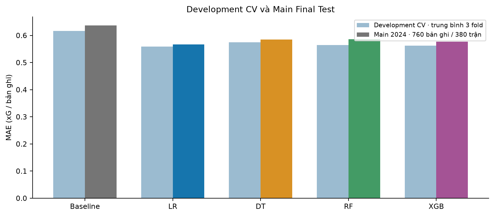
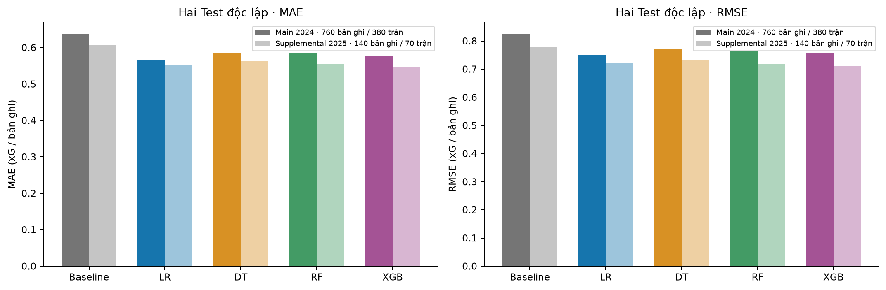
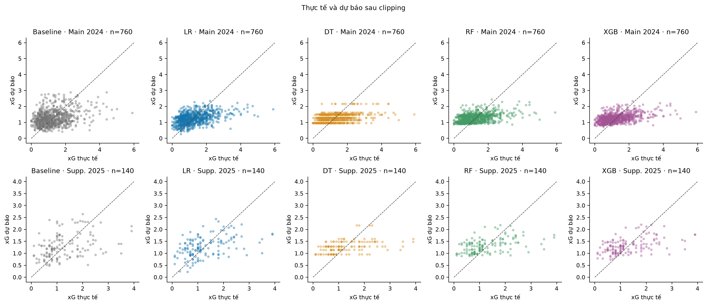
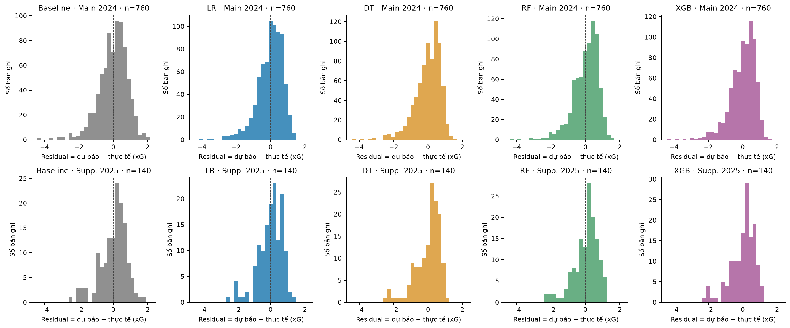
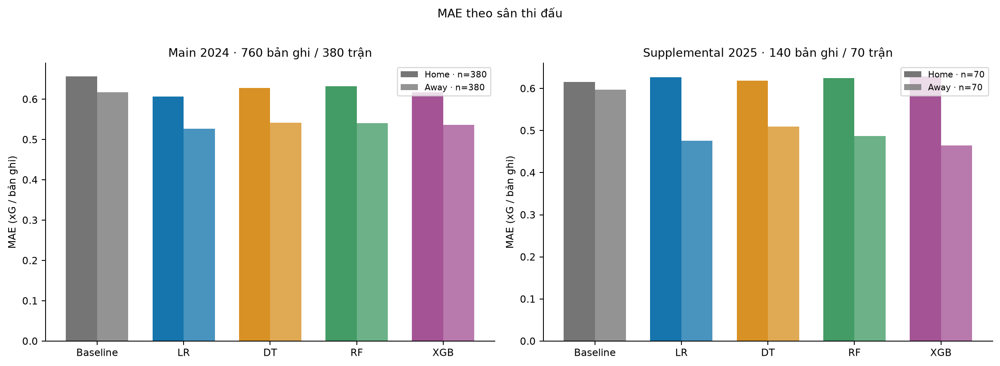
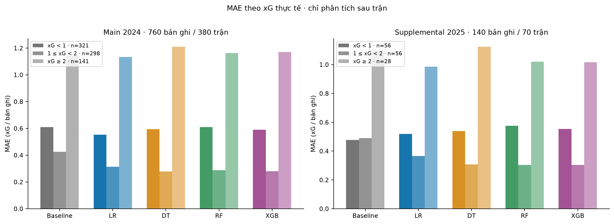
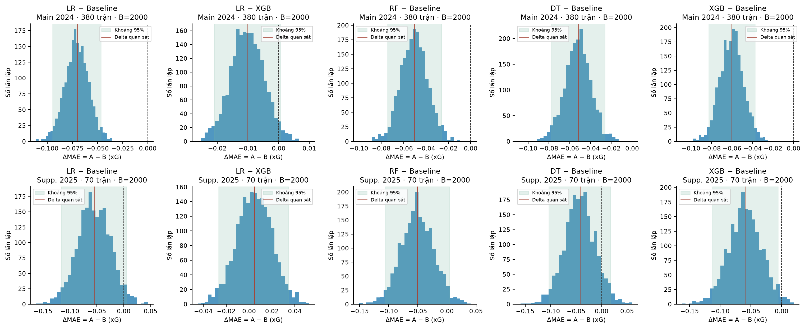

# Đánh giá mô hình xG La Liga trên các tập Test độc lập theo thời gian

## 1. Bối cảnh và mục tiêu

Dự án dự báo xG trước trận La Liga đã hoàn tất Phase 1–6 bằng Development. Phase 7 lần đầu đánh giá hiệu năng trên mùa 2024 và phần đầu mùa 2025 đã được bảo vệ. Mục tiêu là kiểm tra khả năng khái quát theo thời gian, so sánh Baseline, phân tích sai số và định lượng bất định; không điều chỉnh thiết kế theo Test.

## 2. Nguyên tắc đánh giá độc lập

Tất cả quyết định mô hình, 13 features, preprocessing, clipping, chỉ số, các ngưỡng sai số và so sánh bootstrap được xác định từ trước khi chấm điểm Test. Hai Test có vai trò riêng và không gộp thành một chỉ số chính. Thứ hạng quan sát chỉ mô tả mẫu Test, không thay thế Primary Candidate và không tạo quyết định Final Model.

## 3. Protocol đóng băng trước đánh giá

Lệnh `prepare` hoàn tất trước lệnh `evaluate`; bước đầu chỉ kiểm tra cấu trúc/toàn vẹn và đọc quyết định Development. `evaluate` đòi hỏi protocol đã tồn tại và so sánh toàn bộ nội dung, SHA nguồn, cấu hình và tham chiếu trước fit/predict/score. Protocol không bị ghi đè. Nếu đã có manifest hoàn tất, CLI chặn đánh giá lại để tránh vô tình retrain.

Protocol: [`evaluation_protocol.json`](../outputs/final_test/evaluation_protocol.json). SHA-256: `0029e8b29bd6b68a544cf8dba32ceb61791b28064846155271093d177654d621`. Đã xác minh nguyên trạng sau đánh giá. Bootstrap đã cố định năm so sánh, 2.000 lần lặp, seed 42, ngưỡng percentile 2,5/97,5 và phương pháp quantile `linear`. Các khoảng là khoảng biên, không hiệu chỉnh nhiều so sánh.

## 4. Kiểm tra repository và kết quả kế thừa

Đã đọc Feature Engineering, chuẩn hóa số, API khôi phục prior/median, splitter, training/tuning, cấu hình Phase 5, phân tích Phase 6, dependencies, báo cáo Phase 3–6 và kiểm thử cũ. Tái sử dụng `load_dataset`, `prepare_features`, `build_pipeline`, `load_selected_models`, `evaluate_predictions`, các hàm phân tích sai số và `export_tables`. Tham chiếu CV lấy đúng `outputs/tuning/tuning_summary.csv`, các cột `mean_validation_*_after`. Baseline không có estimator hoặc hyperparameter giả.

| model | mae | rmse |
|---|---|---|
| Historical Baseline | 0.616173 | 0.796530 |
| Linear Regression | 0.558838 | 0.724288 |
| Decision Tree | 0.574865 | 0.743133 |
| Random Forest | 0.564262 | 0.726435 |
| XGBoost | 0.562303 | 0.724073 |

## 5. Dữ liệu và ranh giới Development/Test

Nguồn thực tế: 4.700 bản ghi đội–trận, 2.350 trận, 26 cột. Ba phần không giao source rows hoặc match_id; mỗi trận đủ đúng một Home, một Away, cùng ngày và mùa. Không random split. `season=2024` tương ứng mùa 2024–2025, `season=2025` tương ứng phần đầu mùa 2025–2026.

| partition | seasons | n_observations | n_matches | start | end |
|---|---|---|---|---|---|
| development | [2019, 2020, 2021, 2022, 2023] | 3800 | 1900 | 2019-08-16 | 2024-05-26 |
| main_final_test | [2024] | 760 | 380 | 2024-08-15 | 2025-05-25 |
| supplemental_test | [2025] | 140 | 70 | 2025-08-15 | 2025-09-30 |

## 6. Khả dụng lịch sử và độ phân giải thời gian

Nguồn FE dùng `shift(1).rolling(5,min_periods=1)` trong team/stint; reset khi khoảng mùa >1. Audit đối chiếu chỉ đọc 28,200 giá trị với công thức hiện có, không tạo lại/ghi đè rolling. Dung sai `5.1e-9` được xác định trước Test metrics từ độ làm tròn CSV gốc: `5/3 → 1,666666667`, `46/3 → 15,33333333`; Phase 2 chỉ đổi dấu thập phân. Sai khác lớn nhất thực tế `3.33333360913e-09`. Đối chiếu counters và opponent features giữ nguyên logic cũ.

Không có trường hợp cùng đội có hai trận khác nhau cùng ngày. Mọi bản ghi trong cửa sổ lịch sử có ngày nhỏ hơn ngày dự báo. Dataset chỉ xác nhận độ phân giải ngày; chưa xác nhận giờ khai cuộc/múi giờ, vì vậy không khẳng định kiểm soát đến kickoff. Các trận đã hoàn tất trước đó trong mùa Test được phép làm lịch sử; đây là cập nhật thông tin sẵn có, không phải cập nhật trọng số. Không phát hiện vi phạm thời gian theo độ phân giải hiện có. Nếu audit thất bại, mã dừng, không tự sửa hay loại dòng.

## 7. Huấn luyện cố định một lần

Bốn regressors và bốn preprocessors mới được fit đúng một lần trên toàn bộ 3.800 dòng Development. Toàn bộ fit hoàn tất trước đánh giá hai Test. Cùng fitted objects được giữ trong bộ nhớ để predict Main và Supplemental; sau đó lặp inference kiểm tra chính xác, không fit lại. Không có fit/fit_transform/partial_fit trên Test, không train giữa hai Test và không serialize model. Đếm fit trong manifest được đối chiếu kiểm thử spy; không phải log bao phủ mọi thao tác Python ngoài chương trình.

| model | estimator_fit_calls | imputer_fit_calls | n_fit_records |
|---|---|---|---|
| Linear Regression | 1 | 1 | 3800 |
| Decision Tree | 1 | 1 | 3800 |
| Random Forest | 1 | 1 | 3800 |
| XGBoost | 1 | 1 | 3800 |

## 8. Median Imputation và chống rò rỉ

`prepare_features` khôi phục đúng prior đã xác minh về NaN khi số trận lịch sử bằng 0; không thay giá trị hợp lệ tình cờ bằng prior, không coi short_history là thiếu toàn bộ lịch sử. Tám median chỉ học trên Development và đối chiếu phép tính median độc lập; năm cột passthrough giữ nguyên. X, y, metadata giữ index và đúng thứ tự 13 cột; target, date, team, round, match_id và thống kê hiện tại không thuộc X. Sau transform, mọi số hữu hạn, không đổi ô hợp lệ. Test shift nhân tạo +1.000.000 xác nhận median không đổi.

| feature | development_median |
|---|---|
| xg_avg5 | 1.200000 |
| xga_avg5 | 1.240000 |
| gf_avg5 | 1.200000 |
| ga_avg5 | 1.200000 |
| shot_avg5 | 11.200000 |
| sot_avg5 | 3.600000 |
| opponent_xg_avg5 | 1.200000 |
| opponent_xga_avg5 | 1.240000 |

Thứ tự X:

```text
is_home, matches_seen, short_history, xg_avg5, xga_avg5, gf_avg5, ga_avg5, shot_avg5, sot_avg5, opponent_xg_avg5, opponent_xga_avg5, opponent_matches_seen, opponent_short_history
```

## 9. Cấu hình năm phương pháp

Đọc trực tiếp selected/fixed parameters trong Phase 5, xác minh dataset SHA và toàn bộ fixed parameters với estimator templates, không tuning lại. Các seed cố định giữ nguyên. Baseline lấy `xg_avg5` đã transform bằng preprocessor Development của LR; không có bước fit Baseline độc lập.

| model | best_params |
|---|---|
| Decision Tree | {"max_depth": 3, "min_samples_leaf": 1, "min_samples_split": 2} |
| Linear Regression | {"fit_intercept": true, "positive": false} |
| Random Forest | {"max_depth": 4, "max_features": 1.0, "min_samples_leaf": 2, "n_estimators": 100} |
| XGBoost | {"colsample_bytree": 0.7, "learning_rate": 0.05, "max_depth": 2, "min_child_weight": 3, "n_estimators": 100, "reg_lambda": 10, "subsample": 0.85} |

Toàn bộ effective parameters gồm fixed parameters (giá trị `nan` là biểu diễn JSON của missing marker, không phải feature NaN sau transform):

```json
{
  "Linear Regression": {
    "copy_X": true,
    "fit_intercept": true,
    "n_jobs": 1,
    "positive": false,
    "tol": 1e-06
  },
  "Decision Tree": {
    "ccp_alpha": 0.0,
    "criterion": "squared_error",
    "max_depth": 3,
    "max_features": null,
    "max_leaf_nodes": null,
    "min_impurity_decrease": 0.0,
    "min_samples_leaf": 1,
    "min_samples_split": 2,
    "min_weight_fraction_leaf": 0.0,
    "monotonic_cst": null,
    "random_state": 42,
    "splitter": "best"
  },
  "Random Forest": {
    "bootstrap": true,
    "ccp_alpha": 0.0,
    "criterion": "squared_error",
    "max_depth": 4,
    "max_features": 1.0,
    "max_leaf_nodes": null,
    "max_samples": null,
    "min_impurity_decrease": 0.0,
    "min_samples_leaf": 2,
    "min_samples_split": 2,
    "min_weight_fraction_leaf": 0.0,
    "monotonic_cst": null,
    "n_estimators": 100,
    "n_jobs": 1,
    "oob_score": false,
    "random_state": 42,
    "verbose": 0,
    "warm_start": false
  },
  "XGBoost": {
    "objective": "reg:squarederror",
    "base_score": null,
    "booster": null,
    "callbacks": null,
    "colsample_bylevel": null,
    "colsample_bynode": null,
    "colsample_bytree": 0.7,
    "device": "cpu",
    "early_stopping_rounds": null,
    "enable_categorical": true,
    "eval_metric": null,
    "feature_types": null,
    "feature_weights": null,
    "gamma": null,
    "grow_policy": null,
    "importance_type": null,
    "interaction_constraints": null,
    "learning_rate": 0.05,
    "max_bin": null,
    "max_cat_threshold": null,
    "max_cat_to_onehot": null,
    "max_delta_step": null,
    "max_depth": 2,
    "max_leaves": null,
    "min_child_weight": 3,
    "missing": "nan",
    "monotone_constraints": null,
    "multi_strategy": null,
    "n_estimators": 100,
    "n_jobs": 1,
    "num_parallel_tree": null,
    "random_state": 42,
    "reg_alpha": null,
    "reg_lambda": 10,
    "sampling_method": null,
    "scale_pos_weight": null,
    "subsample": 0.85,
    "tree_method": "hist",
    "validate_parameters": null,
    "verbosity": null
  }
}
```

## 10. Primary Candidate và Main Challenger

Linear Regression được chỉ định Primary Candidate do MAE Development CV nhỏ nhất; XGBoost là Main Challenger. Hai vai trò được đóng băng trước Test. Mọi thứ hạng Test sau đây là quan sát thực nghiệm, không tự động chọn mô hình khác hoặc công bố Final Model.

## 11. Kết quả Main Final Test mùa 2024

Bảng độc lập cho `main_final_test`. MAE thấp nhất quan sát: **Linear Regression**, `0.566524` xG; đây là thứ hạng mô tả, LR vẫn là Primary Candidate.

| model | designation | n_observations | n_matches | mae | rmse | observed_mae_rank |
|---|---|---|---|---|---|---|
| Linear Regression | primary_candidate | 760 | 380 | 0.566524 | 0.749676 | 1 |
| XGBoost | main_challenger | 760 | 380 | 0.576604 | 0.756181 | 2 |
| Decision Tree | comparison_regressor | 760 | 380 | 0.584939 | 0.773602 | 3 |
| Random Forest | comparison_regressor | 760 | 380 | 0.586461 | 0.763143 | 4 |
| Historical Baseline | benchmark | 760 | 380 | 0.636770 | 0.823998 | 5 |

## 12. Kết quả Supplemental Test mùa 2025

Bảng độc lập cho `supplemental_test`. MAE thấp nhất quan sát: **XGBoost**, `0.546786` xG; đây là thứ hạng mô tả, LR vẫn là Primary Candidate.

| model | designation | n_observations | n_matches | mae | rmse | observed_mae_rank |
|---|---|---|---|---|---|---|
| XGBoost | main_challenger | 140 | 70 | 0.546786 | 0.709490 | 1 |
| Linear Regression | primary_candidate | 140 | 70 | 0.551345 | 0.720295 | 2 |
| Random Forest | comparison_regressor | 140 | 70 | 0.555838 | 0.716981 | 3 |
| Decision Tree | comparison_regressor | 140 | 70 | 0.563926 | 0.731594 | 4 |
| Historical Baseline | benchmark | 140 | 70 | 0.606464 | 0.777203 | 5 |

## 13. Quy ước metric và chẩn đoán

Tất cả dự báo được clip `maximum(0,raw_prediction)` trước mọi metric. MAE = trung bình |prediction−actual|; RMSE = căn trung bình bình phương. Residual = prediction−actual, dương là dự báo cao, âm là dự báo thấp. `residual_std` dùng ddof=0; đây là độ phân tán residual, không phải khoảng tin cậy. CSV dự báo giữ cả raw_prediction để kiểm toán số âm.

| test_split | model | n_observations | n_matches | mean_residual | median_absolute_error | residual_std | negative_raw_predictions |
|---|---|---|---|---|---|---|---|
| main_final_test | Linear Regression | 760 | 380 | -0.026561 | 0.474297 | 0.749206 | 0 |
| main_final_test | Decision Tree | 760 | 380 | -0.016393 | 0.483535 | 0.773429 | 0 |
| main_final_test | Random Forest | 760 | 380 | 0.010113 | 0.508491 | 0.763076 | 0 |
| main_final_test | XGBoost | 760 | 380 | -0.004496 | 0.492836 | 0.756167 | 0 |
| main_final_test | Historical Baseline | 760 | 380 | -0.001621 | 0.520000 | 0.823997 | 0 |
| supplemental_test | Linear Regression | 140 | 70 | -0.013077 | 0.455885 | 0.720176 | 0 |
| supplemental_test | Decision Tree | 140 | 70 | -0.015344 | 0.455662 | 0.731433 | 0 |
| supplemental_test | Random Forest | 140 | 70 | 0.035036 | 0.453046 | 0.716124 | 0 |
| supplemental_test | XGBoost | 140 | 70 | 0.021536 | 0.461224 | 0.709163 | 0 |
| supplemental_test | Historical Baseline | 140 | 70 | 0.008631 | 0.490000 | 0.777155 | 0 |

## 14. Cải thiện so với Historical Baseline

Cải thiện tuyệt đối = MAE Baseline − MAE model; phần trăm = 100 × cải thiện / MAE Baseline, tính riêng từng Test. Giá trị dương là tốt hơn Baseline; Baseline có cải thiện 0 theo định nghĩa.

| test_split | model | baseline_mae_improvement | baseline_mae_improvement_percent |
|---|---|---|---|
| main_final_test | Historical Baseline | 0.000000 | 0.000000 |
| main_final_test | Linear Regression | 0.070246 | 11.031591 |
| main_final_test | Decision Tree | 0.051830 | 8.139577 |
| main_final_test | Random Forest | 0.050309 | 7.900695 |
| main_final_test | XGBoost | 0.060166 | 9.448619 |
| supplemental_test | Historical Baseline | 0.000000 | 0.000000 |
| supplemental_test | Linear Regression | 0.055119 | 9.088624 |
| supplemental_test | Decision Tree | 0.042538 | 7.014105 |
| supplemental_test | Random Forest | 0.050627 | 8.347819 |
| supplemental_test | XGBoost | 0.059678 | 9.840360 |

## 15. Development CV so với Test

Tham chiếu là trung bình số học metric của ba validation folds, không phải RMSE trên residual gộp. Chênh lệch Test − CV dương nghĩa là sai số tăng. Các mô hình Development từng fold có ít dữ liệu train hơn mô hình fit toàn bộ Development ở đây, nên chênh lệch còn chịu ảnh hưởng cỡ train và phân phối theo mùa.

| test_split | model | development_cv_mean_fold_mae | mae | mae_minus_development_cv | development_cv_mean_fold_rmse | rmse | rmse_minus_development_cv |
|---|---|---|---|---|---|---|---|
| main_final_test | Historical Baseline | 0.616173 | 0.636770 | 0.020597 | 0.796530 | 0.823998 | 0.027468 |
| main_final_test | Linear Regression | 0.558838 | 0.566524 | 0.007686 | 0.724288 | 0.749676 | 0.025388 |
| main_final_test | Decision Tree | 0.574865 | 0.584939 | 0.010074 | 0.743133 | 0.773602 | 0.030469 |
| main_final_test | Random Forest | 0.564262 | 0.586461 | 0.022198 | 0.726435 | 0.763143 | 0.036708 |
| main_final_test | XGBoost | 0.562303 | 0.576604 | 0.014301 | 0.724073 | 0.756181 | 0.032108 |
| supplemental_test | Historical Baseline | 0.616173 | 0.606464 | -0.009708 | 0.796530 | 0.777203 | -0.019327 |
| supplemental_test | Linear Regression | 0.558838 | 0.551345 | -0.007493 | 0.724288 | 0.720295 | -0.003993 |
| supplemental_test | Decision Tree | 0.574865 | 0.563926 | -0.010939 | 0.743133 | 0.731594 | -0.011539 |
| supplemental_test | Random Forest | 0.564262 | 0.555838 | -0.008425 | 0.726435 | 0.716981 | -0.009454 |
| supplemental_test | XGBoost | 0.562303 | 0.546786 | -0.015517 | 0.724073 | 0.709490 | -0.014583 |

`main_final_test`: 5/5 phương pháp có MAE cao hơn Development CV; 5/5 có RMSE cao hơn. Đây là kết quả trên từng mẫu theo thời gian, không chứng minh hiệu năng cải thiện lâu dài.

`supplemental_test`: 0/5 phương pháp có MAE cao hơn Development CV; 0/5 có RMSE cao hơn. Đây là kết quả trên từng mẫu theo thời gian, không chứng minh hiệu năng cải thiện lâu dài.

## 16. Phương pháp Paired Bootstrap

Mỗi Test dùng danh sách match_id sắp tăng riêng; lấy có hoàn lại số trận bằng cỡ Test bằng `default_rng(42)`, 2.000 lần. Giữ đủ hai phía và số lần xuất hiện của trận; lấy trung bình sai số hai phía rồi lấy trung bình các trận có multiplicity tương đương MAE trên toàn bộ 2×n records lấy mẫu. Năm so sánh trong cùng Test dùng đúng cùng draw indices; không lấy mẫu từng đội–trận riêng, không deduplicate. ΔMAE = MAE_A − MAE_B, âm có lợi cho A. Khoảng percentile 2,5/97,5 dùng `linear`. Lưu tóm tắt, đủ 20.000 delta và hash draw indices để replay; không gộp hai mùa.

## 17. Kết quả bootstrap và khoảng 95%

Khoảng hoàn toàn âm cho thấy ưu thế MAE của A trong bootstrap trên mẫu này; khoảng chứa 0 chưa tách rõ hai phương pháp theo thủ tục đã định. Khoảng không chứng minh một model luôn thắng ở tương lai và không được dùng để đổi Primary Candidate.

| test_split | comparison_id | model_a | model_b | observed_delta_mae | bootstrap_mean_delta | ci_lower | ci_upper | interval_contains_zero | n_matches | n_bootstrap | random_seed |
|---|---|---|---|---|---|---|---|---|---|---|---|
| main_final_test | lr_minus_baseline | Linear Regression | Historical Baseline | -0.070246 | -0.070603 | -0.094565 | -0.046451 | False | 380 | 2000 | 42 |
| main_final_test | lr_minus_xgb | Linear Regression | XGBoost | -0.010080 | -0.010181 | -0.020992 | 0.000672 | True | 380 | 2000 | 42 |
| main_final_test | rf_minus_baseline | Random Forest | Historical Baseline | -0.050309 | -0.050552 | -0.074478 | -0.026024 | False | 380 | 2000 | 42 |
| main_final_test | dt_minus_baseline | Decision Tree | Historical Baseline | -0.051830 | -0.052120 | -0.077628 | -0.026248 | False | 380 | 2000 | 42 |
| main_final_test | xgb_minus_baseline | XGBoost | Historical Baseline | -0.060166 | -0.060422 | -0.082765 | -0.037493 | False | 380 | 2000 | 42 |
| supplemental_test | lr_minus_baseline | Linear Regression | Historical Baseline | -0.055119 | -0.055259 | -0.115902 | 0.004815 | True | 70 | 2000 | 42 |
| supplemental_test | lr_minus_xgb | Linear Regression | XGBoost | 0.004559 | 0.004523 | -0.026686 | 0.034447 | True | 70 | 2000 | 42 |
| supplemental_test | rf_minus_baseline | Random Forest | Historical Baseline | -0.050627 | -0.050633 | -0.105721 | 0.004278 | True | 70 | 2000 | 42 |
| supplemental_test | dt_minus_baseline | Decision Tree | Historical Baseline | -0.042538 | -0.042663 | -0.103404 | 0.017340 | True | 70 | 2000 | 42 |
| supplemental_test | xgb_minus_baseline | XGBoost | Historical Baseline | -0.059678 | -0.059783 | -0.112595 | -0.005784 | False | 70 | 2000 | 42 |

`main_final_test` · Linear Regression − Historical Baseline: khoảng `[-0.094565, -0.046451]` hoàn toàn âm, có lợi cho LR trong mẫu bootstrap này.

`main_final_test` · Linear Regression − XGBoost: khoảng `[-0.020992, 0.000672]` chứa 0, chưa tách rõ chênh MAE.

`supplemental_test` · Linear Regression − Historical Baseline: khoảng `[-0.115902, 0.004815]` chứa 0, chưa tách rõ chênh MAE.

`supplemental_test` · Linear Regression − XGBoost: khoảng `[-0.026686, 0.034447]` chứa 0, chưa tách rõ chênh MAE.

## 18. Sai số Home và Away

Mỗi Test được phân tích riêng. Số bản ghi và số trận được báo cho từng subgroup; cùng một trận có thể thuộc cả hai nhóm venue qua hai phía.

| test_split | model | group | n_observations | n_matches | mae | rmse | mean_residual | small_sample |
|---|---|---|---|---|---|---|---|---|
| main_final_test | Historical Baseline | Away | 380 | 380 | 0.616991 | 0.773677 | 0.187307 | False |
| main_final_test | Historical Baseline | Home | 380 | 380 | 0.656548 | 0.871419 | -0.190548 | False |
| main_final_test | Linear Regression | Away | 380 | 380 | 0.526870 | 0.689012 | -0.014451 | False |
| main_final_test | Linear Regression | Home | 380 | 380 | 0.606178 | 0.805786 | -0.038671 | False |
| main_final_test | Decision Tree | Away | 380 | 380 | 0.541477 | 0.707704 | -0.006489 | False |
| main_final_test | Decision Tree | Home | 380 | 380 | 0.628401 | 0.834312 | -0.026298 | False |
| main_final_test | Random Forest | Away | 380 | 380 | 0.540957 | 0.696982 | 0.009401 | False |
| main_final_test | Random Forest | Home | 380 | 380 | 0.631964 | 0.824010 | 0.010824 | False |
| main_final_test | XGBoost | Away | 380 | 380 | 0.535922 | 0.689650 | 0.028496 | False |
| main_final_test | XGBoost | Home | 380 | 380 | 0.617286 | 0.817314 | -0.037488 | False |
| supplemental_test | Historical Baseline | Away | 70 | 70 | 0.597381 | 0.763453 | 0.170714 | False |
| supplemental_test | Historical Baseline | Home | 70 | 70 | 0.615548 | 0.790713 | -0.153452 | False |
| supplemental_test | Linear Regression | Away | 70 | 70 | 0.475878 | 0.638510 | -0.029705 | False |
| supplemental_test | Linear Regression | Home | 70 | 70 | 0.626812 | 0.793696 | 0.003550 | False |
| supplemental_test | Decision Tree | Away | 70 | 70 | 0.509114 | 0.689205 | -0.021439 | False |
| supplemental_test | Decision Tree | Home | 70 | 70 | 0.618739 | 0.771657 | -0.009249 | False |
| supplemental_test | Random Forest | Away | 70 | 70 | 0.486575 | 0.652032 | 0.013428 | False |
| supplemental_test | Random Forest | Home | 70 | 70 | 0.625100 | 0.776516 | 0.056644 | False |
| supplemental_test | XGBoost | Away | 70 | 70 | 0.465020 | 0.633139 | 0.031607 | False |
| supplemental_test | XGBoost | Home | 70 | 70 | 0.628552 | 0.778388 | 0.011465 | False |

## 19. Sai số theo mức xG thực tế

Ngưỡng cố định từ Phase 6: xG <1; 1≤xG<2; xG≥2. Actual xG chỉ dùng phân nhóm hậu kiểm, tuyệt đối không đưa vào X. Các nhóm n<30 được đánh dấu small_sample.

| test_split | model | group | n_observations | n_matches | mae | rmse | mean_residual | small_sample |
|---|---|---|---|---|---|---|---|---|
| main_final_test | Historical Baseline | xg_1_to_2 | 298 | 239 | 0.425800 | 0.524720 | -0.100565 | False |
| main_final_test | Historical Baseline | xg_ge_2 | 141 | 132 | 1.145957 | 1.362371 | -1.123546 | False |
| main_final_test | Historical Baseline | xg_lt_1 | 321 | 272 | 0.608962 | 0.732570 | 0.583043 | False |
| main_final_test | Linear Regression | xg_1_to_2 | 298 | 239 | 0.313724 | 0.391714 | -0.103936 | False |
| main_final_test | Linear Regression | xg_ge_2 | 141 | 132 | 1.133402 | 1.337469 | -1.131249 | False |
| main_final_test | Linear Regression | xg_lt_1 | 321 | 272 | 0.552208 | 0.634378 | 0.530506 | False |
| main_final_test | Decision Tree | xg_1_to_2 | 298 | 239 | 0.279007 | 0.353730 | -0.109805 | False |
| main_final_test | Decision Tree | xg_ge_2 | 141 | 132 | 1.209742 | 1.405778 | -1.209742 | False |
| main_final_test | Decision Tree | xg_lt_1 | 321 | 272 | 0.594506 | 0.657800 | 0.594506 | False |
| main_final_test | Random Forest | xg_1_to_2 | 298 | 239 | 0.287736 | 0.356512 | -0.082460 | False |
| main_final_test | Random Forest | xg_ge_2 | 141 | 132 | 1.163714 | 1.354706 | -1.160300 | False |
| main_final_test | Random Forest | xg_lt_1 | 321 | 272 | 0.610221 | 0.674344 | 0.610159 | False |
| main_final_test | XGBoost | xg_1_to_2 | 298 | 239 | 0.281014 | 0.353415 | -0.091771 | False |
| main_final_test | XGBoost | xg_ge_2 | 141 | 132 | 1.171583 | 1.359144 | -1.169578 | False |
| main_final_test | XGBoost | xg_lt_1 | 321 | 272 | 0.589668 | 0.653028 | 0.588291 | False |
| supplemental_test | Historical Baseline | xg_1_to_2 | 56 | 42 | 0.489613 | 0.587108 | 0.068958 | False |
| supplemental_test | Historical Baseline | xg_ge_2 | 28 | 26 | 1.096786 | 1.274829 | -1.002500 | True |
| supplemental_test | Historical Baseline | xg_lt_1 | 56 | 47 | 0.478155 | 0.593987 | 0.453869 | False |
| supplemental_test | Linear Regression | xg_1_to_2 | 56 | 42 | 0.366581 | 0.448190 | -0.000843 | False |
| supplemental_test | Linear Regression | xg_ge_2 | 28 | 26 | 0.985545 | 1.200119 | -0.976933 | True |
| supplemental_test | Linear Regression | xg_lt_1 | 56 | 47 | 0.519009 | 0.613225 | 0.456617 | False |
| supplemental_test | Decision Tree | xg_1_to_2 | 56 | 42 | 0.307682 | 0.372040 | -0.016582 | False |
| supplemental_test | Decision Tree | xg_ge_2 | 28 | 26 | 1.123912 | 1.292489 | -1.123912 | True |
| supplemental_test | Decision Tree | xg_lt_1 | 56 | 47 | 0.540178 | 0.603652 | 0.540178 | False |
| supplemental_test | Random Forest | xg_1_to_2 | 56 | 42 | 0.304420 | 0.365571 | 0.022056 | False |
| supplemental_test | Random Forest | xg_ge_2 | 28 | 26 | 1.019640 | 1.205538 | -1.019640 | True |
| supplemental_test | Random Forest | xg_lt_1 | 56 | 47 | 0.575354 | 0.651806 | 0.575354 | False |
| supplemental_test | XGBoost | xg_1_to_2 | 56 | 42 | 0.304767 | 0.370108 | 0.003608 | False |
| supplemental_test | XGBoost | xg_ge_2 | 28 | 26 | 1.016396 | 1.200884 | -1.007534 | True |
| supplemental_test | XGBoost | xg_lt_1 | 56 | 47 | 0.554000 | 0.632771 | 0.554000 | False |

## 20. Sai số theo độ dài lịch sử

Tách lịch sử đội và đối thủ: 0, 1–4, ≥5 trận. Bảng chỉ có nhóm thực sự tồn tại; không tạo metric giả cho nhóm rỗng. Nhóm không xuất hiện không đủ bằng chứng để kết luận độ bền ở tình huống đó.

**team_history**

| test_split | model | group | n_observations | n_matches | mae | rmse | mean_residual | small_sample |
|---|---|---|---|---|---|---|---|---|
| main_final_test | Historical Baseline | five_or_more | 745 | 378 | 0.639087 | 0.828336 | -0.004081 | False |
| main_final_test | Historical Baseline | one_to_four | 12 | 11 | 0.560417 | 0.605210 | 0.059028 | True |
| main_final_test | Historical Baseline | zero | 3 | 2 | 0.366667 | 0.387298 | 0.366667 | True |
| main_final_test | Linear Regression | five_or_more | 745 | 378 | 0.570388 | 0.754354 | -0.028571 | False |
| main_final_test | Linear Regression | one_to_four | 12 | 11 | 0.365279 | 0.465728 | 0.028100 | True |
| main_final_test | Linear Regression | zero | 3 | 2 | 0.411890 | 0.442159 | 0.253947 | True |
| main_final_test | Decision Tree | five_or_more | 745 | 378 | 0.587639 | 0.777872 | -0.022566 | False |
| main_final_test | Decision Tree | one_to_four | 12 | 11 | 0.498307 | 0.558152 | 0.303997 | True |
| main_final_test | Decision Tree | zero | 3 | 2 | 0.261178 | 0.317925 | 0.234847 | True |
| main_final_test | Random Forest | five_or_more | 745 | 378 | 0.589277 | 0.767366 | 0.004388 | False |
| main_final_test | Random Forest | one_to_four | 12 | 11 | 0.482935 | 0.538393 | 0.293881 | True |
| main_final_test | Random Forest | zero | 3 | 2 | 0.301229 | 0.384328 | 0.296628 | True |
| main_final_test | XGBoost | five_or_more | 745 | 378 | 0.579107 | 0.760194 | -0.010058 | False |
| main_final_test | XGBoost | one_to_four | 12 | 11 | 0.489402 | 0.548837 | 0.264872 | True |
| main_final_test | XGBoost | zero | 3 | 2 | 0.303849 | 0.378186 | 0.299262 | True |
| supplemental_test | Historical Baseline | five_or_more | 125 | 68 | 0.616640 | 0.789361 | 0.022400 | False |
| supplemental_test | Historical Baseline | one_to_four | 12 | 10 | 0.552083 | 0.715297 | -0.232639 | True |
| supplemental_test | Historical Baseline | zero | 3 | 3 | 0.400000 | 0.424264 | 0.400000 | True |
| supplemental_test | Linear Regression | five_or_more | 125 | 68 | 0.569325 | 0.730233 | 0.009144 | False |
| supplemental_test | Linear Regression | one_to_four | 12 | 10 | 0.423396 | 0.677855 | -0.272729 | True |
| supplemental_test | Linear Regression | zero | 3 | 3 | 0.313994 | 0.394392 | 0.099663 | True |
| supplemental_test | Decision Tree | five_or_more | 125 | 68 | 0.573387 | 0.741685 | -0.033345 | False |
| supplemental_test | Decision Tree | one_to_four | 12 | 10 | 0.539318 | 0.688928 | 0.101287 | True |
| supplemental_test | Decision Tree | zero | 3 | 3 | 0.268181 | 0.397719 | 0.268181 | True |
| supplemental_test | Random Forest | five_or_more | 125 | 68 | 0.564281 | 0.723523 | 0.023470 | False |
| supplemental_test | Random Forest | one_to_four | 12 | 10 | 0.528972 | 0.702238 | 0.086401 | True |
| supplemental_test | Random Forest | zero | 3 | 3 | 0.311507 | 0.452871 | 0.311507 | True |
| supplemental_test | XGBoost | five_or_more | 125 | 68 | 0.558228 | 0.716638 | 0.015522 | False |
| supplemental_test | XGBoost | one_to_four | 12 | 10 | 0.493723 | 0.692129 | 0.018995 | True |
| supplemental_test | XGBoost | zero | 3 | 3 | 0.282279 | 0.419524 | 0.282279 | True |

`main_final_test` không có nhóm: không.

`supplemental_test` không có nhóm: không.

**opponent_history**

| test_split | model | group | n_observations | n_matches | mae | rmse | mean_residual | small_sample |
|---|---|---|---|---|---|---|---|---|
| main_final_test | Historical Baseline | five_or_more | 745 | 378 | 0.635725 | 0.821369 | 0.004991 | False |
| main_final_test | Historical Baseline | one_to_four | 12 | 11 | 0.725833 | 1.019759 | -0.427500 | True |
| main_final_test | Historical Baseline | zero | 3 | 2 | 0.540000 | 0.556297 | 0.060000 | True |
| main_final_test | Linear Regression | five_or_more | 745 | 378 | 0.567111 | 0.748217 | -0.025890 | False |
| main_final_test | Linear Regression | one_to_four | 12 | 11 | 0.584117 | 0.890951 | -0.162475 | True |
| main_final_test | Linear Regression | zero | 3 | 2 | 0.350337 | 0.421551 | 0.350337 | True |
| main_final_test | Decision Tree | five_or_more | 745 | 378 | 0.584601 | 0.770242 | -0.010494 | False |
| main_final_test | Decision Tree | one_to_four | 12 | 11 | 0.655498 | 1.015178 | -0.414034 | True |
| main_final_test | Decision Tree | zero | 3 | 2 | 0.386834 | 0.397958 | 0.109191 | True |
| main_final_test | Random Forest | five_or_more | 745 | 378 | 0.585989 | 0.759363 | 0.015574 | False |
| main_final_test | Random Forest | one_to_four | 12 | 11 | 0.669156 | 1.021914 | -0.382669 | True |
| main_final_test | Random Forest | zero | 3 | 2 | 0.372810 | 0.405052 | 0.225047 | True |
| main_final_test | XGBoost | five_or_more | 745 | 378 | 0.576301 | 0.753085 | -0.000422 | False |
| main_final_test | XGBoost | one_to_four | 12 | 11 | 0.649793 | 0.983150 | -0.319525 | True |
| main_final_test | XGBoost | zero | 3 | 2 | 0.359149 | 0.391101 | 0.243962 | True |
| supplemental_test | Historical Baseline | five_or_more | 125 | 68 | 0.617360 | 0.797727 | 0.024027 | False |
| supplemental_test | Historical Baseline | one_to_four | 12 | 10 | 0.504583 | 0.546521 | -0.012917 | True |
| supplemental_test | Historical Baseline | zero | 3 | 3 | 0.560000 | 0.691857 | -0.546667 | True |
| supplemental_test | Linear Regression | five_or_more | 125 | 68 | 0.550692 | 0.725868 | -0.043351 | False |
| supplemental_test | Linear Regression | one_to_four | 12 | 10 | 0.598697 | 0.725180 | 0.335145 | True |
| supplemental_test | Linear Regression | zero | 3 | 3 | 0.389138 | 0.393404 | -0.144546 | True |
| supplemental_test | Decision Tree | five_or_more | 125 | 68 | 0.561375 | 0.736400 | -0.004237 | False |
| supplemental_test | Decision Tree | one_to_four | 12 | 10 | 0.580129 | 0.684807 | 0.002553 | True |
| supplemental_test | Decision Tree | zero | 3 | 3 | 0.605430 | 0.711545 | -0.549740 | True |
| supplemental_test | Random Forest | five_or_more | 125 | 68 | 0.557882 | 0.726586 | 0.037920 | False |
| supplemental_test | Random Forest | one_to_four | 12 | 10 | 0.535161 | 0.634981 | 0.120923 | True |
| supplemental_test | Random Forest | zero | 3 | 3 | 0.553385 | 0.616276 | -0.428682 | True |
| supplemental_test | XGBoost | five_or_more | 125 | 68 | 0.552547 | 0.722029 | 0.013475 | False |
| supplemental_test | XGBoost | one_to_four | 12 | 10 | 0.494887 | 0.603973 | 0.203419 | True |
| supplemental_test | XGBoost | zero | 3 | 3 | 0.514354 | 0.556659 | -0.370117 | True |

`main_final_test` không có nhóm: không.

`supplemental_test` không có nhóm: không.

## 21. Sai số theo vòng đấu

`Matchweek N` được parse và kiểm tra 1–38, sắp theo số. Dưới đây là LR và XGBoost; CSV `final_test_error_analysis.csv` chứa đủ năm phương pháp. Mỗi vòng chỉ có tối đa 20 bản ghi nên mọi nhóm vòng đấu đều nhỏ theo ngưỡng 30; không suy luận chắc chắn từ vòng có MAE cực trị.

| test_split | model | group | n_observations | n_matches | mae | rmse | mean_residual | small_sample |
|---|---|---|---|---|---|---|---|---|
| main_final_test | Linear Regression | 1 | 20 | 10 | 0.505248 | 0.649682 | 0.132520 | True |
| main_final_test | XGBoost | 1 | 20 | 10 | 0.477531 | 0.640164 | 0.144362 | True |
| main_final_test | Linear Regression | 2 | 20 | 10 | 0.447056 | 0.527534 | 0.303066 | True |
| main_final_test | XGBoost | 2 | 20 | 10 | 0.464623 | 0.551271 | 0.299778 | True |
| main_final_test | Linear Regression | 3 | 20 | 10 | 0.717510 | 0.906162 | -0.089068 | True |
| main_final_test | XGBoost | 3 | 20 | 10 | 0.726584 | 0.894176 | -0.055334 | True |
| main_final_test | Linear Regression | 4 | 20 | 10 | 0.647674 | 0.836809 | 0.019873 | True |
| main_final_test | XGBoost | 4 | 20 | 10 | 0.654622 | 0.869887 | 0.025586 | True |
| main_final_test | Linear Regression | 5 | 20 | 10 | 0.444728 | 0.565696 | -0.129495 | True |
| main_final_test | XGBoost | 5 | 20 | 10 | 0.498602 | 0.621191 | -0.106811 | True |
| main_final_test | Linear Regression | 6 | 20 | 10 | 0.607941 | 0.864454 | -0.082622 | True |
| main_final_test | XGBoost | 6 | 20 | 10 | 0.611629 | 0.847036 | -0.046577 | True |
| main_final_test | Linear Regression | 7 | 20 | 10 | 0.329535 | 0.429546 | 0.141972 | True |
| main_final_test | XGBoost | 7 | 20 | 10 | 0.374071 | 0.450593 | 0.157028 | True |
| main_final_test | Linear Regression | 8 | 20 | 10 | 0.572292 | 0.776992 | -0.123114 | True |
| main_final_test | XGBoost | 8 | 20 | 10 | 0.580071 | 0.754091 | -0.093874 | True |
| main_final_test | Linear Regression | 9 | 20 | 10 | 0.593562 | 0.760341 | 0.075391 | True |
| main_final_test | XGBoost | 9 | 20 | 10 | 0.626591 | 0.779537 | 0.105480 | True |
| main_final_test | Linear Regression | 10 | 20 | 10 | 0.780228 | 0.994769 | -0.276367 | True |
| main_final_test | XGBoost | 10 | 20 | 10 | 0.833592 | 1.050595 | -0.261470 | True |
| main_final_test | Linear Regression | 11 | 20 | 10 | 0.451447 | 0.537685 | 0.034703 | True |
| main_final_test | XGBoost | 11 | 20 | 10 | 0.429970 | 0.522001 | 0.028941 | True |
| main_final_test | Linear Regression | 12 | 20 | 10 | 0.564278 | 0.798595 | -0.102732 | True |
| main_final_test | XGBoost | 12 | 20 | 10 | 0.562364 | 0.826767 | -0.092174 | True |
| main_final_test | Linear Regression | 13 | 20 | 10 | 0.611815 | 0.753747 | 0.087494 | True |
| main_final_test | XGBoost | 13 | 20 | 10 | 0.613950 | 0.737604 | 0.089407 | True |
| main_final_test | Linear Regression | 14 | 20 | 10 | 0.538272 | 0.720023 | -0.109384 | True |
| main_final_test | XGBoost | 14 | 20 | 10 | 0.531306 | 0.738941 | -0.101039 | True |
| main_final_test | Linear Regression | 15 | 20 | 10 | 0.568189 | 0.808973 | 0.038943 | True |
| main_final_test | XGBoost | 15 | 20 | 10 | 0.641270 | 0.858785 | 0.048916 | True |
| main_final_test | Linear Regression | 16 | 20 | 10 | 0.479806 | 0.628574 | 0.043674 | True |
| main_final_test | XGBoost | 16 | 20 | 10 | 0.478287 | 0.622153 | 0.064778 | True |
| main_final_test | Linear Regression | 17 | 20 | 10 | 0.414812 | 0.499713 | 0.248807 | True |
| main_final_test | XGBoost | 17 | 20 | 10 | 0.435676 | 0.515079 | 0.290583 | True |
| main_final_test | Linear Regression | 18 | 20 | 10 | 0.615682 | 0.763616 | -0.193547 | True |
| main_final_test | XGBoost | 18 | 20 | 10 | 0.607125 | 0.769814 | -0.173513 | True |
| main_final_test | Linear Regression | 19 | 20 | 10 | 0.662574 | 1.003086 | -0.130709 | True |
| main_final_test | XGBoost | 19 | 20 | 10 | 0.643846 | 1.008646 | -0.111250 | True |
| main_final_test | Linear Regression | 20 | 20 | 10 | 0.719859 | 1.102425 | -0.296466 | True |
| main_final_test | XGBoost | 20 | 20 | 10 | 0.703870 | 1.124061 | -0.264255 | True |
| main_final_test | Linear Regression | 21 | 20 | 10 | 0.602673 | 0.825740 | -0.160517 | True |
| main_final_test | XGBoost | 21 | 20 | 10 | 0.626940 | 0.821761 | -0.142862 | True |
| main_final_test | Linear Regression | 22 | 20 | 10 | 0.536235 | 0.643100 | 0.059823 | True |
| main_final_test | XGBoost | 22 | 20 | 10 | 0.578506 | 0.687613 | 0.070905 | True |
| main_final_test | Linear Regression | 23 | 20 | 10 | 0.482077 | 0.623423 | -0.121359 | True |
| main_final_test | XGBoost | 23 | 20 | 10 | 0.500348 | 0.634361 | -0.086459 | True |
| main_final_test | Linear Regression | 24 | 20 | 10 | 0.464593 | 0.567853 | 0.067751 | True |
| main_final_test | XGBoost | 24 | 20 | 10 | 0.492759 | 0.568957 | 0.075111 | True |
| main_final_test | Linear Regression | 25 | 20 | 10 | 0.570102 | 0.712138 | 0.033436 | True |
| main_final_test | XGBoost | 25 | 20 | 10 | 0.559498 | 0.685165 | 0.060320 | True |
| main_final_test | Linear Regression | 26 | 20 | 10 | 0.630769 | 0.731103 | -0.078239 | True |
| main_final_test | XGBoost | 26 | 20 | 10 | 0.629567 | 0.716420 | -0.045731 | True |
| main_final_test | Linear Regression | 27 | 20 | 10 | 0.561268 | 0.739074 | 0.047352 | True |
| main_final_test | XGBoost | 27 | 20 | 10 | 0.575148 | 0.739889 | 0.098746 | True |
| main_final_test | Linear Regression | 28 | 20 | 10 | 0.426068 | 0.525174 | 0.004815 | True |
| main_final_test | XGBoost | 28 | 20 | 10 | 0.502286 | 0.592925 | 0.090673 | True |
| main_final_test | Linear Regression | 29 | 20 | 10 | 0.528655 | 0.680189 | 0.195718 | True |
| main_final_test | XGBoost | 29 | 20 | 10 | 0.545130 | 0.655907 | 0.245942 | True |
| main_final_test | Linear Regression | 30 | 20 | 10 | 0.772088 | 0.987473 | -0.233521 | True |
| main_final_test | XGBoost | 30 | 20 | 10 | 0.754743 | 0.957331 | -0.218649 | True |
| main_final_test | Linear Regression | 31 | 20 | 10 | 0.465912 | 0.607286 | -0.003213 | True |
| main_final_test | XGBoost | 31 | 20 | 10 | 0.417350 | 0.571325 | 0.028189 | True |
| main_final_test | Linear Regression | 32 | 20 | 10 | 0.614463 | 0.709600 | -0.082053 | True |
| main_final_test | XGBoost | 32 | 20 | 10 | 0.612500 | 0.720292 | -0.079699 | True |
| main_final_test | Linear Regression | 33 | 20 | 10 | 0.602454 | 0.722020 | 0.042172 | True |
| main_final_test | XGBoost | 33 | 20 | 10 | 0.610803 | 0.753801 | 0.075308 | True |
| main_final_test | Linear Regression | 34 | 20 | 10 | 0.409073 | 0.517067 | 0.027737 | True |
| main_final_test | XGBoost | 34 | 20 | 10 | 0.415473 | 0.516325 | 0.066215 | True |
| main_final_test | Linear Regression | 35 | 20 | 10 | 0.783584 | 0.967199 | -0.177546 | True |
| main_final_test | XGBoost | 35 | 20 | 10 | 0.767002 | 0.941004 | -0.158842 | True |
| main_final_test | Linear Regression | 36 | 20 | 10 | 0.444865 | 0.549261 | 0.111870 | True |
| main_final_test | XGBoost | 36 | 20 | 10 | 0.427233 | 0.526172 | 0.141202 | True |
| main_final_test | Linear Regression | 37 | 20 | 10 | 0.718872 | 1.003227 | -0.218059 | True |
| main_final_test | XGBoost | 37 | 20 | 10 | 0.738641 | 0.999171 | -0.200855 | True |
| main_final_test | Linear Regression | 38 | 20 | 10 | 0.641649 | 0.762667 | -0.118441 | True |
| main_final_test | XGBoost | 38 | 20 | 10 | 0.661439 | 0.787058 | -0.138925 | True |
| supplemental_test | Linear Regression | 1 | 20 | 10 | 0.586579 | 0.744879 | -0.059397 | True |
| supplemental_test | XGBoost | 1 | 20 | 10 | 0.591224 | 0.751430 | -0.022278 | True |
| supplemental_test | Linear Regression | 2 | 20 | 10 | 0.468328 | 0.559014 | 0.138122 | True |
| supplemental_test | XGBoost | 2 | 20 | 10 | 0.489037 | 0.571470 | 0.193447 | True |
| supplemental_test | Linear Regression | 3 | 20 | 10 | 0.346117 | 0.440618 | 0.143352 | True |
| supplemental_test | XGBoost | 3 | 20 | 10 | 0.348497 | 0.401224 | 0.177613 | True |
| supplemental_test | Linear Regression | 4 | 20 | 10 | 0.685741 | 0.868837 | -0.115353 | True |
| supplemental_test | XGBoost | 4 | 20 | 10 | 0.722611 | 0.868242 | -0.102489 | True |
| supplemental_test | Linear Regression | 5 | 20 | 10 | 0.572049 | 0.711389 | -0.054344 | True |
| supplemental_test | XGBoost | 5 | 20 | 10 | 0.582519 | 0.723072 | -0.037308 | True |
| supplemental_test | Linear Regression | 6 | 20 | 10 | 0.666851 | 0.865710 | -0.194424 | True |
| supplemental_test | XGBoost | 6 | 20 | 10 | 0.600210 | 0.836099 | -0.140533 | True |
| supplemental_test | Linear Regression | 7 | 20 | 10 | 0.533750 | 0.748252 | 0.050502 | True |
| supplemental_test | XGBoost | 7 | 20 | 10 | 0.493403 | 0.704052 | 0.082302 | True |

## 22. Các sai số lớn và bất đồng dự báo

Giữ nguyên ngưỡng absolute_error≥1,0 xG; bất đồng |LR−XGB|≥0,5; top 15 theo lỗi tuyệt đối mỗi model/split cùng cực trị over/under, deduplicate nguồn. `final_test_notable_errors.csv` giữ toàn bộ các ca được chọn; bảng match-level giữ đủ cả hai phía và cờ both_large_errors; bảng cross-model dùng đơn vị đội–trận để đếm cả bốn regressors sai lớn.

| test_split | n_team_records | multiple_regressors_large | all_four_large | lr_xgb_large_disagreement | mean_abs_lr_xgb_prediction_difference |
|---|---|---|---|---|---|
| main_final_test | 760 | 101 | 72 | 0 | 0.118678 |
| supplemental_test | 140 | 18 | 9 | 4 | 0.152909 |

Các ca cả bốn regressors cùng sai lớn (tối đa 5 mỗi Test, theo lỗi trung bình giảm dần):

| test_split | date | match_id | team | opponent | actual_xg | linear_regression_predicted_xg | decision_tree_predicted_xg | random_forest_predicted_xg | xgboost_predicted_xg | mean_regressor_absolute_error |
|---|---|---|---|---|---|---|---|---|---|---|
| main_final_test | 2025-01-19 | 2097 | Real Madrid | Las Palmas | 5.900000 | 1.833309 | 1.497450 | 1.630127 | 1.651519 | 4.246899 |
| main_final_test | 2024-12-03 | 2048 | Barcelona | Mallorca | 5.000000 | 1.380908 | 1.150820 | 1.183344 | 1.263450 | 3.755369 |
| main_final_test | 2025-05-18 | 2263 | Atletico Madrid | Real Betis | 4.800000 | 1.456288 | 1.497450 | 1.562990 | 1.518025 | 3.291311 |
| main_final_test | 2024-08-31 | 1931 | Barcelona | Valladolid | 4.700000 | 2.028953 | 1.606742 | 1.628146 | 1.757793 | 2.944592 |
| main_final_test | 2024-10-20 | 1996 | Atletico Madrid | Leganes | 4.400000 | 1.680488 | 1.283535 | 1.455094 | 1.484807 | 2.924019 |
| supplemental_test | 2025-09-28 | 2347 | Elche | Celta Vigo | 3.500000 | 1.010189 | 1.283535 | 1.169828 | 1.174207 | 2.340560 |
| supplemental_test | 2025-09-23 | 2334 | Real Madrid | Levante | 3.900000 | 1.820253 | 1.479181 | 1.662690 | 1.780784 | 2.214273 |
| supplemental_test | 2025-09-14 | 2317 | Barcelona | Valencia | 3.900000 | 1.789207 | 1.606742 | 1.775020 | 1.788206 | 2.160206 |
| supplemental_test | 2025-08-15 | 2281 | Rayo Vallecano | Girona | 3.400000 | 1.452426 | 1.144242 | 1.385703 | 1.561398 | 2.014058 |
| supplemental_test | 2025-09-24 | 2337 | Atletico Madrid | Rayo Vallecano | 3.500000 | 1.594500 | 1.497450 | 1.599587 | 1.522641 | 1.946455 |

| test_split | model | n_matches | both_sides_large |
|---|---|---|---|
| main_final_test | Decision Tree | 380 | 7 |
| main_final_test | Historical Baseline | 380 | 13 |
| main_final_test | Linear Regression | 380 | 10 |
| main_final_test | Random Forest | 380 | 6 |
| main_final_test | XGBoost | 380 | 6 |
| supplemental_test | Decision Tree | 70 | 0 |
| supplemental_test | Historical Baseline | 70 | 1 |
| supplemental_test | Linear Regression | 70 | 0 |
| supplemental_test | Random Forest | 70 | 0 |
| supplemental_test | XGBoost | 70 | 0 |

Cực trị over/under thực tế của từng model và Test:

| test_split | model | source_row | date | match_id | team | opponent | actual_xg | predicted_xg | residual | largest_overprediction | largest_underprediction |
|---|---|---|---|---|---|---|---|---|---|---|---|
| main_final_test | Historical Baseline | 197 | 2025-01-19 | 2097 | Real Madrid | Las Palmas | 5.900000 | 1.600000 | -4.300000 | False | True |
| main_final_test | Historical Baseline | 175 | 2025-05-15 | 2259 | Barcelona | Espanyol | 0.600000 | 2.740000 | 2.140000 | True | False |
| main_final_test | Linear Regression | 197 | 2025-01-19 | 2097 | Real Madrid | Las Palmas | 5.900000 | 1.833309 | -4.066691 | False | True |
| main_final_test | Linear Regression | 186 | 2024-10-05 | 1986 | Real Madrid | Villarreal | 0.500000 | 1.869699 | 1.369699 | True | False |
| main_final_test | Decision Tree | 197 | 2025-01-19 | 2097 | Real Madrid | Las Palmas | 5.900000 | 1.497450 | -4.402550 | False | True |
| main_final_test | Decision Tree | 784 | 2025-05-18 | 2270 | Sevilla | Real Madrid | 0.500000 | 2.173469 | 1.673469 | True | False |
| main_final_test | Random Forest | 197 | 2025-01-19 | 2097 | Real Madrid | Las Palmas | 5.900000 | 1.630127 | -4.269873 | False | True |
| main_final_test | Random Forest | 186 | 2024-10-05 | 1986 | Real Madrid | Villarreal | 0.500000 | 2.073909 | 1.573909 | True | False |
| main_final_test | XGBoost | 197 | 2025-01-19 | 2097 | Real Madrid | Las Palmas | 5.900000 | 1.651519 | -4.248481 | False | True |
| main_final_test | XGBoost | 364 | 2025-05-11 | 2250 | Real Betis | Osasuna | 0.400000 | 1.888680 | 1.488680 | True | False |
| supplemental_test | Historical Baseline | 27 | 2025-09-28 | 2347 | Elche | Celta Vigo | 3.500000 | 1.000000 | -2.500000 | False | True |
| supplemental_test | Historical Baseline | 13 | 2025-09-27 | 2344 | Real Madrid | Atletico Madrid | 0.700000 | 2.400000 | 1.700000 | True | False |
| supplemental_test | Linear Regression | 27 | 2025-09-28 | 2347 | Elche | Celta Vigo | 3.500000 | 1.010189 | -2.489811 | False | True |
| supplemental_test | Linear Regression | 59 | 2025-09-12 | 2312 | Sevilla | Elche | 0.400000 | 1.768857 | 1.368857 | True | False |
| supplemental_test | Decision Tree | 12 | 2025-09-23 | 2334 | Real Madrid | Levante | 3.900000 | 1.479181 | -2.420819 | False | True |
| supplemental_test | Decision Tree | 126 | 2025-08-16 | 2284 | Mallorca | Barcelona | 0.200000 | 1.283535 | 1.083535 | True | False |
| supplemental_test | Random Forest | 27 | 2025-09-28 | 2347 | Elche | Celta Vigo | 3.500000 | 1.169828 | -2.330172 | False | True |
| supplemental_test | Random Forest | 126 | 2025-08-16 | 2284 | Mallorca | Barcelona | 0.200000 | 1.387245 | 1.187245 | True | False |
| supplemental_test | XGBoost | 27 | 2025-09-28 | 2347 | Elche | Celta Vigo | 3.500000 | 1.174207 | -2.325793 | False | True |
| supplemental_test | XGBoost | 106 | 2025-08-25 | 2299 | Rayo Vallecano | Athletic Club | 0.300000 | 1.513755 | 1.213755 | True | False |

Các ca LR có lỗi tuyệt đối lớn nhất (5 mỗi Test):

| test_split | source_row | date | match_id | team | opponent | actual_xg | predicted_xg | absolute_error |
|---|---|---|---|---|---|---|---|---|
| main_final_test | 197 | 2025-01-19 | 2097 | Real Madrid | Las Palmas | 5.900000 | 1.833309 | 4.066691 |
| main_final_test | 155 | 2024-12-03 | 2048 | Barcelona | Mallorca | 5.000000 | 1.380908 | 3.619092 |
| main_final_test | 252 | 2025-05-18 | 2263 | Atletico Madrid | Real Betis | 4.800000 | 1.456288 | 3.343712 |
| main_final_test | 662 | 2025-04-04 | 2190 | Espanyol | Rayo Vallecano | 3.400000 | 0.613615 | 2.786385 |
| main_final_test | 225 | 2024-10-20 | 1996 | Atletico Madrid | Leganes | 4.400000 | 1.680488 | 2.719512 |
| supplemental_test | 27 | 2025-09-28 | 2347 | Elche | Celta Vigo | 3.500000 | 1.010189 | 2.489811 |
| supplemental_test | 3 | 2025-09-14 | 2317 | Barcelona | Valencia | 3.900000 | 1.789207 | 2.110793 |
| supplemental_test | 12 | 2025-09-23 | 2334 | Real Madrid | Levante | 3.900000 | 1.820253 | 2.079747 |
| supplemental_test | 102 | 2025-09-20 | 2326 | Levante | Girona | 2.900000 | 0.929267 | 1.970733 |
| supplemental_test | 105 | 2025-08-15 | 2281 | Rayo Vallecano | Girona | 3.400000 | 1.452426 | 1.947574 |

Các trận có lỗi lớn cả hai phía ở LR (tối đa 5 mỗi Test):

| test_split | match_id | date | home_team | away_team | home_actual_xg | away_actual_xg | home_predicted_xg | away_predicted_xg | sum_absolute_error |
|---|---|---|---|---|---|---|---|---|---|
| main_final_test | 2190 | 2025-04-04 | Rayo Vallecano | Espanyol | 0.700000 | 3.400000 | 1.784597 | 0.613615 | 3.870982 |
| main_final_test | 1921 | 2024-08-26 | Villarreal | Celta Vigo | 3.600000 | 2.700000 | 1.460522 | 1.003094 | 3.836384 |
| main_final_test | 2248 | 2025-05-11 | Barcelona | Real Madrid | 4.200000 | 2.700000 | 1.842497 | 1.230058 | 3.827445 |
| main_final_test | 2022 | 2024-11-09 | Real Madrid | Osasuna | 3.100000 | 0.100000 | 1.269031 | 1.270055 | 3.001024 |
| main_final_test | 2182 | 2025-03-29 | Real Madrid | Leganes | 2.900000 | 2.400000 | 1.791817 | 0.679511 | 2.828671 |

## 23. Hình thực nghiệm và diễn giải

Bảy hình dùng trực tiếp CSV kết quả: so sánh CV/Main, hai Test theo MAE/RMSE, scatter thực tế/dự báo, histogram residual, nhóm venue, nhóm actual xG, histogram bootstrap. Kiểm tra trực tiếp bar heights, scatter offsets, histogram bins và percentile với bảng nguồn. Scatter có đường y=x; residual bên âm là dự báo thấp; bootstrap có đường 0 và delta quan sát. Hai Test luôn giữ nhãn/cỡ mẫu riêng; ảnh Phase 6 không bị thay đổi.















## 24. Đối chiếu các phát hiện Phase 6 với Test

Bảng dưới đối chiếu định lượng cùng định nghĩa subgroup với Validation gộp Phase 6. Không coi kết quả vài subgroup ít mẫu là quy luật mới hoặc dùng để đề xuất feature đã kiểm chứng trên Test.

| model | test_split | phase6_home_minus_away | test_home_minus_away | home_mae_higher | high_xg_group_largest_mae | high_xg_n |
|---|---|---|---|---|---|---|
| Historical Baseline | main_final_test | 0.056135 | 0.039557 | True | True | 141 |
| Historical Baseline | supplemental_test | 0.056135 | 0.018167 | True | True | 28 |
| Linear Regression | main_final_test | 0.071188 | 0.079308 | True | True | 141 |
| Linear Regression | supplemental_test | 0.071188 | 0.150934 | True | True | 28 |
| Decision Tree | main_final_test | 0.081975 | 0.086924 | True | True | 141 |
| Decision Tree | supplemental_test | 0.081975 | 0.109625 | True | True | 28 |
| Random Forest | main_final_test | 0.068159 | 0.091008 | True | True | 141 |
| Random Forest | supplemental_test | 0.068159 | 0.138525 | True | True | 28 |
| XGBoost | main_final_test | 0.064151 | 0.081364 | True | True | 141 |
| XGBoost | supplemental_test | 0.064151 | 0.163533 | True | True | 28 |

`main_final_test`: 5/5 phương pháp lặp lại mẫu Home MAE cao hơn Away; 5/5 có MAE cao nhất ở nhóm xG≥2 (n=141). Nhóm xG cao vượt ngưỡng cảnh báo mẫu nhỏ, nhưng vẫn là phân tích hậu kiểm. Cả bốn regressors cùng sai lớn ở 72/760 bản ghi (9.47%).

`supplemental_test`: 5/5 phương pháp lặp lại mẫu Home MAE cao hơn Away; 5/5 có MAE cao nhất ở nhóm xG≥2 (n=28). Nhóm xG cao dưới ngưỡng 30 nên chỉ mô tả, chưa đủ để kết luận ổn định. Cả bốn regressors cùng sai lớn ở 9/140 bản ghi (6.43%).

Phase 6 ghi nhận 217/2280 đội–trận mà cả bốn regressors sai ≥1 xG. So sánh số Test ở mục 22; cỡ mẫu khác nhau nên không đồng nhất số đếm với tỷ lệ. Các ca chung cho bốn model vẫn phản ánh hạn chế của bộ dự báo trung bình trước trận, không chứng minh một nguyên nhân chiến thuật cụ thể.

## 25. Linear Regression và XGBoost

Hai model được so sánh theo vai trò đã định từ Development. Dưới đây là chênh MAE và khoảng bootstrap thực tế. Khoảng chứa 0 cần giữ mức kết luận thận trọng; bất đồng trên từng dự báo ở mục 22 không đồng nghĩa chênh hiệu năng tổng thể. XGBoost có thể có RMSE tốt hơn ngay khi MAE cao hơn vì hai metric nhấn mạnh sai số khác nhau.

| test_split | comparison_id | model_a | model_b | observed_delta_mae | bootstrap_mean_delta | ci_lower | ci_upper | interval_contains_zero | n_matches | n_bootstrap | random_seed |
|---|---|---|---|---|---|---|---|---|---|---|---|
| main_final_test | lr_minus_xgb | Linear Regression | XGBoost | -0.010080 | -0.010181 | -0.020992 | 0.000672 | True | 380 | 2000 | 42 |
| supplemental_test | lr_minus_xgb | Linear Regression | XGBoost | 0.004559 | 0.004523 | -0.026686 | 0.034447 | True | 70 | 2000 | 42 |

## 26. Thiên lệch lựa chọn và giới hạn CV

CV dùng để tìm hyperparameters và so sánh models; điểm tốt nhất sau tìm kiếm có thể lạc quan vì tái sử dụng Validation. Split theo mùa giảm rò rỉ thời gian nhưng không loại bỏ selection bias hoặc distribution shift. Phase 6 phân tích lặp trên Development cũng không phải bằng chứng độc lập. Test hiện đã được mở; mọi thay đổi kiến trúc/feature hoặc lựa chọn Final Model dựa trên kết quả ở đây đều là quyết định sau Test và phải ghi rõ, cần một tập độc lập mới cho tuyên bố xác nhận tiếp theo.

## 27. Giới hạn Supplemental và bootstrap

Supplemental chỉ 70 trận đầu mùa, không đại diện trọn mùa 2025–2026. Bootstrap theo trận giữ phụ thuộc Home/Away nhưng không xử lý đầy đủ phụ thuộc giữa các trận cùng đội, tự tương quan thời gian hoặc shift giữa mùa. Seed 42 được khởi tạo riêng cho mỗi Test, các danh sách trận khác nhau và không trộn hai tập. Khoảng 95% là percentile biên trên mẫu quan sát, chưa hiệu chỉnh năm so sánh; không phải xác suất thắng tương lai, prediction interval hay khoảng hiệu năng ở mọi mùa.

## 28. Các kiểm thử đã thực thi

Chạy thực tế **62 tests**, failures=0, errors=0, skipped=0. Bao gồm 44 tests Phase 4–6 và 18 tests Phase 7. Fixtures Phase 7 chỉ dùng Development/nhân tạo; nhãn mùa Test giả trong kiểm thử cơ chế không phải kết quả Test thật. Không chạy lại toàn bộ Phase 5 search. Kiểm tra bổ sung trong luồng thực nghiệm xác minh schema, fit lineage, medians, alignment, pairs, clipping, metrics, bootstrap replay và nguyên trạng file.

```text
test_ablation_fresh_estimators_train_only_exact_columns (test_evaluation.EvaluationTests.test_ablation_fresh_estimators_train_only_exact_columns) ... ok
test_actual_xg_and_history_group_boundaries (test_evaluation.EvaluationTests.test_actual_xg_and_history_group_boundaries) ... ok
test_error_subgroup_counts_and_matchweek_numeric_order (test_evaluation.EvaluationTests.test_error_subgroup_counts_and_matchweek_numeric_order) ... ok
test_export_csv_roundtrip_preserves_original_inputs (test_evaluation.EvaluationTests.test_export_csv_roundtrip_preserves_original_inputs) ... ok
test_invalid_matchweek_omits_only_that_analysis (test_evaluation.EvaluationTests.test_invalid_matchweek_omits_only_that_analysis) ... ok
test_load_selected_params_and_reject_fixed_parameter_drift (test_evaluation.EvaluationTests.test_load_selected_params_and_reject_fixed_parameter_drift) ... ok
test_match_and_cross_model_units_are_not_double_counted (test_evaluation.EvaluationTests.test_match_and_cross_model_units_are_not_double_counted) ... ok
test_notable_cases_are_unique_and_include_over_and_under_extremes (test_evaluation.EvaluationTests.test_notable_cases_are_unique_and_include_over_and_under_extremes) ... ok
test_permutation_never_refits_or_changes_target_and_repeats_exactly (test_evaluation.EvaluationTests.test_permutation_never_refits_or_changes_target_and_repeats_exactly) ... ok
test_permutation_sign_and_two_levels_of_dispersion (test_evaluation.EvaluationTests.test_permutation_sign_and_two_levels_of_dispersion) ... ok
test_prediction_clipping_residuals_and_traceability (test_evaluation.EvaluationTests.test_prediction_clipping_residuals_and_traceability) ... ok
test_six_groups_partition_exact_thirteen_features (test_evaluation.EvaluationTests.test_six_groups_partition_exact_thirteen_features) ... ok
test_visualizations_match_supplied_tables (test_evaluation.EvaluationTests.test_visualizations_match_supplied_tables) ... ok
test_clipping_residual_and_metrics (test_final_test.BootstrapAndErrorTests.test_clipping_residual_and_metrics) ... ok
test_exact_sampling_multiplicity_delta_and_intervals (test_final_test.BootstrapAndErrorTests.test_exact_sampling_multiplicity_delta_and_intervals) ... ok
test_generic_error_helpers_keep_original_outputs (test_final_test.BootstrapAndErrorTests.test_generic_error_helpers_keep_original_outputs) ... ok
test_match_means_preserve_home_away (test_final_test.BootstrapAndErrorTests.test_match_means_preserve_home_away) ... ok
test_mixed_splits_rejected (test_final_test.BootstrapAndErrorTests.test_mixed_splits_rejected) ... ok
test_fit_test_seasons_rejected (test_final_test.FrozenTrainingTests.test_fit_test_seasons_rejected) ... ok
test_four_fits_dev_only_same_objects_and_no_test_fitting (test_final_test.FrozenTrainingTests.test_four_fits_dev_only_same_objects_and_no_test_fitting) ... ok
test_overlap_broken_pair_and_dates_rejected (test_final_test.FrozenTrainingTests.test_overlap_broken_pair_and_dates_rejected) ... ok
test_splits_are_disjoint_pairs_chronological (test_final_test.FrozenTrainingTests.test_splits_are_disjoint_pairs_chronological) ... ok
test_test_wrapper_does_not_weaken_development_guard (test_final_test.FrozenTrainingTests.test_test_wrapper_does_not_weaken_development_guard) ... ok
test_evaluate_requires_preexisting_protocol (test_final_test.ProtocolTests.test_evaluate_requires_preexisting_protocol) ... ok
test_prepare_does_not_score_and_reuses_exact_bytes (test_final_test.ProtocolTests.test_prepare_does_not_score_and_reuses_exact_bytes) ... ok
test_selected_models_match_frozen_phase5 (test_final_test.ProtocolTests.test_selected_models_match_frozen_phase5) ... ok
test_tampered_protocol_and_changed_sources_rejected (test_final_test.ProtocolTests.test_tampered_protocol_and_changed_sources_rejected) ... ok
test_current_future_and_same_day_ambiguity_stop (test_final_test.TemporalAndExportTests.test_current_future_and_same_day_ambiguity_stop) ... ok
test_export_has_exact_schema_and_no_staging_leftovers (test_final_test.TemporalAndExportTests.test_export_has_exact_schema_and_no_staging_leftovers) ... ok
test_read_only_rolling_audit_and_prior_restoration (test_final_test.TemporalAndExportTests.test_read_only_rolling_audit_and_prior_restoration) ... ok
test_synthetic_end_to_end_exports_figures_and_report (test_final_test.TemporalAndExportTests.test_synthetic_end_to_end_exports_figures_and_report) ... ok
test_actual_fold_counts_and_reserved_seasons (test_training.TrainingTests.test_actual_fold_counts_and_reserved_seasons) ... ok
test_csv_roundtrip_and_protection_on_failed_validation (test_training.TrainingTests.test_csv_roundtrip_and_protection_on_failed_validation) ... ok
test_every_estimator_fit_receives_only_training_indices (test_training.TrainingTests.test_every_estimator_fit_receives_only_training_indices) ... ok
test_fixed_model_configuration_and_seeds (test_training.TrainingTests.test_fixed_model_configuration_and_seeds) ... ok
test_imputer_fit_receives_only_training_indices (test_training.TrainingTests.test_imputer_fit_receives_only_training_indices) ... ok
test_metrics_use_clipped_predictions_and_rmse (test_training.TrainingTests.test_metrics_use_clipped_predictions_and_rmse) ... ok
test_reject_future_dates_in_training_season (test_training.TrainingTests.test_reject_future_dates_in_training_season) ... ok
test_reject_incomplete_match (test_training.TrainingTests.test_reject_incomplete_match) ... ok
test_reject_match_crossing_seasons (test_training.TrainingTests.test_reject_match_crossing_seasons) ... ok
test_reject_missing_model_fold (test_training.TrainingTests.test_reject_missing_model_fold) ... ok
test_reject_non_expanding_configuration (test_training.TrainingTests.test_reject_non_expanding_configuration) ... ok
test_reject_non_finite_predictions (test_training.TrainingTests.test_reject_non_finite_predictions) ... ok
test_reject_reserved_season_configuration (test_training.TrainingTests.test_reject_reserved_season_configuration) ... ok
test_reproducibility_detects_changed_prediction (test_training.TrainingTests.test_reproducibility_detects_changed_prediction) ... ok
test_sklearn_splitter_interface (test_training.TrainingTests.test_sklearn_splitter_interface) ... ok
test_source_dataframe_preserved (test_training.TrainingTests.test_source_dataframe_preserved) ... ok
test_split_is_independent_of_csv_order (test_training.TrainingTests.test_split_is_independent_of_csv_order) ... ok
test_summary_population_std_and_equal_fold_weights (test_training.TrainingTests.test_summary_population_std_and_equal_fold_weights) ... ok
test_windows_exports_inherit_directory_permissions (test_training.TrainingTests.test_windows_exports_inherit_directory_permissions) ... ok
test_budget_unique_and_reproducible_candidates (test_tuning.TuningTests.test_budget_unique_and_reproducible_candidates) ... ok
test_development_positions_align_with_search_inputs (test_tuning.TuningTests.test_development_positions_align_with_search_inputs) ... ok
test_every_candidate_fits_only_its_training_partition (test_tuning.TuningTests.test_every_candidate_fits_only_its_training_partition) ... ok
test_exported_csv_json_roundtrip_and_failed_validation_preserves_outputs (test_tuning.TuningTests.test_exported_csv_json_roundtrip_and_failed_validation_preserves_outputs) ... ok
test_linear_search_exhausts_exact_four_combinations (test_tuning.TuningTests.test_linear_search_exhausts_exact_four_combinations) ... ok
test_output_validation_rejects_missing_trial_or_artificial_baseline_params (test_tuning.TuningTests.test_output_validation_rejects_missing_trial_or_artificial_baseline_params) ... ok
test_pipeline_clones_without_fitted_state (test_tuning.TuningTests.test_pipeline_clones_without_fitted_state) ... ok
test_search_does_not_refit_full_development (test_tuning.TuningTests.test_search_does_not_refit_full_development) ... ok
test_search_scores_have_correct_sign_and_clip (test_tuning.TuningTests.test_search_scores_have_correct_sign_and_clip) ... ok
test_selected_evaluation_comparison_detects_prediction_change (test_tuning.TuningTests.test_selected_evaluation_comparison_detects_prediction_change) ... ok
test_selection_uses_mae_then_rmse_tolerance_and_stable_params (test_tuning.TuningTests.test_selection_uses_mae_then_rmse_tolerance_and_stable_params) ... ok
test_tuning_json_and_csv_inherit_directory_permissions (test_tuning.TuningTests.test_tuning_json_and_csv_inherit_directory_permissions) ... ok

----------------------------------------------------------------------
Ran 62 tests in 13.676s

OK
```

## 29. Tái lập và toàn vẹn

Dataset SHA-256 `90000ce22f42abe5eb5b5bfa38ad1ed5ef7b1c1c75cd4d39e749e7b324e0e5ca`.

Best parameters SHA-256 `c664b9844986dd80bdef1de7ab16a8a136c29cc0dc7c18bc77d674e51cc10115`.

Protocol SHA-256 `0029e8b29bd6b68a544cf8dba32ceb61791b28064846155271093d177654d621`.

Inference lặp bằng chính fitted objects cho kết quả chính xác từng giá trị; không thực hiện fit độc lập lần hai. Đã đọc lại 9 CSV bằng csv chuẩn và float Python để xác minh round-trip 17 chữ số, schema, nguồn dòng, clipping/errors và tính lại metrics; replay bootstrap khớp toàn bộ deltas/khoảng. Manifest giữ prediction hashes, draw hashes, hashes CSV/hình/nguồn và snapshot file được bảo vệ. CSV staging được tạo trực tiếp trong thư mục đích để kế thừa ACL, tránh lỗi NoPermissions do di chuyển từ thư mục tạm riêng. Đọc lại thành công trong tiến trình hiện tại; việc mở bằng VS Code/Excel của phiên người dùng không được giả nhận là đã kiểm thử tương tác.

| file | sha256 |
|---|---|
| final_test_metrics.csv | 5321bfead89cafaafbac61526e0bda7eba563ca09a38ff0b8f7f3618045a642a |
| final_test_predictions.csv | 0326181caaea21253e0abb20db4073934c18e980f5c1f404d4cd40860b85b2c1 |
| final_test_diagnostics.csv | 5d3a235d5e5bf4e585564df5a9786e871d635bb5e3faefcd398600dc206d2c9f |
| bootstrap_results.csv | f6b1835a7790d1bdb997bd172b414aab48422d57e30eb1893dfb16be69d9d050 |
| bootstrap_replicates.csv | c618a88afec6bc5ed8f9c0b8bbbe82dbcc6e638e7693f32ad9a0a2f7402b2e9f |
| final_test_error_analysis.csv | 0ec82447c1efb042367c77b0d617d29fc05bcefb9c0e5799e9b22f2b794fba62 |
| final_test_notable_errors.csv | b50d51d14e42e6496f3edbfa3e0299d36a8bd688819761beb6fbd7c40ee80cd2 |
| final_test_match_errors.csv | 1c146fe49aa3e432ed904b2bd987951d4f923a13b441a45199dacd70557db6d6 |
| final_test_cross_model_errors.csv | daa092955951cad0cb35250981ad76811396043cced05600d30c3fe65390ed65 |

## 30. Môi trường và lệnh thực thi

Python thực tế: `3.14.0`. Dùng dependencies sẵn có của môi trường `.venv`, yêu cầu từ training/evaluation requirements; không thêm dependency mới.

| package | version |
|---|---|
| numpy | 2.5.4 |
| pandas | 3.1.0 |
| scipy | 1.18.1 |
| scikit-learn | 1.9.1 |
| xgboost | 3.4.1 |
| matplotlib | 3.11.2 |
| threadpoolctl | 3.8.0 |

```powershell
.\.venv\Scripts\python.exe -m unittest discover -s tests -p "test_*.py" -v
.\.venv\Scripts\python.exe -m scripts.evaluation.final_test prepare
.\.venv\Scripts\python.exe -m scripts.evaluation.final_test evaluate
```

## 31. File mới, tái sử dụng và bảo toàn

Thêm `scripts/evaluation/final_test.py`, `bootstrap_analysis.py`, `final_test_visualizations.py`, `final_test_reporting.py`, `tests/test_final_test.py`, thư mục `outputs/final_test/`, hình `outputs/figures/phase7/` và đúng báo cáo này. Các bảng bổ sung có vai trò riêng: subgroup, ca nổi bật, cặp trận, đối chiếu model và bootstrap replicates để kiểm toán.

Chỉnh tối thiểu `error_analysis.py`: tách `build_prediction_records` dùng chung; wrapper Validation vẫn kiểm tra fold/mùa cũ; ba hàm tổng hợp nhận `partition_column` mặc định `fold`, mặc định schema và hành vi Phase 6 không đổi. Đã chạy regression tests và kiểm thử đối chiếu hai giao diện. Không sửa splitter/RESERVED_SEASONS, Feature Engineering, chuẩn hóa, imputer, cấu hình tuning hoặc datasets. Snapshot xác minh nguyên trạng toàn bộ kết quả/báo cáo Phase 1–6; không commit/push.

## 32. Vấn đề còn lại và phạm vi kiểm chứng

Không có lỗi chặn trong lần thực nghiệm hoàn tất. Chưa có kickoff timestamp đã xác minh. Nhóm zero-history thực tế chỉ 3 bản ghi và nhóm 1–4 trận chỉ 12 bản ghi mỗi Test; không đủ kết luận độ bền riêng cho các nhóm này. Kiểm chứng tái lập giới hạn ở inference cùng fitted objects, bootstrap và đọc lại kết quả, không phải fit độc lập lần hai hoặc kiểm thử trên mọi hệ điều hành. Không suy diễn nguồn gốc causal của sai số. Kết quả Test không được dùng sửa params/features/ngưỡng. Kiểm thử mock/synthetic đã có lỗi fixture ngày nhuận và sai số làm tròn quá chặt trong lúc phát triển; đã sửa trước khi đóng băng protocol và trước mọi Test metric, không đổi quyết định sau Test.

Sau thực nghiệm chỉ sửa trình bày: chuẩn hóa dấu phân cách đường dẫn ảnh Windows trong báo cáo và bổ sung diễn giải định lượng từ các CSV đã xuất. Không đổi protocol, mã quyết định đánh giá, dự báo, metrics, bootstrap, hình hoặc fit model. Manifest ghi hash nguồn tại thực nghiệm và các cập nhật tài liệu để phân biệt hai thời điểm.

## 33. Kết luận Phase 7

Đã thực thi quy trình fit một lần trên Development, đánh giá hai Test bằng đúng cấu hình Phase 5 và đủ năm phương pháp. Kết quả thực tế, chênh CV/Baseline, các khoảng bootstrap và ca sai số được lưu đầy đủ; vai trò Primary LR và Challenger XGBoost giữ nguyên. Hoàn thành phạm vi đánh giá, không công bố Final Model qua thứ hạng Test.

`main_final_test`: LR MAE `0.566524`, RMSE `0.749676`; cải thiện MAE Baseline `11.03%`; ΔMAE LR−XGB `-0.010080`, khoảng 95% `[-0.020992, 0.000672]`.

`supplemental_test`: LR MAE `0.551345`, RMSE `0.720295`; cải thiện MAE Baseline `9.09%`; ΔMAE LR−XGB `0.004559`, khoảng 95% `[-0.026686, 0.034447]`.

## 34. Khuyến nghị cho Phase 8 khi được yêu cầu

Khi người dùng cho phép, có thể xây dựng Final Model Pipeline theo quy trình và vai trò đã đóng băng, lưu metadata/schema/preprocessing nhất quán và kiểm toán nguồn gốc quyết định. Nếu thay đổi quyết định vì Test, phải ghi rõ tính chất sau Test và lập kế hoạch xác nhận độc lập mới. Báo cáo này không thực hiện serialization, rolling retraining, SHAP, Streamlit, website, deployment hay tài liệu nộp cuối kỳ. Dừng ở Phase 7.
